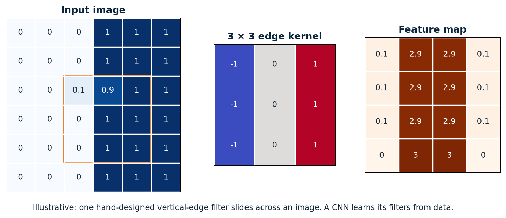
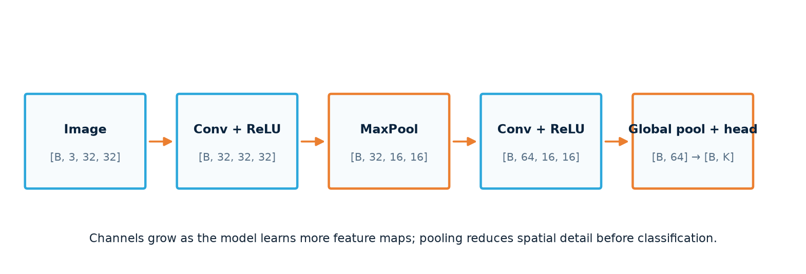

# 1.2 · Fundamentals — vision and real data {#fundamentals-vision-and-real-data}

Apply the core workflow to images: trace shapes through a CNN, check the files before training, then decide whether validation evidence supports the model.
{ .page-lead }

<div class="learning-context" data-guide-id="1.2" markdown="1">

**Guide 1.2 · Learn the fundamentals**
{ .learning-location }

**You will learn:** Trace a convolutional neural network (CNN), check real image data and interpret generalization.

**Before you start:** Read [1.1 · Build and train](core-workflow.md) for batches, logits and the training loop.

**Practice:** [P2 · EMNIST letters](../../projects/emnist.md) · [P3 · Robust image pipeline](../../projects/robust-image-pipeline.md) · [P4 · Nature CNN](../../projects/nature-cnn.md)

</div>

**Notation:** a convolutional neural network (CNN) preserves spatial structure while learning filters. `[N,C,H,W]` means batch, channels, height and width; class scores `[N,K]` have one row per image and one column per class. ReLU is the rectified linear unit activation; BatchNorm (BN) is batch normalization.

**Code key:** “Runnable toy” includes imports and inputs. Other snippets are excerpts: reuse `torch`, `nn`, and the model, loader, tokenizer or helper named in the section. Projects contain the complete runnable scripts.

## What this guide connects

```text
image files → validated samples → augmented training batches
                                      ↓
                         convolutional feature maps
                                      ↓
                           [batch, classes] logits
                                      ↓
                 validation curves + error inspection
                                      ↓
                    reproducible checkpoint and context
```

Read [Fundamentals — core workflow](core-workflow.md) first if Dataset, logits, loss, or the training update order are unfamiliar.

**Study target:** after each section, name the input, output, and reason for the operation. A CNN is the same training loop as before; the important new questions are spatial shape, file quality, and generalization.


## Convolution and feature maps

A dense layer sees one long list of pixels. A convolution keeps the spatial layout and applies the same small kernel at many positions. Reusing weights makes it efficient and allows one learned pattern to be recognized in different locations.

The default filter in the explorer is hand-designed to make its response visible. A trained CNN learns its kernel values through backpropagation.

<div data-learning-lab="convolution">
<!-- learning-overview:convolution -->
<section class="learning-overview" data-overview="convolution" aria-label="One output cell is a sum of products"><p><strong>One output cell is a sum of products</strong></p><div class="overview-grid"><figure class="learning-matrix" tabindex="0" aria-label="Input · selected 3×3 window. Arrow keys scroll a wide matrix."><figcaption>Input · selected 3×3 window</figcaption><div class="learning-cells" style="--columns:6"><span>0</span><span class="selected-cell">0</span><span class="selected-cell">0</span><span class="selected-cell">1</span><span>1</span><span>1</span><span>0</span><span class="selected-cell">0</span><span class="selected-cell">0</span><span class="selected-cell">1</span><span>1</span><span>1</span><span>0</span><span class="selected-cell">0</span><span class="selected-cell">0.1</span><span class="selected-cell">0.9</span><span>1</span><span>1</span><span>0</span><span>0</span><span>0</span><span>1</span><span>1</span><span>1</span><span>0</span><span>0</span><span>0</span><span>1</span><span>1</span><span>1</span><span>0</span><span>0</span><span>0</span><span>1</span><span>1</span><span>1</span></div></figure><figure class="learning-matrix" tabindex="0" aria-label="Vertical edge filter. Arrow keys scroll a wide matrix."><figcaption>Vertical edge filter</figcaption><div class="learning-cells" style="--columns:3"><span>-1</span><span>0</span><span>1</span><span>-1</span><span>0</span><span>1</span><span>-1</span><span>0</span><span>1</span></div></figure><figure class="learning-matrix" tabindex="0" aria-label="Output · selected cell [0,1]. Arrow keys scroll a wide matrix."><figcaption>Output · selected cell [0,1]</figcaption><div class="learning-cells" style="--columns:4"><span>0.1</span><span class="selected-cell">2.9</span><span>2.9</span><span>0.1</span><span>0.1</span><span>2.9</span><span>2.9</span><span>0.1</span><span>0.1</span><span>2.9</span><span>2.9</span><span>0.1</span><span>0</span><span>3</span><span>3</span><span>0</span></div></figure></div><p><strong>Output [0,1] = 0 + 0 + 1 + 0 + 0 + 1 + 0 + 0 + 0.9 = 2.9</strong>. Slide the window to inspect a different sum.</p><p><small>Exact cross-correlation on a fixed 6×6 synthetic input; stride 1, zero padding 0. No kernel reversal.</small></p></section>
<!-- /learning-overview -->
</div>

Move the selected cell to follow the window. Large decimal matrices can be scrolled horizontally on small screens; the calculation below states the selected result in text.

<details markdown="1"><summary>View the original-size convolution diagram</summary>

{ width="1488" height="643" }

[Open full-size diagram](../../assets/images/convolution-visual.png)

</details>

### Channels

Convolutions turn input channels into learned feature channels while preserving each sample.

??? note "Code and details"
    ```python
    nn.Conv2d(
        in_channels=3,
        out_channels=32,
        kernel_size=3,
        padding=1,
    )
    ```

    Each of the 32 learned filters spans all three RGB input channels. The result is 32 feature maps—not 32 colours. Early filters may respond to edges, colour transitions, or texture; deeper layers combine those maps into patterns useful for the task.

    Try one layer with a small batch:

    ```python
    from torch import nn
    images = torch.zeros(4, 3, 32, 32)      # four RGB images
    conv = nn.Conv2d(3, 8, 3, padding=1)    # learn eight 3 × 3 filters
    maps = conv(images)
    print(maps.shape)                       # [4, 8, 32, 32]
    ```

    The batch count stays 4; the filter count sets output channels to 8. Padding keeps 32 × 32 here. **Check yourself:** what changes if `padding=0`? The spatial output becomes 30 × 30.

### Kernel size, stride, and padding

- **Kernel size** controls the local window inspected at once.
- **Stride** controls how far the kernel moves between positions.
- **Padding** adds a border so edge pixels participate and output size can be controlled.
- **Dilation** spaces kernel elements apart to expand the receptive field.

For one spatial dimension:

```text
output = floor((input + 2 × padding − dilation × (kernel − 1) − 1) / stride + 1)
```

A `3 × 3` convolution with padding `1`, stride `1`, and dilation `1` preserves height and width.

## CNN architecture and shapes

<figure class="concept-flow"><figcaption>Follow an illustrative image batch</figcaption><ol><li><b>Input</b><span>[N,3,32,32]</span></li><li><b>Conv + ReLU</b><span>[N,32,32,32] with padding 1</span></li><li><b>Pool 2×</b><span>[N,32,16,16]</span></li><li><b>Conv + ReLU</b><span>[N,64,16,16] with padding 1</span></li><li><b>Global pool + head</b><span>[N,64,1,1] → [N,64] → [N,K]</span></li></ol></figure>

<details markdown="1"><summary>View the original-size diagram</summary>

{ width="1570" height="534" }

[Open full-size diagram](../../assets/images/cnn-shape-visual.png)

</details>

The values in the diagram are an illustrative shape trace. Always inspect the real input and real model.

```text
[batch, 3, 32, 32]
  → convolution: channels grow
  → pooling or stride: width and height shrink
  → classifier: [batch, classes]
```

### A reusable block

A convolution learns local features; an activation adds nonlinearity; pooling reduces spatial size.

??? note "Code and details"
    ```python
    class CNNBlock(nn.Module):
        def __init__(self, in_channels, out_channels):
            super().__init__()
            self.block = nn.Sequential(
                nn.Conv2d(in_channels, out_channels, 3, padding=1),
                nn.BatchNorm2d(out_channels),
                nn.ReLU(),
                nn.MaxPool2d(2),
            )

        def forward(self, x):
            return self.block(x)
    ```

    Convolution learns local features, ReLU adds nonlinearity, normalization stabilizes intermediate distributions, and pooling reduces spatial resolution.

    Trace this block on `[4, 3, 32, 32]`: convolution gives `[4, 8, 32, 32]`; batch normalization and ReLU keep that shape; `MaxPool2d(2)` gives `[4, 8, 16, 16]`. Pooling keeps the strongest value in each 2 × 2 window. It reduces detail and compute, so excessive pooling can discard information. Batch normalization tracks statistics during training and uses stored statistics in evaluation; that is one reason `model.eval()` matters.

    <div class="shape-tracer interactive-panel" data-shape-tracer>
      <div class="interactive-heading">CNN shape tracer</div>
      <label>Input size <input type="number" min="8" value="32" data-spatial-size></label>
      <label>Pooling blocks <input type="number" min="0" max="6" value="3" data-pool-blocks></label>
      <button type="button" data-trace-shape>Trace</button>
      <output data-shape-output aria-live="polite"></output>
    </div>

### Safer classifier boundaries

Hard-coded flatten sizes break when input resolution or feature blocks change. Prefer adaptive pooling when spatial position no longer needs to be preserved:

```python
self.features = nn.Sequential(
    CNNBlock(3, 32),
    CNNBlock(32, 64),
    nn.AdaptiveAvgPool2d((1, 1)),
)
self.classifier = nn.Linear(64, classes)

def forward(self, x):
    x = self.features(x)
    x = torch.flatten(x, 1)
    return self.classifier(x)
```

When a fixed feature size is intentional, inspect it with a dummy input rather than calculating it mentally:

```python
with torch.no_grad():
    features = self.features(torch.zeros(1, 3, 32, 32))
print(features.shape)
```

### Trace the first unexpected shape

```python
def show_shape(name):
    def hook(module, inputs, output):
        print(name, tuple(output.shape))
    return hook

handle = model.features.register_forward_hook(show_shape("features"))
# run one batch, then remove the temporary hook
handle.remove()
```

Most shape failures are easier to understand at the first incorrect boundary than at the final linear-layer error.

### Inspect the model and its activations

Inspect registered modules and intermediate output shapes to locate the first unexpected transformation.

??? note "Code and details"
    | Method | What you see |
    | --- | --- |
    | `print(model)` | layer hierarchy and declared dimensions |
    | `named_children()` | direct child modules |
    | `named_modules()` | nested modules recursively |
    | `named_parameters()` | registered weight/bias names and tensors |
    | `buffers()` | non-parameter state, such as BatchNorm running statistics |
    | `state_dict()` | persisted parameters and buffers |

    ```python
    for name, parameter in model.named_parameters():
        print(name, tuple(parameter.shape), parameter.requires_grad)
    total = sum(parameter.numel() for parameter in model.parameters())
    ```

    A linear layer with `F` inputs and `K` outputs has `F*K + K` parameters with bias. An ordinary convolution has `out_channels * in_channels * kernel_height * kernel_width + out_channels` with bias and `groups=1`. Pooling and ReLU have no trainable parameters. Parameter count is not the same as compute cost.

    Inspect finite values, mean, standard deviation, minimum, maximum and zero fraction after a suspicious block. Mostly zero ReLU outputs or collapsing variance can guide an investigation; they do not prove a bug alone. Hooks are temporary diagnostics: remove their handles and avoid storing tensors with live computation graphs. Start by overfitting one tiny batch before changing the architecture.

    **Next:** compare a dense model with a CNN in [EMNIST](../../projects/emnist.md), then inspect a modular regularized model in [Nature CNN](../../projects/nature-cnn.md).

## Reliable image data

<div class="recall-flow" role="group" aria-label="Input to output">
<div><b>Train</b><code>fit parameters</code><small>random label-preserving transforms</small></div>
<div><b>Validation</b><code>choose settings and checkpoint</code><small>deterministic inputs; no gradient updates</small></div>
<div><b>Test</b><code>assess selected model once</code><small>keep outside tuning</small></div>
</div>
<p class="visual-caption">Illustration: shapes and operations, not measured model performance.</p>

A larger architecture cannot repair inconsistent labels, leakage, corrupt files, or transforms applied to the wrong split.

### Establish the data contract before training

1. Define stable class names and a class-to-index mapping.
2. Verify file existence, extension, readability, colour mode, and expected input shape.
3. Record rejected files with their path and reason.
4. Split with a fixed seed before applying random augmentation.
5. Inspect class counts in each split.
6. Keep validation preprocessing deterministic.
7. Split related entities together so near-duplicates cannot leak across sets.

```python
from PIL import Image

def open_rgb(path):
    with Image.open(path) as image:
        return image.convert("RGB")
```

### Handle failures deliberately

Do not recursively request another sample from `__getitem__` without a strict limit; a cluster of corrupt files can create infinite recursion. Prefer validating the index before training. When runtime filtering is required, return a controlled sentinel and use a custom `collate_fn`.

```python
def collate_valid(batch):
    valid = [sample for sample in batch if sample is not None]
    if not valid:
        raise RuntimeError("Batch contains no valid samples")
    return torch.utils.data.default_collate(valid)
```

### Make splits reproducible

```python
generator = torch.Generator().manual_seed(42)
train_set, validation_set = random_split(
    dataset,
    [train_size, validation_size],
    generator=generator,
)
```

Record the split seed and per-class distribution. For multiple images of the same person, object, location, or capture burst, split by entity rather than individual image. `random_split` by itself does not prevent that kind of leakage.

The three splits answer different questions. A conceptual factory example makes the unit of independence explicit:

| Split | Original panels | Allowed use |
| --- | --- | --- |
| Train | A, B, C, D, E, F | fit weights/normalization; apply training augmentation |
| Validation | G, H | choose settings and the best checkpoint |
| Test | I, J | measure the selected procedure at the end |

All views, crops and near-duplicate captures of panel A stay with A. A random image split can put the same physical scratch on both sides, even with disjoint file paths. If the intended deployment predicts future captures, a chronological split can be more realistic than a shuffled split. Stratification preserves class proportions; it does not ensure independence. Keep a manifest of identities and split membership. The table illustrates a split policy, not a measured dataset. [Group and time-aware evaluation](https://scikit-learn.org/stable/modules/cross_validation.html).

### Separate transforms for shared split indices

`Subset` and `random_split` retain references to their underlying dataset. Assigning a new transform through a shared parent can accidentally augment validation too. With identical folder contents and ordering, use separate dataset objects:

??? note "Code and details"
    ```python
    from torchvision.datasets import ImageFolder
    from torch.utils.data import Subset

    train_base = ImageFolder("images", transform=train_transform)
    val_base = ImageFolder("images", transform=validation_transform)
    assert train_base.samples == val_base.samples
    assert train_base.class_to_idx == val_base.class_to_idx
    order = torch.randperm(len(train_base), generator=torch.Generator().manual_seed(17))
    cut = int(0.8 * len(order))
    train_set = Subset(train_base, order[:cut].tolist())
    val_set = Subset(val_base, order[cut:].tolist())
    ```

    Here the transform objects were defined earlier. Use group-aware indices instead of the random permutation when samples are related. A custom per-subset wrapper is another solution; it must receive raw samples so it does not transform an already transformed tensor twice.

    **Check yourself:** if two crops of the same photo land in different splits, validation can reward recognition of that photo rather than a pattern that works on new photos. Group them before splitting.

### Monitor data, not only the model

- Samples and rejected files per class.
- Pixel range after transforms.
- Label dtype and minimum/maximum values.
- Batch loading time and accelerator idle time.
- Class mapping stored with the run.
- Example transformed images from both training and validation.

??? note "Code and details"
    Decode images in a context manager and convert to RGB explicitly. `Image.verify()` checks file integrity but requires reopening before decoding/transforming; a successful check does not validate the label. For one-based label files, translate IDs consistently. For filenames starting at 1 and sample indices starting at 0, keep the offset explicit. Do not repeatedly load an entire table inside `__getitem__` when only one row is needed.

    The [robust image-pipeline project](../../projects/robust-image-pipeline.md) downloads public data, builds a folder dataset, adds one known corrupt file, records the validation decision, and trains only on valid examples.

## Generalization and regularization

Generalization asks whether patterns learned from training examples remain useful on unseen data from the intended environment.

### Read learning curves

Compare training and validation curves to see whether learning generalizes or begins to overfit.

<!-- learning-overview:curves -->
<section class="learning-overview" data-overview="curves" aria-label="Compare the train–validation relationship"><p><strong>Compare the train–validation relationship</strong></p><div class="overview-grid"><figure><figcaption>Underfitting</figcaption><span class="plot-label">Loss</span><div class="overview-plot"><div class="plot-ticks" aria-hidden="true"><span>1.6</span><span>0.8</span><span>0</span></div><svg class="overview-chart" viewBox="0 0 280 150" role="img" aria-label="Underfitting: both losses remain high. Same loss axis: 0 to 1.6; illustrative epochs 0 to 29."><path d="M8 10V140H272" fill="none" stroke="currentColor"/><path d="M8,18.45 L17.1034,26.3013 L26.2069,33.141 L35.3103,39.0994 L44.4138,44.2902 L53.5172,48.8122 L62.6207,52.7515 L71.7241,56.1833 L80.8276,59.173 L89.931,61.7775 L99.0345,64.0464 L108.1379,66.0229 L117.2414,67.7448 L126.3448,69.2449 L135.4483,70.5517 L144.5517,71.6901 L153.6552,72.6818 L162.7586,73.5458 L171.8621,74.2985 L180.9655,74.9541 L190.069,75.5253 L199.1724,76.0229 L208.2759,76.4564 L217.3793,76.8341 L226.4828,77.1631 L235.5862,77.4497 L244.6897,77.6993 L253.7931,77.9168 L262.8966,78.1063 L272,78.2714" fill="none" stroke="#007995" stroke-width="3"/><path d="M8,15.2 L17.1034,21.6718 L26.2069,27.4277 L35.3103,32.5468 L44.4138,37.0995 L53.5172,41.1486 L62.6207,44.7498 L71.7241,47.9525 L80.8276,50.8009 L89.931,53.3343 L99.0345,55.5873 L108.1379,57.5911 L117.2414,59.3732 L126.3448,60.9582 L135.4483,62.3678 L144.5517,63.6215 L153.6552,64.7365 L162.7586,65.7281 L171.8621,66.61 L180.9655,67.3944 L190.069,68.092 L199.1724,68.7124 L208.2759,69.2642 L217.3793,69.7549 L226.4828,70.1913 L235.5862,70.5795 L244.6897,70.9247 L253.7931,71.2317 L262.8966,71.5048 L272,71.7477" fill="none" stroke="#bf5a0c" stroke-width="3" stroke-dasharray="6 3"/></svg></div><div class="plot-epochs"><span>0</span><span>Illustrative epoch</span><span>29</span></div><p>Underfitting: both losses remain high.</p><p>Final train 0.7597; validation 0.84.</p></figure><figure><figcaption>Balanced illustration</figcaption><span class="plot-label">Loss</span><div class="overview-plot"><div class="plot-ticks" aria-hidden="true"><span>1.6</span><span>0.8</span><span>0</span></div><svg class="overview-chart" viewBox="0 0 280 150" role="img" aria-label="Balanced illustration: both losses fall, with a modest gap. Same loss axis: 0 to 1.6; illustrative epochs 0 to 29."><path d="M8 10V140H272" fill="none" stroke="currentColor"/><path d="M8,72.5625 L17.1034,80.4138 L26.2069,87.2535 L35.3103,93.2119 L44.4138,98.4027 L53.5172,102.9247 L62.6207,106.864 L71.7241,110.2958 L80.8276,113.2855 L89.931,115.89 L99.0345,118.1589 L108.1379,120.1354 L117.2414,121.8573 L126.3448,123.3574 L135.4483,124.6642 L144.5517,125.8026 L153.6552,126.7943 L162.7586,127.6583 L171.8621,128.411 L180.9655,129.0666 L190.069,129.6378 L199.1724,130.1354 L208.2759,130.5689 L217.3793,130.9466 L226.4828,131.2756 L235.5862,131.5622 L244.6897,131.8118 L253.7931,132.0293 L262.8966,132.2188 L272,132.3839" fill="none" stroke="#007995" stroke-width="3"/><path d="M8,69.3125 L17.1034,75.7843 L26.2069,81.5402 L35.3103,86.6593 L44.4138,91.212 L53.5172,95.2611 L62.6207,98.8623 L71.7241,102.065 L80.8276,104.9134 L89.931,107.4468 L99.0345,109.6998 L108.1379,111.7036 L117.2414,113.4857 L126.3448,115.0707 L135.4483,116.4803 L144.5517,117.734 L153.6552,118.849 L162.7586,119.8406 L171.8621,120.7225 L180.9655,121.5069 L190.069,122.2045 L199.1724,122.8249 L208.2759,123.3767 L217.3793,123.8674 L226.4828,124.3038 L235.5862,124.692 L244.6897,125.0372 L253.7931,125.3442 L262.8966,125.6173 L272,125.8602" fill="none" stroke="#bf5a0c" stroke-width="3" stroke-dasharray="6 3"/></svg></div><div class="plot-epochs"><span>0</span><span>Illustrative epoch</span><span>29</span></div><p>Balanced illustration: both losses fall, with a modest gap.</p><p>Final train 0.0937; validation 0.174.</p></figure><figure><figcaption>Overfitting</figcaption><span class="plot-label">Loss</span><div class="overview-plot"><div class="plot-ticks" aria-hidden="true"><span>1.6</span><span>0.8</span><span>0</span></div><svg class="overview-chart" viewBox="0 0 280 150" role="img" aria-label="Overfitting: training falls while validation turns upward. Same loss axis: 0 to 1.6; illustrative epochs 0 to 29."><path d="M8 10V140H272" fill="none" stroke="currentColor"/><path d="M8,72.5625 L17.1034,80.4138 L26.2069,87.2535 L35.3103,93.2119 L44.4138,98.4027 L53.5172,102.9247 L62.6207,106.864 L71.7241,110.2958 L80.8276,113.2855 L89.931,115.89 L99.0345,118.1589 L108.1379,120.1354 L117.2414,121.8573 L126.3448,123.3574 L135.4483,124.6642 L144.5517,125.8026 L153.6552,126.7943 L162.7586,127.6583 L171.8621,128.411 L180.9655,129.0666 L190.069,129.6378 L199.1724,130.1354 L208.2759,130.5689 L217.3793,130.9466 L226.4828,131.2756 L235.5862,131.5622 L244.6897,131.8118 L253.7931,132.0293 L262.8966,132.2188 L272,132.3839" fill="none" stroke="#007995" stroke-width="3"/><path d="M8,69.3125 L17.1034,75.7843 L26.2069,81.5402 L35.3103,86.6593 L44.4138,91.212 L53.5172,95.2611 L62.6207,98.8623 L71.7241,102.065 L80.8276,104.9134 L89.931,107.4468 L99.0345,109.6998 L108.1379,111.7036 L117.2414,113.4703 L126.3448,114.8813 L135.4483,115.9238 L144.5517,116.6172 L153.6552,116.9786 L162.7586,117.0234 L171.8621,116.7653 L180.9655,116.2165 L190.069,115.3876 L199.1724,114.2883 L208.2759,112.9272 L217.3793,111.3118 L226.4828,109.4489 L235.5862,107.3445 L244.6897,105.0039 L253.7931,102.4319 L262.8966,99.6328 L272,96.6102" fill="none" stroke="#bf5a0c" stroke-width="3" stroke-dasharray="6 3"/></svg></div><div class="plot-epochs"><span>0</span><span>Illustrative epoch</span><span>29</span></div><p>Overfitting: training falls while validation turns upward.</p><p>Final train 0.0937; validation 0.534.</p></figure></div><p><span class="curve-key train-key">Solid teal: training</span> · <span class="curve-key validation-key">Dashed orange: validation</span>. Read each pair on the same axes; these are three situations, not a continuous regularization law.</p><p><small>Synthetic curves, not measured Nature CNN or other model results.</small></p></section>
<!-- /learning-overview -->

| Observation | Likely issue | First checks |
| --- | --- | --- |
| Training and validation both poor | underfitting or broken pipeline | labels, loss, learning rate, capacity |
| Training improves; validation worsens | overfitting | split quality, augmentation, regularization |
| Loss becomes NaN | numerical instability | invalid inputs, learning rate, gradients |
| High total accuracy; one class fails | imbalance or shortcut learning | per-class recall and confusion matrix |

### Four gaps to inspect

1. **Training–validation gap:** has the model fitted training-specific detail?
2. **Validation–deployment gap:** does validation represent real inputs?
3. **Aggregate–class gap:** does one headline metric hide weak classes?
4. **Accuracy–cost gap:** is an improvement worth the memory, latency, and complexity?

A model can improve on a standard held-out set and still fail on an external source. Report both domains instead of treating one as the universal truth.

### Regularization tools

**Data augmentation** creates realistic label-preserving variation. An upside-down vehicle or severely distorted character may not preserve the label.

??? note "Code and details"
    **Weight decay** discourages unnecessarily large weights:

    ```python
    optimizer = torch.optim.AdamW(
        model.parameters(),
        lr=1e-3,
        weight_decay=1e-4,
    )
    ```

    **Dropout** randomly removes activations during training:

    ```python
    self.dropout = nn.Dropout(0.3)
    ```

    It is active in `model.train()` and disabled in `model.eval()`.

    **Early stopping** ends training after sufficient non-improvement. Saving and restoring the **best validation checkpoint** is a separate action; stopping alone does not restore those weights.

    Change one hypothesis at a time. Use the same split, seed, metrics, and evaluation procedure so an apparent gain does not come from changing the test.

    If training loss falls while validation loss rises, first inspect the split and the mistakes. Then try one change, such as realistic augmentation, weight decay, or a smaller model. Dropout is a training-time source of noise; it is not a repair for incorrect labels or leakage.

## Saving and restoring

### Save model parameters

```python
torch.save(model.state_dict(), "model.pth")
```

Restore them into the same architecture:

```python
model = Classifier(classes=len(class_names))
state = torch.load("model.pth", map_location=device, weights_only=True)
model.load_state_dict(state)
model.to(device)
model.eval()
```

### Save a training checkpoint

A resumable checkpoint includes optimizer state and run context as well as model weights.

??? note "Code and details"
    ```python
    torch.save({
        "epoch": epoch,
        "model_state": model.state_dict(),
        "optimizer_state": optimizer.state_dict(),
        "validation_loss": validation_loss,
        "class_names": class_names,
        "input_shape": input_shape,
        "normalization": normalization,
    }, "checkpoint.pth")
    ```

    A usable model is more than its tensors. Retain architecture code, preprocessing, class order, input shape, selected metric, split identity, seed, and package versions. Verify the restored model on a known input.

    To resume training consistently, retain scheduler state, mixed-precision scaler state when used, and the next epoch as well. For a best model held in memory, use `copy.deepcopy(model.state_dict())` or save immediately: a dictionary of live tensor references can follow later updates. Random state and sampler state matter when exact continuation is required.

    Never load an untrusted pickle-based checkpoint. Prefer weight-only loading when the saved format and installed PyTorch version support it.

## Vision-workflow checklist

Before trusting an image model, confirm:

1. Files, labels, classes, and splits were validated before training.
2. Training and validation transforms differ only where intended.
3. Every CNN boundary has a known shape.
4. The classifier produces `[batch, classes]` logits.
5. Metrics include error structure, not only one average.
6. Training and validation curves are interpreted together.
7. The selected checkpoint can be restored with its preprocessing and class order.

Use the [project gallery](../../projects/index.md) to move from these patterns to complete, runnable examples, or open the [reference](../../reference/index.md) when debugging a specific run.

For the next layer of the same workflow, study [noise and augmentation](../vision/augmentation.md) and [pretrained vision models](../vision/pretrained-models.md). Both rely on the shape, split and evaluation checks above.

Related architecture: [advanced vision and generative models](../architectures/vision-generative.md): skip connections, segmentation and reconstruction change the architecture or objective while preserving these data and evaluation contracts.

**Continue reading:** [2.1 · Metrics and tuning](../training/training-quality.md). Return to [the learning map](../../index.md#choose-a-guide) to choose another topic.
