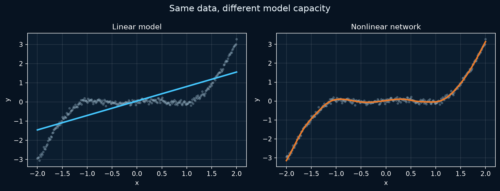

# P1 · Nonlinear regression {#project-nonlinear-regression}

One small experiment shows exactly what the activation changes: the shape of the function the model can learn.
{ .page-lead }

<div class="learning-context" data-project-id="P1" markdown="1">

**P1 · Nonlinear regression**
{ .learning-location }

**You will practice:** Compare a straight-line model with a nonlinear network and inspect validation mean squared error (MSE).

**Read first:** [1.1 · Build and train](../guides/fundamentals/core-workflow.md)

**Data and setup:** Synthetic numeric data generated by the script; CPU, no download.

</div>

## The question

When does a linear layer stop being expressive enough for the pattern in the data?

## What to remember

Several `Linear` layers still compose into one affine mapping (a linear transformation plus a bias) unless a nonlinear activation sits between them. `Tanh` lets this small network bend its prediction around a curved target.

Read MSE as mean squared error in the target’s units squared. Compare predictions on validation points, not only the training curve. **Common trap:** adding width without an activation still leaves an affine function; the retained figure compares fits; it does not retrain a network when viewed.

## Key code

**Code key:** the short snippets are excerpts from the maintained script, not standalone programs. The complete source below supplies imports, classes, data and helper functions; run that script from the repository root.

```python
linear = nn.Linear(1, 1)

nonlinear = nn.Sequential(
    nn.Linear(1, 32), nn.Tanh(),
    nn.Linear(32, 32), nn.Tanh(),
    nn.Linear(32, 1),
)
```

`nn.Linear(1, 1)` can only fit a line. The hidden layers create intermediate features; each `Tanh` makes the final mapping nonlinear.

**Check yourself:** remove both `Tanh` calls. The network has more parameters, but can it follow the curve? No: its layers still combine into one affine mapping. Compare this with the [ReLU mini experiment](../guides/fundamentals/core-workflow.md#why-activations-matter): the exact activation differs, but the need for nonlinearity is the same.

## Evidence and visual

This is a reproduced result from the retained script, using its synthetic dataset, seed `42`, split, architecture, and training configuration. It is a capacity demonstration, not a general benchmark.

| Model | Validation MSE |
| --- | ---: |
| Linear | 0.40296 |
| Nonlinear network | 0.00755 |

{ width="1852" height="708" }

[Open figure at original size](../assets/images/regression-comparison.png){ .figure-original }

## Visual check {#interactive-check}


Changing width changes the number of learned hidden features. The important switch is still the activation: width without a nonlinear activation does not make a curved function possible.

## Run it yourself

```bash
python examples/regression_demo.py
```

It prints the two validation losses and refreshes `docs/assets/images/regression-comparison.png`.

## Complete source

??? note "Open the maintained runnable script"
    ```python
    --8<-- "examples/regression_demo.py"
    ```

**Inspect after running:** The script prints validation losses and refreshes the retained prediction chart; run a disposable copy to preserve the checked-in image.

**Connect the result:** [1.1 · Build and train](../guides/fundamentals/core-workflow.md). [Choose another project](index.md).
