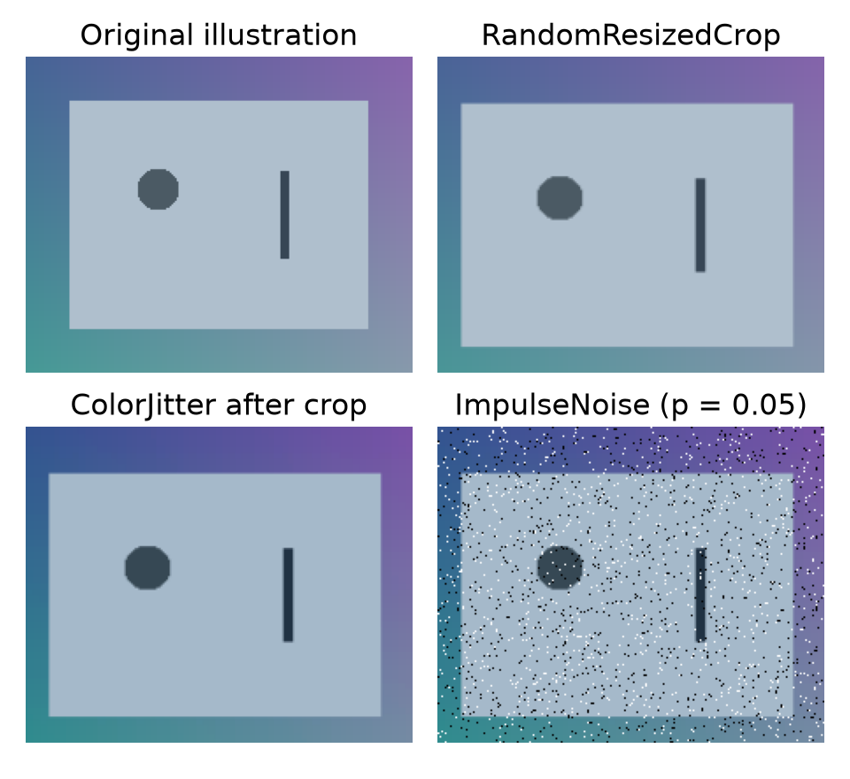

# P6 · Image augmentation and head training {#project-image-augmentation-and-head-training}

Connect image variation, impulse noise and a replacement classification head while keeping the backbone fixed.
{ .page-lead }

<div class="learning-context" data-project-id="P6" markdown="1">

**P6 · Image augmentation and head training**
{ .learning-location }

**You will practice:** Inspect transform order, frozen backbone state and a changing classifier head.

**Read first:** [3.1 · Data, transforms and noise](../guides/vision/augmentation.md) · [3.2 · Pretrained models](../guides/vision/pretrained-models.md)

**Data and setup:** Generated images and random ResNet weights by default; offline CPU. Own image folders plus --pretrained are optional.

</div>

## What to remember

Transfer learning reuses pretrained features; head-only training learns a new output mapping. Freezing parameters alone does not freeze BatchNorm statistics. This script holds the backbone in evaluation mode and trains only the new head.

The default run uses synthetic images and a **random** ResNet backbone, so it demonstrates the mechanics without downloads. The optional `--data … --pretrained` run uses ImageNet weights and your own image folders for actual transfer learning.

A backbone extracts features; the head maps them to the new classes. BN means batch normalization. Freezing gradients and selecting evaluation mode are separate operations. **Common trap:** calling `model.train()` can put the frozen backbone back into training mode; the script deliberately restores its evaluation behavior.

## Important code

**Code key:** the short snippets are excerpts from the maintained script, not standalone programs. The complete source below supplies imports, classes, data and helper functions; run that script from the repository root.

```python
model = resnet18(weights=weights)
model.requires_grad_(False)
model.fc = nn.Linear(model.fc.in_features, len(classes))
optimizer = torch.optim.Adam(model.fc.parameters(), lr=1e-3)

# Repeat at the start of each head-only training epoch:
model.eval()       # keep backbone BatchNorm statistics fixed
model.fc.train()   # the new head is the part being trained
```

For your image folders, the training transform follows this order:

```python
train_transform = transforms.Compose([
    transforms.RandomResizedCrop(224),
    transforms.RandomHorizontalFlip(),
    transforms.ToTensor(),
    ImpulseNoise(noise),
    transforms.Normalize(mean, std),
])
```

`ImpulseNoise(0.02)` replaces about 2% of spatial pixels with black or white in expectation, using one mask shared by RGB channels. It runs on floats in 0–1, before normalization. The amount varies by sample. This is the salt-and-pepper mechanism studied in the course; it is not a complete camera-noise model.

| Decision | Training | Validation |
| --- | --- | --- |
| Geometry | Random crop and optional flip | Fixed resize and centre crop |
| Noise | Optional selected severity | Clean, deterministic input |
| Normalization | Matching channel mean/std | The same channel mean/std |
| Layers | New `fc` head learns | All layers evaluate |

Flips/crops must preserve your labels. For a separate robustness evaluation, create a fixed noisy validation set rather than randomizing ordinary validation.

## Visual noise check

<!-- learning-overview:noise -->
<section class="learning-overview" data-overview="noise" aria-label="Different noise changes different pixels"><p><strong>Different noise changes different pixels</strong></p><div class="overview-grid"><div class="overview-card"><b>Clean</b><svg class="overview-noise" viewBox="0 0 48 32" role="img" aria-label="clean: fixed synthetic target, not a photograph"><path fill="#2d2d2d" d="M0 0h1v1h-1zM0 1h1v1h-1zM0 2h1v1h-1zM0 3h1v1h-1zM0 4h1v1h-1zM0 5h1v1h-1zM0 6h1v1h-1zM0 7h1v1h-1zM0 8h1v1h-1zM0 9h1v1h-1zM0 10h1v1h-1zM0 11h1v1h-1zM0 12h1v1h-1zM0 13h1v1h-1zM0 14h1v1h-1zM0 15h1v1h-1zM0 16h1v1h-1zM0 17h1v1h-1zM0 18h1v1h-1zM0 19h1v1h-1zM0 20h1v1h-1zM0 21h1v1h-1zM0 22h1v1h-1zM0 23h1v1h-1zM0 24h1v1h-1zM0 25h1v1h-1zM0 26h1v1h-1zM0 27h1v1h-1zM0 28h1v1h-1zM0 29h1v1h-1zM0 30h1v1h-1zM0 31h1v1h-1z"/><path fill="#2e2e2e" d="M1 0h1v1h-1zM1 1h1v1h-1zM1 2h1v1h-1zM1 3h1v1h-1zM1 4h1v1h-1zM1 5h1v1h-1zM1 6h1v1h-1zM1 7h1v1h-1zM1 8h1v1h-1zM1 9h1v1h-1zM1 10h1v1h-1zM1 11h1v1h-1zM1 12h1v1h-1zM1 13h1v1h-1zM1 14h1v1h-1zM1 15h1v1h-1zM1 16h1v1h-1zM1 17h1v1h-1zM1 18h1v1h-1zM1 19h1v1h-1zM1 20h1v1h-1zM1 21h1v1h-1zM1 22h1v1h-1zM1 23h1v1h-1zM1 24h1v1h-1zM1 25h1v1h-1zM1 26h1v1h-1zM1 27h1v1h-1zM1 28h1v1h-1zM1 29h1v1h-1zM1 30h1v1h-1zM1 31h1v1h-1z"/><path fill="#2f2f2f" d="M2 0h1v1h-1zM2 1h1v1h-1zM2 2h1v1h-1zM2 3h1v1h-1zM2 4h1v1h-1zM2 5h1v1h-1zM2 6h1v1h-1zM2 7h1v1h-1zM2 8h1v1h-1zM2 9h1v1h-1zM2 10h1v1h-1zM2 11h1v1h-1zM2 12h1v1h-1zM2 13h1v1h-1zM2 14h1v1h-1zM2 15h1v1h-1zM2 16h1v1h-1zM2 17h1v1h-1zM2 18h1v1h-1zM2 19h1v1h-1zM2 20h1v1h-1zM2 21h1v1h-1zM2 22h1v1h-1zM2 23h1v1h-1zM2 24h1v1h-1zM2 25h1v1h-1zM2 26h1v1h-1zM2 27h1v1h-1zM2 28h1v1h-1zM2 29h1v1h-1zM2 30h1v1h-1zM2 31h1v1h-1z"/><path fill="#303030" d="M3 0h1v1h-1zM3 1h1v1h-1zM3 2h1v1h-1zM3 3h1v1h-1zM3 4h1v1h-1zM3 5h1v1h-1zM3 6h1v1h-1zM3 7h1v1h-1zM3 8h1v1h-1zM3 9h1v1h-1zM3 10h1v1h-1zM3 11h1v1h-1zM3 12h1v1h-1zM3 13h1v1h-1zM3 14h1v1h-1zM3 15h1v1h-1zM3 16h1v1h-1zM3 17h1v1h-1zM3 18h1v1h-1zM3 19h1v1h-1zM3 20h1v1h-1zM3 21h1v1h-1zM3 22h1v1h-1zM3 23h1v1h-1zM3 24h1v1h-1zM3 25h1v1h-1zM3 26h1v1h-1zM3 27h1v1h-1zM3 28h1v1h-1zM3 29h1v1h-1zM3 30h1v1h-1zM3 31h1v1h-1z"/><path fill="#313131" d="M4 0h1v1h-1zM4 1h1v1h-1zM4 2h1v1h-1zM4 3h1v1h-1zM4 4h1v1h-1zM4 5h1v1h-1zM4 6h1v1h-1zM4 7h1v1h-1zM4 8h1v1h-1zM4 9h1v1h-1zM4 10h1v1h-1zM4 11h1v1h-1zM4 12h1v1h-1zM4 13h1v1h-1zM4 14h1v1h-1zM4 15h1v1h-1zM4 16h1v1h-1zM4 17h1v1h-1zM4 18h1v1h-1zM4 19h1v1h-1zM4 20h1v1h-1zM4 21h1v1h-1zM4 22h1v1h-1zM4 23h1v1h-1zM4 24h1v1h-1zM4 25h1v1h-1zM4 26h1v1h-1zM4 27h1v1h-1zM4 28h1v1h-1zM4 29h1v1h-1zM4 30h1v1h-1zM4 31h1v1h-1z"/><path fill="#323232" d="M5 0h1v1h-1zM5 1h1v1h-1zM5 2h1v1h-1zM5 3h1v1h-1zM5 4h1v1h-1zM5 5h1v1h-1zM5 6h1v1h-1zM5 7h1v1h-1zM5 8h1v1h-1zM5 9h1v1h-1zM5 10h1v1h-1zM5 11h1v1h-1zM5 12h1v1h-1zM5 13h1v1h-1zM5 14h1v1h-1zM5 15h1v1h-1zM5 16h1v1h-1zM5 17h1v1h-1zM5 18h1v1h-1zM5 19h1v1h-1zM5 20h1v1h-1zM5 21h1v1h-1zM5 22h1v1h-1zM5 23h1v1h-1zM5 24h1v1h-1zM5 25h1v1h-1zM5 26h1v1h-1zM5 27h1v1h-1zM5 28h1v1h-1zM5 29h1v1h-1zM5 30h1v1h-1zM5 31h1v1h-1z"/><path fill="#333333" d="M6 0h1v1h-1zM6 1h1v1h-1zM6 2h1v1h-1zM6 3h1v1h-1zM6 4h1v1h-1zM6 5h1v1h-1zM6 28h1v1h-1zM6 29h1v1h-1zM6 30h1v1h-1zM6 31h1v1h-1z"/><path fill="#343434" d="M7 0h1v1h-1zM7 1h1v1h-1zM7 2h1v1h-1zM7 3h1v1h-1zM7 4h1v1h-1zM7 5h1v1h-1zM7 28h1v1h-1zM7 29h1v1h-1zM7 30h1v1h-1zM7 31h1v1h-1z"/><path fill="#353535" d="M8 0h1v1h-1zM9 0h1v1h-1zM8 1h1v1h-1zM9 1h1v1h-1zM8 2h1v1h-1zM9 2h1v1h-1zM8 3h1v1h-1zM9 3h1v1h-1zM8 4h1v1h-1zM9 4h1v1h-1zM8 5h1v1h-1zM9 5h1v1h-1zM8 28h1v1h-1zM9 28h1v1h-1zM8 29h1v1h-1zM9 29h1v1h-1zM8 30h1v1h-1zM9 30h1v1h-1zM8 31h1v1h-1zM9 31h1v1h-1z"/><path fill="#363636" d="M10 0h1v1h-1zM10 1h1v1h-1zM10 2h1v1h-1zM10 3h1v1h-1zM10 4h1v1h-1zM10 5h1v1h-1zM10 28h1v1h-1zM10 29h1v1h-1zM10 30h1v1h-1zM10 31h1v1h-1z"/><path fill="#373737" d="M11 0h1v1h-1zM11 1h1v1h-1zM11 2h1v1h-1zM11 3h1v1h-1zM11 4h1v1h-1zM11 5h1v1h-1zM11 28h1v1h-1zM11 29h1v1h-1zM11 30h1v1h-1zM11 31h1v1h-1z"/><path fill="#383838" d="M12 0h1v1h-1zM12 1h1v1h-1zM12 2h1v1h-1zM12 3h1v1h-1zM12 4h1v1h-1zM12 5h1v1h-1zM12 28h1v1h-1zM12 29h1v1h-1zM12 30h1v1h-1zM12 31h1v1h-1z"/><path fill="#393939" d="M13 0h1v1h-1zM13 1h1v1h-1zM13 2h1v1h-1zM13 3h1v1h-1zM13 4h1v1h-1zM13 5h1v1h-1zM13 28h1v1h-1zM13 29h1v1h-1zM13 30h1v1h-1zM13 31h1v1h-1z"/><path fill="#3a3a3a" d="M14 0h1v1h-1zM14 1h1v1h-1zM14 2h1v1h-1zM14 3h1v1h-1zM14 4h1v1h-1zM14 5h1v1h-1zM14 28h1v1h-1zM14 29h1v1h-1zM14 30h1v1h-1zM14 31h1v1h-1z"/><path fill="#3b3b3b" d="M15 0h1v1h-1zM15 1h1v1h-1zM15 2h1v1h-1zM15 3h1v1h-1zM15 4h1v1h-1zM15 5h1v1h-1zM15 28h1v1h-1zM15 29h1v1h-1zM15 30h1v1h-1zM15 31h1v1h-1z"/><path fill="#3c3c3c" d="M16 0h1v1h-1zM16 1h1v1h-1zM16 2h1v1h-1zM16 3h1v1h-1zM16 4h1v1h-1zM16 5h1v1h-1zM16 28h1v1h-1zM16 29h1v1h-1zM16 30h1v1h-1zM16 31h1v1h-1z"/><path fill="#3d3d3d" d="M17 0h1v1h-1zM17 1h1v1h-1zM17 2h1v1h-1zM17 3h1v1h-1zM17 4h1v1h-1zM17 5h1v1h-1zM17 28h1v1h-1zM17 29h1v1h-1zM17 30h1v1h-1zM17 31h1v1h-1z"/><path fill="#3e3e3e" d="M18 0h1v1h-1zM18 1h1v1h-1zM18 2h1v1h-1zM18 3h1v1h-1zM18 4h1v1h-1zM18 5h1v1h-1zM18 28h1v1h-1zM18 29h1v1h-1zM18 30h1v1h-1zM18 31h1v1h-1z"/><path fill="#3f3f3f" d="M19 0h1v1h-1zM19 1h1v1h-1zM19 2h1v1h-1zM19 3h1v1h-1zM19 4h1v1h-1zM19 5h1v1h-1zM19 28h1v1h-1zM19 29h1v1h-1zM19 30h1v1h-1zM19 31h1v1h-1z"/><path fill="#404040" d="M20 0h1v1h-1zM20 1h1v1h-1zM20 2h1v1h-1zM20 3h1v1h-1zM20 4h1v1h-1zM20 5h1v1h-1zM20 28h1v1h-1zM20 29h1v1h-1zM20 30h1v1h-1zM20 31h1v1h-1z"/><path fill="#414141" d="M21 0h1v1h-1zM21 1h1v1h-1zM21 2h1v1h-1zM21 3h1v1h-1zM21 4h1v1h-1zM21 5h1v1h-1zM31 14h1v1h-1zM31 15h1v1h-1zM31 16h1v1h-1zM31 17h1v1h-1zM31 18h1v1h-1zM31 19h1v1h-1zM21 28h1v1h-1zM21 29h1v1h-1zM21 30h1v1h-1zM21 31h1v1h-1z"/><path fill="#424242" d="M22 0h1v1h-1zM22 1h1v1h-1zM22 2h1v1h-1zM22 3h1v1h-1zM22 4h1v1h-1zM22 5h1v1h-1zM22 28h1v1h-1zM22 29h1v1h-1zM22 30h1v1h-1zM22 31h1v1h-1z"/><path fill="#434343" d="M23 0h1v1h-1zM23 1h1v1h-1zM23 2h1v1h-1zM23 3h1v1h-1zM23 4h1v1h-1zM23 5h1v1h-1zM23 28h1v1h-1zM23 29h1v1h-1zM23 30h1v1h-1zM23 31h1v1h-1z"/><path fill="#444444" d="M24 0h1v1h-1zM25 0h1v1h-1zM24 1h1v1h-1zM25 1h1v1h-1zM24 2h1v1h-1zM25 2h1v1h-1zM24 3h1v1h-1zM25 3h1v1h-1zM24 4h1v1h-1zM25 4h1v1h-1zM24 5h1v1h-1zM25 5h1v1h-1zM24 28h1v1h-1zM25 28h1v1h-1zM24 29h1v1h-1zM25 29h1v1h-1zM24 30h1v1h-1zM25 30h1v1h-1zM24 31h1v1h-1zM25 31h1v1h-1z"/><path fill="#454545" d="M26 0h1v1h-1zM26 1h1v1h-1zM26 2h1v1h-1zM26 3h1v1h-1zM26 4h1v1h-1zM26 5h1v1h-1zM26 28h1v1h-1zM26 29h1v1h-1zM26 30h1v1h-1zM26 31h1v1h-1z"/><path fill="#464646" d="M27 0h1v1h-1zM27 1h1v1h-1zM27 2h1v1h-1zM27 3h1v1h-1zM27 4h1v1h-1zM27 5h1v1h-1zM27 28h1v1h-1zM27 29h1v1h-1zM27 30h1v1h-1zM27 31h1v1h-1z"/><path fill="#474747" d="M28 0h1v1h-1zM28 1h1v1h-1zM28 2h1v1h-1zM28 3h1v1h-1zM28 4h1v1h-1zM28 5h1v1h-1zM28 28h1v1h-1zM28 29h1v1h-1zM28 30h1v1h-1zM28 31h1v1h-1z"/><path fill="#484848" d="M29 0h1v1h-1zM29 1h1v1h-1zM29 2h1v1h-1zM29 3h1v1h-1zM29 4h1v1h-1zM29 5h1v1h-1zM29 28h1v1h-1zM29 29h1v1h-1zM29 30h1v1h-1zM29 31h1v1h-1z"/><path fill="#494949" d="M30 0h1v1h-1zM30 1h1v1h-1zM30 2h1v1h-1zM30 3h1v1h-1zM30 4h1v1h-1zM30 5h1v1h-1zM30 28h1v1h-1zM30 29h1v1h-1zM30 30h1v1h-1zM30 31h1v1h-1z"/><path fill="#4a4a4a" d="M31 0h1v1h-1zM31 1h1v1h-1zM31 2h1v1h-1zM31 3h1v1h-1zM31 4h1v1h-1zM31 5h1v1h-1zM31 28h1v1h-1zM31 29h1v1h-1zM31 30h1v1h-1zM31 31h1v1h-1z"/><path fill="#4b4b4b" d="M32 0h1v1h-1zM32 1h1v1h-1zM32 2h1v1h-1zM32 3h1v1h-1zM32 4h1v1h-1zM32 5h1v1h-1zM32 28h1v1h-1zM32 29h1v1h-1zM32 30h1v1h-1zM32 31h1v1h-1z"/><path fill="#4c4c4c" d="M33 0h1v1h-1zM33 1h1v1h-1zM33 2h1v1h-1zM33 3h1v1h-1zM33 4h1v1h-1zM33 5h1v1h-1zM33 28h1v1h-1zM33 29h1v1h-1zM33 30h1v1h-1zM33 31h1v1h-1z"/><path fill="#4d4d4d" d="M34 0h1v1h-1zM34 1h1v1h-1zM34 2h1v1h-1zM34 3h1v1h-1zM34 4h1v1h-1zM34 5h1v1h-1zM34 28h1v1h-1zM34 29h1v1h-1zM34 30h1v1h-1zM34 31h1v1h-1z"/><path fill="#4e4e4e" d="M35 0h1v1h-1zM35 1h1v1h-1zM35 2h1v1h-1zM35 3h1v1h-1zM35 4h1v1h-1zM35 5h1v1h-1zM35 28h1v1h-1zM35 29h1v1h-1zM35 30h1v1h-1zM35 31h1v1h-1z"/><path fill="#4f4f4f" d="M36 0h1v1h-1zM36 1h1v1h-1zM36 2h1v1h-1zM36 3h1v1h-1zM36 4h1v1h-1zM36 5h1v1h-1zM36 28h1v1h-1zM36 29h1v1h-1zM36 30h1v1h-1zM36 31h1v1h-1z"/><path fill="#505050" d="M37 0h1v1h-1zM37 1h1v1h-1zM37 2h1v1h-1zM37 3h1v1h-1zM37 4h1v1h-1zM37 5h1v1h-1zM37 28h1v1h-1zM37 29h1v1h-1zM37 30h1v1h-1zM37 31h1v1h-1z"/><path fill="#515151" d="M38 0h1v1h-1zM38 1h1v1h-1zM38 2h1v1h-1zM38 3h1v1h-1zM38 4h1v1h-1zM38 5h1v1h-1zM38 28h1v1h-1zM38 29h1v1h-1zM38 30h1v1h-1zM38 31h1v1h-1z"/><path fill="#525252" d="M39 0h1v1h-1zM39 1h1v1h-1zM39 2h1v1h-1zM39 3h1v1h-1zM39 4h1v1h-1zM39 5h1v1h-1zM39 28h1v1h-1zM39 29h1v1h-1zM39 30h1v1h-1zM39 31h1v1h-1z"/><path fill="#535353" d="M40 0h1v1h-1zM41 0h1v1h-1zM40 1h1v1h-1zM41 1h1v1h-1zM40 2h1v1h-1zM41 2h1v1h-1zM40 3h1v1h-1zM41 3h1v1h-1zM40 4h1v1h-1zM41 4h1v1h-1zM40 5h1v1h-1zM41 5h1v1h-1zM40 28h1v1h-1zM41 28h1v1h-1zM40 29h1v1h-1zM41 29h1v1h-1zM40 30h1v1h-1zM41 30h1v1h-1zM40 31h1v1h-1zM41 31h1v1h-1z"/><path fill="#545454" d="M42 0h1v1h-1zM42 1h1v1h-1zM42 2h1v1h-1zM42 3h1v1h-1zM42 4h1v1h-1zM42 5h1v1h-1zM42 28h1v1h-1zM42 29h1v1h-1zM42 30h1v1h-1zM42 31h1v1h-1z"/><path fill="#555555" d="M43 0h1v1h-1zM43 1h1v1h-1zM43 2h1v1h-1zM43 3h1v1h-1zM43 4h1v1h-1zM43 5h1v1h-1zM43 6h1v1h-1zM43 7h1v1h-1zM43 8h1v1h-1zM43 9h1v1h-1zM43 10h1v1h-1zM43 11h1v1h-1zM43 12h1v1h-1zM43 13h1v1h-1zM43 14h1v1h-1zM43 15h1v1h-1zM43 16h1v1h-1zM43 17h1v1h-1zM43 18h1v1h-1zM43 19h1v1h-1zM43 20h1v1h-1zM43 21h1v1h-1zM43 22h1v1h-1zM43 23h1v1h-1zM43 24h1v1h-1zM43 25h1v1h-1zM43 26h1v1h-1zM43 27h1v1h-1zM43 28h1v1h-1zM43 29h1v1h-1zM43 30h1v1h-1zM43 31h1v1h-1z"/><path fill="#565656" d="M44 0h1v1h-1zM44 1h1v1h-1zM44 2h1v1h-1zM44 3h1v1h-1zM44 4h1v1h-1zM44 5h1v1h-1zM44 6h1v1h-1zM44 7h1v1h-1zM44 8h1v1h-1zM44 9h1v1h-1zM44 10h1v1h-1zM44 11h1v1h-1zM44 12h1v1h-1zM44 13h1v1h-1zM44 14h1v1h-1zM44 15h1v1h-1zM44 16h1v1h-1zM44 17h1v1h-1zM44 18h1v1h-1zM44 19h1v1h-1zM44 20h1v1h-1zM44 21h1v1h-1zM44 22h1v1h-1zM44 23h1v1h-1zM44 24h1v1h-1zM44 25h1v1h-1zM44 26h1v1h-1zM44 27h1v1h-1zM44 28h1v1h-1zM44 29h1v1h-1zM44 30h1v1h-1zM44 31h1v1h-1z"/><path fill="#575757" d="M45 0h1v1h-1zM45 1h1v1h-1zM45 2h1v1h-1zM45 3h1v1h-1zM45 4h1v1h-1zM45 5h1v1h-1zM45 6h1v1h-1zM45 7h1v1h-1zM45 8h1v1h-1zM45 9h1v1h-1zM45 10h1v1h-1zM45 11h1v1h-1zM45 12h1v1h-1zM45 13h1v1h-1zM45 14h1v1h-1zM45 15h1v1h-1zM45 16h1v1h-1zM45 17h1v1h-1zM45 18h1v1h-1zM45 19h1v1h-1zM45 20h1v1h-1zM45 21h1v1h-1zM45 22h1v1h-1zM45 23h1v1h-1zM45 24h1v1h-1zM45 25h1v1h-1zM45 26h1v1h-1zM45 27h1v1h-1zM45 28h1v1h-1zM45 29h1v1h-1zM45 30h1v1h-1zM45 31h1v1h-1z"/><path fill="#585858" d="M46 0h1v1h-1zM46 1h1v1h-1zM46 2h1v1h-1zM46 3h1v1h-1zM46 4h1v1h-1zM46 5h1v1h-1zM46 6h1v1h-1zM46 7h1v1h-1zM46 8h1v1h-1zM46 9h1v1h-1zM46 10h1v1h-1zM46 11h1v1h-1zM46 12h1v1h-1zM46 13h1v1h-1zM46 14h1v1h-1zM46 15h1v1h-1zM46 16h1v1h-1zM46 17h1v1h-1zM46 18h1v1h-1zM46 19h1v1h-1zM46 20h1v1h-1zM46 21h1v1h-1zM46 22h1v1h-1zM46 23h1v1h-1zM46 24h1v1h-1zM46 25h1v1h-1zM46 26h1v1h-1zM46 27h1v1h-1zM46 28h1v1h-1zM46 29h1v1h-1zM46 30h1v1h-1zM46 31h1v1h-1z"/><path fill="#595959" d="M47 0h1v1h-1zM47 1h1v1h-1zM47 2h1v1h-1zM47 3h1v1h-1zM47 4h1v1h-1zM47 5h1v1h-1zM47 6h1v1h-1zM47 7h1v1h-1zM47 8h1v1h-1zM47 9h1v1h-1zM47 10h1v1h-1zM47 11h1v1h-1zM47 12h1v1h-1zM47 13h1v1h-1zM47 14h1v1h-1zM47 15h1v1h-1zM47 16h1v1h-1zM47 17h1v1h-1zM47 18h1v1h-1zM47 19h1v1h-1zM47 20h1v1h-1zM47 21h1v1h-1zM47 22h1v1h-1zM47 23h1v1h-1zM47 24h1v1h-1zM47 25h1v1h-1zM47 26h1v1h-1zM47 27h1v1h-1zM47 28h1v1h-1zM47 29h1v1h-1zM47 30h1v1h-1zM47 31h1v1h-1z"/><path fill="#929292" d="M6 6h1v1h-1zM7 6h1v1h-1zM8 6h1v1h-1zM9 6h1v1h-1zM10 6h1v1h-1zM11 6h1v1h-1zM12 6h1v1h-1zM13 6h1v1h-1zM14 6h1v1h-1zM15 6h1v1h-1zM16 6h1v1h-1zM17 6h1v1h-1zM18 6h1v1h-1zM19 6h1v1h-1zM20 6h1v1h-1zM21 6h1v1h-1zM22 6h1v1h-1zM23 6h1v1h-1zM24 6h1v1h-1zM25 6h1v1h-1zM26 6h1v1h-1zM27 6h1v1h-1zM28 6h1v1h-1zM29 6h1v1h-1zM30 6h1v1h-1zM31 6h1v1h-1zM32 6h1v1h-1zM33 6h1v1h-1zM34 6h1v1h-1zM35 6h1v1h-1zM36 6h1v1h-1zM37 6h1v1h-1zM38 6h1v1h-1zM39 6h1v1h-1zM40 6h1v1h-1zM41 6h1v1h-1zM42 6h1v1h-1z"/><path fill="#949494" d="M6 7h1v1h-1zM7 7h1v1h-1zM8 7h1v1h-1zM9 7h1v1h-1zM10 7h1v1h-1zM11 7h1v1h-1zM12 7h1v1h-1zM13 7h1v1h-1zM14 7h1v1h-1zM15 7h1v1h-1zM16 7h1v1h-1zM17 7h1v1h-1zM18 7h1v1h-1zM19 7h1v1h-1zM20 7h1v1h-1zM21 7h1v1h-1zM22 7h1v1h-1zM23 7h1v1h-1zM24 7h1v1h-1zM25 7h1v1h-1zM26 7h1v1h-1zM27 7h1v1h-1zM28 7h1v1h-1zM29 7h1v1h-1zM30 7h1v1h-1zM31 7h1v1h-1zM32 7h1v1h-1zM33 7h1v1h-1zM34 7h1v1h-1zM35 7h1v1h-1zM36 7h1v1h-1zM37 7h1v1h-1zM38 7h1v1h-1zM39 7h1v1h-1zM40 7h1v1h-1zM41 7h1v1h-1zM42 7h1v1h-1z"/><path fill="#969696" d="M6 8h1v1h-1zM7 8h1v1h-1zM8 8h1v1h-1zM9 8h1v1h-1zM10 8h1v1h-1zM11 8h1v1h-1zM12 8h1v1h-1zM13 8h1v1h-1zM14 8h1v1h-1zM15 8h1v1h-1zM16 8h1v1h-1zM17 8h1v1h-1zM18 8h1v1h-1zM19 8h1v1h-1zM20 8h1v1h-1zM21 8h1v1h-1zM22 8h1v1h-1zM23 8h1v1h-1zM24 8h1v1h-1zM25 8h1v1h-1zM26 8h1v1h-1zM27 8h1v1h-1zM28 8h1v1h-1zM29 8h1v1h-1zM30 8h1v1h-1zM31 8h1v1h-1zM32 8h1v1h-1zM33 8h1v1h-1zM34 8h1v1h-1zM35 8h1v1h-1zM36 8h1v1h-1zM37 8h1v1h-1zM38 8h1v1h-1zM39 8h1v1h-1zM40 8h1v1h-1zM41 8h1v1h-1zM42 8h1v1h-1z"/><path fill="#989898" d="M6 9h1v1h-1zM7 9h1v1h-1zM8 9h1v1h-1zM9 9h1v1h-1zM10 9h1v1h-1zM11 9h1v1h-1zM12 9h1v1h-1zM13 9h1v1h-1zM14 9h1v1h-1zM15 9h1v1h-1zM16 9h1v1h-1zM17 9h1v1h-1zM18 9h1v1h-1zM19 9h1v1h-1zM20 9h1v1h-1zM21 9h1v1h-1zM22 9h1v1h-1zM23 9h1v1h-1zM24 9h1v1h-1zM25 9h1v1h-1zM26 9h1v1h-1zM27 9h1v1h-1zM28 9h1v1h-1zM29 9h1v1h-1zM30 9h1v1h-1zM31 9h1v1h-1zM32 9h1v1h-1zM33 9h1v1h-1zM34 9h1v1h-1zM35 9h1v1h-1zM36 9h1v1h-1zM37 9h1v1h-1zM38 9h1v1h-1zM39 9h1v1h-1zM40 9h1v1h-1zM41 9h1v1h-1zM42 9h1v1h-1z"/><path fill="#9a9a9a" d="M6 10h1v1h-1zM7 10h1v1h-1zM8 10h1v1h-1zM9 10h1v1h-1zM10 10h1v1h-1zM11 10h1v1h-1zM12 10h1v1h-1zM13 10h1v1h-1zM14 10h1v1h-1zM15 10h1v1h-1zM16 10h1v1h-1zM17 10h1v1h-1zM18 10h1v1h-1zM19 10h1v1h-1zM20 10h1v1h-1zM21 10h1v1h-1zM22 10h1v1h-1zM38 10h1v1h-1zM39 10h1v1h-1zM40 10h1v1h-1zM41 10h1v1h-1zM42 10h1v1h-1z"/><path fill="#dcdcdc" d="M23 10h1v1h-1zM24 10h1v1h-1zM25 10h1v1h-1zM26 10h1v1h-1zM27 10h1v1h-1zM28 10h1v1h-1zM29 10h1v1h-1zM30 10h1v1h-1zM31 10h1v1h-1zM32 10h1v1h-1zM33 10h1v1h-1zM34 10h1v1h-1zM35 10h1v1h-1zM36 10h1v1h-1zM37 10h1v1h-1zM22 11h1v1h-1zM23 11h1v1h-1zM24 11h1v1h-1zM25 11h1v1h-1zM26 11h1v1h-1zM27 11h1v1h-1zM28 11h1v1h-1zM29 11h1v1h-1zM30 11h1v1h-1zM31 11h1v1h-1zM32 11h1v1h-1zM33 11h1v1h-1zM34 11h1v1h-1zM35 11h1v1h-1zM36 11h1v1h-1zM37 11h1v1h-1zM21 12h1v1h-1zM22 12h1v1h-1zM23 12h1v1h-1zM24 12h1v1h-1zM25 12h1v1h-1zM26 12h1v1h-1zM27 12h1v1h-1zM28 12h1v1h-1zM29 12h1v1h-1zM30 12h1v1h-1zM31 12h1v1h-1zM32 12h1v1h-1zM33 12h1v1h-1zM34 12h1v1h-1zM35 12h1v1h-1zM36 12h1v1h-1zM37 12h1v1h-1zM20 13h1v1h-1zM21 13h1v1h-1zM22 13h1v1h-1zM23 13h1v1h-1zM24 13h1v1h-1zM25 13h1v1h-1zM26 13h1v1h-1zM27 13h1v1h-1zM28 13h1v1h-1zM29 13h1v1h-1zM30 13h1v1h-1zM31 13h1v1h-1zM32 13h1v1h-1zM33 13h1v1h-1zM34 13h1v1h-1zM35 13h1v1h-1zM36 13h1v1h-1zM37 13h1v1h-1zM19 14h1v1h-1zM20 14h1v1h-1zM21 14h1v1h-1zM22 14h1v1h-1zM23 14h1v1h-1zM24 14h1v1h-1zM25 14h1v1h-1zM26 14h1v1h-1zM27 14h1v1h-1zM28 14h1v1h-1zM29 14h1v1h-1zM30 14h1v1h-1zM32 14h1v1h-1zM33 14h1v1h-1zM34 14h1v1h-1zM35 14h1v1h-1zM36 14h1v1h-1zM37 14h1v1h-1zM19 15h1v1h-1zM20 15h1v1h-1zM21 15h1v1h-1zM22 15h1v1h-1zM23 15h1v1h-1zM24 15h1v1h-1zM25 15h1v1h-1zM26 15h1v1h-1zM27 15h1v1h-1zM28 15h1v1h-1zM29 15h1v1h-1zM30 15h1v1h-1zM32 15h1v1h-1zM33 15h1v1h-1zM34 15h1v1h-1zM35 15h1v1h-1zM36 15h1v1h-1zM37 15h1v1h-1zM19 16h1v1h-1zM20 16h1v1h-1zM21 16h1v1h-1zM22 16h1v1h-1zM23 16h1v1h-1zM24 16h1v1h-1zM25 16h1v1h-1zM26 16h1v1h-1zM27 16h1v1h-1zM28 16h1v1h-1zM29 16h1v1h-1zM30 16h1v1h-1zM32 16h1v1h-1zM33 16h1v1h-1zM34 16h1v1h-1zM35 16h1v1h-1zM36 16h1v1h-1zM37 16h1v1h-1zM16 17h1v1h-1zM17 17h1v1h-1zM18 17h1v1h-1zM19 17h1v1h-1zM20 17h1v1h-1zM21 17h1v1h-1zM22 17h1v1h-1zM23 17h1v1h-1zM24 17h1v1h-1zM25 17h1v1h-1zM26 17h1v1h-1zM27 17h1v1h-1zM28 17h1v1h-1zM29 17h1v1h-1zM30 17h1v1h-1zM32 17h1v1h-1zM33 17h1v1h-1zM34 17h1v1h-1zM35 17h1v1h-1zM36 17h1v1h-1zM37 17h1v1h-1zM15 18h1v1h-1zM16 18h1v1h-1zM17 18h1v1h-1zM18 18h1v1h-1zM19 18h1v1h-1zM20 18h1v1h-1zM21 18h1v1h-1zM22 18h1v1h-1zM23 18h1v1h-1zM24 18h1v1h-1zM25 18h1v1h-1zM26 18h1v1h-1zM27 18h1v1h-1zM28 18h1v1h-1zM29 18h1v1h-1zM30 18h1v1h-1zM32 18h1v1h-1zM33 18h1v1h-1zM34 18h1v1h-1zM35 18h1v1h-1zM36 18h1v1h-1zM37 18h1v1h-1zM14 19h1v1h-1zM15 19h1v1h-1zM16 19h1v1h-1zM17 19h1v1h-1zM18 19h1v1h-1zM19 19h1v1h-1zM20 19h1v1h-1zM21 19h1v1h-1zM22 19h1v1h-1zM23 19h1v1h-1zM24 19h1v1h-1zM25 19h1v1h-1zM26 19h1v1h-1zM27 19h1v1h-1zM28 19h1v1h-1zM29 19h1v1h-1zM30 19h1v1h-1zM32 19h1v1h-1zM33 19h1v1h-1zM34 19h1v1h-1zM35 19h1v1h-1zM36 19h1v1h-1zM37 19h1v1h-1zM13 20h1v1h-1zM14 20h1v1h-1zM15 20h1v1h-1zM16 20h1v1h-1zM17 20h1v1h-1zM18 20h1v1h-1zM19 20h1v1h-1zM20 20h1v1h-1zM21 20h1v1h-1zM22 20h1v1h-1zM23 20h1v1h-1zM24 20h1v1h-1zM25 20h1v1h-1zM26 20h1v1h-1zM27 20h1v1h-1zM28 20h1v1h-1zM29 20h1v1h-1zM30 20h1v1h-1zM31 20h1v1h-1zM32 20h1v1h-1zM33 20h1v1h-1zM34 20h1v1h-1zM35 20h1v1h-1zM36 20h1v1h-1zM37 20h1v1h-1zM12 21h1v1h-1zM13 21h1v1h-1zM14 21h1v1h-1zM15 21h1v1h-1zM16 21h1v1h-1zM17 21h1v1h-1zM18 21h1v1h-1zM19 21h1v1h-1zM20 21h1v1h-1zM21 21h1v1h-1zM22 21h1v1h-1zM23 21h1v1h-1zM24 21h1v1h-1zM25 21h1v1h-1zM26 21h1v1h-1zM27 21h1v1h-1zM28 21h1v1h-1zM29 21h1v1h-1zM30 21h1v1h-1zM31 21h1v1h-1zM32 21h1v1h-1zM33 21h1v1h-1zM34 21h1v1h-1zM35 21h1v1h-1zM36 21h1v1h-1zM37 21h1v1h-1zM12 22h1v1h-1zM13 22h1v1h-1zM14 22h1v1h-1zM15 22h1v1h-1zM16 22h1v1h-1zM17 22h1v1h-1zM18 22h1v1h-1zM19 22h1v1h-1zM20 22h1v1h-1zM21 22h1v1h-1zM22 22h1v1h-1zM23 22h1v1h-1zM24 22h1v1h-1zM25 22h1v1h-1zM26 22h1v1h-1zM27 22h1v1h-1zM28 22h1v1h-1zM29 22h1v1h-1zM30 22h1v1h-1zM31 22h1v1h-1zM32 22h1v1h-1zM33 22h1v1h-1zM34 22h1v1h-1zM35 22h1v1h-1zM36 22h1v1h-1zM37 22h1v1h-1z"/><path fill="#9c9c9c" d="M6 11h1v1h-1zM7 11h1v1h-1zM8 11h1v1h-1zM9 11h1v1h-1zM10 11h1v1h-1zM11 11h1v1h-1zM12 11h1v1h-1zM13 11h1v1h-1zM14 11h1v1h-1zM15 11h1v1h-1zM16 11h1v1h-1zM17 11h1v1h-1zM18 11h1v1h-1zM19 11h1v1h-1zM20 11h1v1h-1zM21 11h1v1h-1zM38 11h1v1h-1zM39 11h1v1h-1zM40 11h1v1h-1zM41 11h1v1h-1zM42 11h1v1h-1z"/><path fill="#9e9e9e" d="M6 12h1v1h-1zM7 12h1v1h-1zM8 12h1v1h-1zM9 12h1v1h-1zM10 12h1v1h-1zM11 12h1v1h-1zM12 12h1v1h-1zM13 12h1v1h-1zM14 12h1v1h-1zM15 12h1v1h-1zM16 12h1v1h-1zM17 12h1v1h-1zM18 12h1v1h-1zM19 12h1v1h-1zM20 12h1v1h-1zM38 12h1v1h-1zM39 12h1v1h-1zM40 12h1v1h-1zM41 12h1v1h-1zM42 12h1v1h-1z"/><path fill="#9f9f9f" d="M6 13h1v1h-1zM7 13h1v1h-1zM8 13h1v1h-1zM9 13h1v1h-1zM10 13h1v1h-1zM11 13h1v1h-1zM12 13h1v1h-1zM13 13h1v1h-1zM14 13h1v1h-1zM15 13h1v1h-1zM16 13h1v1h-1zM17 13h1v1h-1zM18 13h1v1h-1zM19 13h1v1h-1zM38 13h1v1h-1zM39 13h1v1h-1zM40 13h1v1h-1zM41 13h1v1h-1zM42 13h1v1h-1z"/><path fill="#a1a1a1" d="M6 14h1v1h-1zM7 14h1v1h-1zM8 14h1v1h-1zM9 14h1v1h-1zM10 14h1v1h-1zM11 14h1v1h-1zM12 14h1v1h-1zM13 14h1v1h-1zM14 14h1v1h-1zM38 14h1v1h-1zM39 14h1v1h-1zM40 14h1v1h-1zM41 14h1v1h-1zM42 14h1v1h-1z"/><path fill="#5f5f5f" d="M15 14h1v1h-1zM16 14h1v1h-1zM17 14h1v1h-1zM18 14h1v1h-1zM15 15h1v1h-1zM16 15h1v1h-1zM17 15h1v1h-1zM18 15h1v1h-1zM15 16h1v1h-1zM16 16h1v1h-1zM17 16h1v1h-1zM18 16h1v1h-1z"/><path fill="#a3a3a3" d="M6 15h1v1h-1zM7 15h1v1h-1zM8 15h1v1h-1zM9 15h1v1h-1zM10 15h1v1h-1zM11 15h1v1h-1zM12 15h1v1h-1zM13 15h1v1h-1zM14 15h1v1h-1zM38 15h1v1h-1zM39 15h1v1h-1zM40 15h1v1h-1zM41 15h1v1h-1zM42 15h1v1h-1z"/><path fill="#a5a5a5" d="M6 16h1v1h-1zM7 16h1v1h-1zM8 16h1v1h-1zM9 16h1v1h-1zM10 16h1v1h-1zM11 16h1v1h-1zM12 16h1v1h-1zM13 16h1v1h-1zM14 16h1v1h-1zM38 16h1v1h-1zM39 16h1v1h-1zM40 16h1v1h-1zM41 16h1v1h-1zM42 16h1v1h-1z"/><path fill="#a7a7a7" d="M6 17h1v1h-1zM7 17h1v1h-1zM8 17h1v1h-1zM9 17h1v1h-1zM10 17h1v1h-1zM11 17h1v1h-1zM12 17h1v1h-1zM13 17h1v1h-1zM14 17h1v1h-1zM15 17h1v1h-1zM38 17h1v1h-1zM39 17h1v1h-1zM40 17h1v1h-1zM41 17h1v1h-1zM42 17h1v1h-1z"/><path fill="#a9a9a9" d="M6 18h1v1h-1zM7 18h1v1h-1zM8 18h1v1h-1zM9 18h1v1h-1zM10 18h1v1h-1zM11 18h1v1h-1zM12 18h1v1h-1zM13 18h1v1h-1zM14 18h1v1h-1zM38 18h1v1h-1zM39 18h1v1h-1zM40 18h1v1h-1zM41 18h1v1h-1zM42 18h1v1h-1z"/><path fill="#ababab" d="M6 19h1v1h-1zM7 19h1v1h-1zM8 19h1v1h-1zM9 19h1v1h-1zM10 19h1v1h-1zM11 19h1v1h-1zM12 19h1v1h-1zM13 19h1v1h-1zM38 19h1v1h-1zM39 19h1v1h-1zM40 19h1v1h-1zM41 19h1v1h-1zM42 19h1v1h-1z"/><path fill="#adadad" d="M6 20h1v1h-1zM7 20h1v1h-1zM8 20h1v1h-1zM9 20h1v1h-1zM10 20h1v1h-1zM11 20h1v1h-1zM12 20h1v1h-1zM38 20h1v1h-1zM39 20h1v1h-1zM40 20h1v1h-1zM41 20h1v1h-1zM42 20h1v1h-1z"/><path fill="#aeaeae" d="M6 21h1v1h-1zM7 21h1v1h-1zM8 21h1v1h-1zM9 21h1v1h-1zM10 21h1v1h-1zM11 21h1v1h-1zM38 21h1v1h-1zM39 21h1v1h-1zM40 21h1v1h-1zM41 21h1v1h-1zM42 21h1v1h-1z"/><path fill="#b0b0b0" d="M6 22h1v1h-1zM7 22h1v1h-1zM8 22h1v1h-1zM9 22h1v1h-1zM10 22h1v1h-1zM11 22h1v1h-1zM38 22h1v1h-1zM39 22h1v1h-1zM40 22h1v1h-1zM41 22h1v1h-1zM42 22h1v1h-1z"/><path fill="#b2b2b2" d="M6 23h1v1h-1zM7 23h1v1h-1zM8 23h1v1h-1zM9 23h1v1h-1zM10 23h1v1h-1zM11 23h1v1h-1zM12 23h1v1h-1zM13 23h1v1h-1zM14 23h1v1h-1zM15 23h1v1h-1zM16 23h1v1h-1zM17 23h1v1h-1zM18 23h1v1h-1zM19 23h1v1h-1zM20 23h1v1h-1zM21 23h1v1h-1zM22 23h1v1h-1zM23 23h1v1h-1zM24 23h1v1h-1zM25 23h1v1h-1zM26 23h1v1h-1zM27 23h1v1h-1zM28 23h1v1h-1zM29 23h1v1h-1zM30 23h1v1h-1zM31 23h1v1h-1zM32 23h1v1h-1zM33 23h1v1h-1zM34 23h1v1h-1zM35 23h1v1h-1zM36 23h1v1h-1zM37 23h1v1h-1zM38 23h1v1h-1zM39 23h1v1h-1zM40 23h1v1h-1zM41 23h1v1h-1zM42 23h1v1h-1z"/><path fill="#b4b4b4" d="M6 24h1v1h-1zM7 24h1v1h-1zM8 24h1v1h-1zM9 24h1v1h-1zM10 24h1v1h-1zM11 24h1v1h-1zM12 24h1v1h-1zM13 24h1v1h-1zM14 24h1v1h-1zM15 24h1v1h-1zM16 24h1v1h-1zM17 24h1v1h-1zM18 24h1v1h-1zM19 24h1v1h-1zM20 24h1v1h-1zM21 24h1v1h-1zM22 24h1v1h-1zM23 24h1v1h-1zM24 24h1v1h-1zM25 24h1v1h-1zM26 24h1v1h-1zM27 24h1v1h-1zM28 24h1v1h-1zM29 24h1v1h-1zM30 24h1v1h-1zM31 24h1v1h-1zM32 24h1v1h-1zM33 24h1v1h-1zM34 24h1v1h-1zM35 24h1v1h-1zM36 24h1v1h-1zM37 24h1v1h-1zM38 24h1v1h-1zM39 24h1v1h-1zM40 24h1v1h-1zM41 24h1v1h-1zM42 24h1v1h-1z"/><path fill="#b6b6b6" d="M6 25h1v1h-1zM7 25h1v1h-1zM8 25h1v1h-1zM9 25h1v1h-1zM10 25h1v1h-1zM11 25h1v1h-1zM12 25h1v1h-1zM13 25h1v1h-1zM14 25h1v1h-1zM15 25h1v1h-1zM16 25h1v1h-1zM17 25h1v1h-1zM18 25h1v1h-1zM19 25h1v1h-1zM20 25h1v1h-1zM21 25h1v1h-1zM22 25h1v1h-1zM23 25h1v1h-1zM24 25h1v1h-1zM25 25h1v1h-1zM26 25h1v1h-1zM27 25h1v1h-1zM28 25h1v1h-1zM29 25h1v1h-1zM30 25h1v1h-1zM31 25h1v1h-1zM32 25h1v1h-1zM33 25h1v1h-1zM34 25h1v1h-1zM35 25h1v1h-1zM36 25h1v1h-1zM37 25h1v1h-1zM38 25h1v1h-1zM39 25h1v1h-1zM40 25h1v1h-1zM41 25h1v1h-1zM42 25h1v1h-1z"/><path fill="#b8b8b8" d="M6 26h1v1h-1zM7 26h1v1h-1zM8 26h1v1h-1zM9 26h1v1h-1zM10 26h1v1h-1zM11 26h1v1h-1zM12 26h1v1h-1zM13 26h1v1h-1zM14 26h1v1h-1zM15 26h1v1h-1zM16 26h1v1h-1zM17 26h1v1h-1zM18 26h1v1h-1zM19 26h1v1h-1zM20 26h1v1h-1zM21 26h1v1h-1zM22 26h1v1h-1zM23 26h1v1h-1zM24 26h1v1h-1zM25 26h1v1h-1zM26 26h1v1h-1zM27 26h1v1h-1zM28 26h1v1h-1zM29 26h1v1h-1zM30 26h1v1h-1zM31 26h1v1h-1zM32 26h1v1h-1zM33 26h1v1h-1zM34 26h1v1h-1zM35 26h1v1h-1zM36 26h1v1h-1zM37 26h1v1h-1zM38 26h1v1h-1zM39 26h1v1h-1zM40 26h1v1h-1zM41 26h1v1h-1zM42 26h1v1h-1z"/><path fill="#bababa" d="M6 27h1v1h-1zM7 27h1v1h-1zM8 27h1v1h-1zM9 27h1v1h-1zM10 27h1v1h-1zM11 27h1v1h-1zM12 27h1v1h-1zM13 27h1v1h-1zM14 27h1v1h-1zM15 27h1v1h-1zM16 27h1v1h-1zM17 27h1v1h-1zM18 27h1v1h-1zM19 27h1v1h-1zM20 27h1v1h-1zM21 27h1v1h-1zM22 27h1v1h-1zM23 27h1v1h-1zM24 27h1v1h-1zM25 27h1v1h-1zM26 27h1v1h-1zM27 27h1v1h-1zM28 27h1v1h-1zM29 27h1v1h-1zM30 27h1v1h-1zM31 27h1v1h-1zM32 27h1v1h-1zM33 27h1v1h-1zM34 27h1v1h-1zM35 27h1v1h-1zM36 27h1v1h-1zM37 27h1v1h-1zM38 27h1v1h-1zM39 27h1v1h-1zM40 27h1v1h-1zM41 27h1v1h-1zM42 27h1v1h-1z"/></svg><p>The reference scene stays fixed.</p></div><div class="overview-card"><b>Salt and pepper</b><svg class="overview-noise" viewBox="0 0 48 32" role="img" aria-label="impulse: fixed synthetic target, not a photograph"><path fill="#2d2d2d" d="M0 0h1v1h-1zM0 2h1v1h-1zM0 3h1v1h-1zM0 4h1v1h-1zM0 5h1v1h-1zM0 6h1v1h-1zM0 7h1v1h-1zM0 8h1v1h-1zM0 9h1v1h-1zM0 10h1v1h-1zM0 11h1v1h-1zM0 12h1v1h-1zM0 13h1v1h-1zM0 14h1v1h-1zM0 15h1v1h-1zM0 16h1v1h-1zM0 17h1v1h-1zM0 18h1v1h-1zM0 19h1v1h-1zM0 20h1v1h-1zM0 21h1v1h-1zM0 22h1v1h-1zM0 23h1v1h-1zM0 24h1v1h-1zM0 25h1v1h-1zM0 26h1v1h-1zM0 27h1v1h-1zM0 29h1v1h-1zM0 30h1v1h-1z"/><path fill="#2e2e2e" d="M1 0h1v1h-1zM1 1h1v1h-1zM1 2h1v1h-1zM1 3h1v1h-1zM1 4h1v1h-1zM1 5h1v1h-1zM1 6h1v1h-1zM1 7h1v1h-1zM1 8h1v1h-1zM1 9h1v1h-1zM1 10h1v1h-1zM1 11h1v1h-1zM1 13h1v1h-1zM1 14h1v1h-1zM1 15h1v1h-1zM1 16h1v1h-1zM1 17h1v1h-1zM1 18h1v1h-1zM1 19h1v1h-1zM1 21h1v1h-1zM1 23h1v1h-1zM1 24h1v1h-1zM1 25h1v1h-1zM1 26h1v1h-1zM1 27h1v1h-1zM1 28h1v1h-1zM1 29h1v1h-1zM1 30h1v1h-1zM1 31h1v1h-1z"/><path fill="#2f2f2f" d="M2 0h1v1h-1zM2 1h1v1h-1zM2 2h1v1h-1zM2 3h1v1h-1zM2 4h1v1h-1zM2 5h1v1h-1zM2 6h1v1h-1zM2 7h1v1h-1zM2 8h1v1h-1zM2 9h1v1h-1zM2 10h1v1h-1zM2 11h1v1h-1zM2 14h1v1h-1zM2 15h1v1h-1zM2 16h1v1h-1zM2 17h1v1h-1zM2 18h1v1h-1zM2 19h1v1h-1zM2 20h1v1h-1zM2 21h1v1h-1zM2 22h1v1h-1zM2 23h1v1h-1zM2 24h1v1h-1zM2 25h1v1h-1zM2 26h1v1h-1zM2 28h1v1h-1zM2 29h1v1h-1zM2 30h1v1h-1z"/><path fill="#303030" d="M3 0h1v1h-1zM3 1h1v1h-1zM3 2h1v1h-1zM3 3h1v1h-1zM3 4h1v1h-1zM3 5h1v1h-1zM3 6h1v1h-1zM3 7h1v1h-1zM3 8h1v1h-1zM3 9h1v1h-1zM3 10h1v1h-1zM3 11h1v1h-1zM3 12h1v1h-1zM3 13h1v1h-1zM3 14h1v1h-1zM3 15h1v1h-1zM3 16h1v1h-1zM3 17h1v1h-1zM3 18h1v1h-1zM3 19h1v1h-1zM3 20h1v1h-1zM3 21h1v1h-1zM3 22h1v1h-1zM3 23h1v1h-1zM3 24h1v1h-1zM3 25h1v1h-1zM3 27h1v1h-1zM3 29h1v1h-1zM3 30h1v1h-1zM3 31h1v1h-1z"/><path fill="#313131" d="M4 0h1v1h-1zM4 1h1v1h-1zM4 2h1v1h-1zM4 3h1v1h-1zM4 4h1v1h-1zM4 5h1v1h-1zM4 8h1v1h-1zM4 9h1v1h-1zM4 10h1v1h-1zM4 11h1v1h-1zM4 12h1v1h-1zM4 13h1v1h-1zM4 14h1v1h-1zM4 15h1v1h-1zM4 16h1v1h-1zM4 17h1v1h-1zM4 18h1v1h-1zM4 19h1v1h-1zM4 20h1v1h-1zM4 21h1v1h-1zM4 22h1v1h-1zM4 23h1v1h-1zM4 24h1v1h-1zM4 25h1v1h-1zM4 26h1v1h-1zM4 27h1v1h-1zM4 28h1v1h-1zM4 29h1v1h-1zM4 30h1v1h-1zM4 31h1v1h-1z"/><path fill="#323232" d="M5 0h1v1h-1zM5 1h1v1h-1zM5 2h1v1h-1zM5 3h1v1h-1zM5 4h1v1h-1zM5 5h1v1h-1zM5 6h1v1h-1zM5 7h1v1h-1zM5 8h1v1h-1zM5 9h1v1h-1zM5 10h1v1h-1zM5 11h1v1h-1zM5 12h1v1h-1zM5 13h1v1h-1zM5 14h1v1h-1zM5 15h1v1h-1zM5 16h1v1h-1zM5 17h1v1h-1zM5 18h1v1h-1zM5 19h1v1h-1zM5 20h1v1h-1zM5 21h1v1h-1zM5 22h1v1h-1zM5 23h1v1h-1zM5 24h1v1h-1zM5 25h1v1h-1zM5 26h1v1h-1zM5 27h1v1h-1zM5 28h1v1h-1zM5 29h1v1h-1zM5 30h1v1h-1zM5 31h1v1h-1z"/><path fill="#333333" d="M6 0h1v1h-1zM6 1h1v1h-1zM6 2h1v1h-1zM6 3h1v1h-1zM6 4h1v1h-1zM6 5h1v1h-1zM6 28h1v1h-1zM6 29h1v1h-1zM6 30h1v1h-1zM6 31h1v1h-1z"/><path fill="#343434" d="M7 0h1v1h-1zM7 1h1v1h-1zM7 2h1v1h-1zM7 3h1v1h-1zM7 4h1v1h-1zM7 5h1v1h-1zM7 28h1v1h-1zM7 29h1v1h-1zM7 30h1v1h-1zM7 31h1v1h-1z"/><path fill="#353535" d="M8 0h1v1h-1zM9 0h1v1h-1zM8 1h1v1h-1zM9 1h1v1h-1zM8 2h1v1h-1zM9 2h1v1h-1zM8 3h1v1h-1zM9 3h1v1h-1zM8 4h1v1h-1zM9 4h1v1h-1zM8 5h1v1h-1zM9 5h1v1h-1zM8 28h1v1h-1zM9 28h1v1h-1zM8 29h1v1h-1zM8 30h1v1h-1zM9 30h1v1h-1zM8 31h1v1h-1zM9 31h1v1h-1z"/><path fill="#363636" d="M10 0h1v1h-1zM10 1h1v1h-1zM10 2h1v1h-1zM10 3h1v1h-1zM10 5h1v1h-1zM10 28h1v1h-1zM10 29h1v1h-1zM10 30h1v1h-1zM10 31h1v1h-1z"/><path fill="#373737" d="M11 0h1v1h-1zM11 2h1v1h-1zM11 3h1v1h-1zM11 4h1v1h-1zM11 29h1v1h-1zM11 31h1v1h-1z"/><path fill="#383838" d="M12 0h1v1h-1zM12 1h1v1h-1zM12 2h1v1h-1zM12 3h1v1h-1zM12 4h1v1h-1zM12 5h1v1h-1zM12 28h1v1h-1zM12 29h1v1h-1zM12 30h1v1h-1zM12 31h1v1h-1z"/><path fill="#393939" d="M13 0h1v1h-1zM13 1h1v1h-1zM13 3h1v1h-1zM13 4h1v1h-1zM13 5h1v1h-1zM13 28h1v1h-1zM13 29h1v1h-1zM13 30h1v1h-1z"/><path fill="#3a3a3a" d="M14 0h1v1h-1zM14 1h1v1h-1zM14 2h1v1h-1zM14 3h1v1h-1zM14 4h1v1h-1zM14 5h1v1h-1zM14 28h1v1h-1zM14 29h1v1h-1zM14 30h1v1h-1z"/><path fill="#3b3b3b" d="M15 0h1v1h-1zM15 2h1v1h-1zM15 3h1v1h-1zM15 4h1v1h-1zM15 28h1v1h-1zM15 29h1v1h-1zM15 30h1v1h-1zM15 31h1v1h-1z"/><path fill="#3c3c3c" d="M16 0h1v1h-1zM16 1h1v1h-1zM16 2h1v1h-1zM16 3h1v1h-1zM16 4h1v1h-1zM16 5h1v1h-1zM16 28h1v1h-1zM16 29h1v1h-1zM16 30h1v1h-1zM16 31h1v1h-1z"/><path fill="#3d3d3d" d="M17 0h1v1h-1zM17 1h1v1h-1zM17 2h1v1h-1zM17 3h1v1h-1zM17 4h1v1h-1zM17 28h1v1h-1zM17 29h1v1h-1zM17 30h1v1h-1zM17 31h1v1h-1z"/><path fill="#3e3e3e" d="M18 0h1v1h-1zM18 1h1v1h-1zM18 2h1v1h-1zM18 3h1v1h-1zM18 4h1v1h-1zM18 5h1v1h-1zM18 28h1v1h-1zM18 29h1v1h-1zM18 30h1v1h-1zM18 31h1v1h-1z"/><path fill="#3f3f3f" d="M19 0h1v1h-1zM19 1h1v1h-1zM19 2h1v1h-1zM19 3h1v1h-1zM19 4h1v1h-1zM19 5h1v1h-1zM19 28h1v1h-1zM19 29h1v1h-1zM19 30h1v1h-1zM19 31h1v1h-1z"/><path fill="#404040" d="M20 0h1v1h-1zM20 1h1v1h-1zM20 2h1v1h-1zM20 3h1v1h-1zM20 4h1v1h-1zM20 5h1v1h-1zM20 28h1v1h-1zM20 29h1v1h-1zM20 30h1v1h-1zM20 31h1v1h-1z"/><path fill="#414141" d="M21 0h1v1h-1zM21 1h1v1h-1zM21 2h1v1h-1zM21 4h1v1h-1zM21 5h1v1h-1zM31 14h1v1h-1zM31 15h1v1h-1zM31 16h1v1h-1zM31 18h1v1h-1zM31 19h1v1h-1zM21 28h1v1h-1zM21 29h1v1h-1zM21 30h1v1h-1zM21 31h1v1h-1z"/><path fill="#424242" d="M22 0h1v1h-1zM22 1h1v1h-1zM22 2h1v1h-1zM22 3h1v1h-1zM22 4h1v1h-1zM22 5h1v1h-1zM22 28h1v1h-1zM22 29h1v1h-1zM22 31h1v1h-1z"/><path fill="#434343" d="M23 0h1v1h-1zM23 1h1v1h-1zM23 2h1v1h-1zM23 4h1v1h-1zM23 5h1v1h-1zM23 28h1v1h-1zM23 29h1v1h-1zM23 30h1v1h-1zM23 31h1v1h-1z"/><path fill="#444444" d="M24 0h1v1h-1zM25 0h1v1h-1zM24 1h1v1h-1zM25 1h1v1h-1zM24 2h1v1h-1zM25 2h1v1h-1zM24 3h1v1h-1zM25 3h1v1h-1zM25 4h1v1h-1zM24 5h1v1h-1zM25 5h1v1h-1zM24 28h1v1h-1zM25 28h1v1h-1zM24 29h1v1h-1zM25 29h1v1h-1zM24 30h1v1h-1zM25 30h1v1h-1zM24 31h1v1h-1zM25 31h1v1h-1z"/><path fill="#000000" d="M26 0h1v1h-1zM37 0h1v1h-1zM11 1h1v1h-1zM43 1h1v1h-1zM35 3h1v1h-1zM31 4h1v1h-1zM41 4h1v1h-1zM11 5h1v1h-1zM39 5h1v1h-1zM44 5h1v1h-1zM47 5h1v1h-1zM4 6h1v1h-1zM13 6h1v1h-1zM21 6h1v1h-1zM29 6h1v1h-1zM4 7h1v1h-1zM27 7h1v1h-1zM31 8h1v1h-1zM36 8h1v1h-1zM41 8h1v1h-1zM6 9h1v1h-1zM20 10h1v1h-1zM26 10h1v1h-1zM34 10h1v1h-1zM29 11h1v1h-1zM10 12h1v1h-1zM36 14h1v1h-1zM19 15h1v1h-1zM20 15h1v1h-1zM34 15h1v1h-1zM10 16h1v1h-1zM19 16h1v1h-1zM24 16h1v1h-1zM42 16h1v1h-1zM45 16h1v1h-1zM6 17h1v1h-1zM12 17h1v1h-1zM13 17h1v1h-1zM14 17h1v1h-1zM19 17h1v1h-1zM31 17h1v1h-1zM16 18h1v1h-1zM37 18h1v1h-1zM12 19h1v1h-1zM14 19h1v1h-1zM10 20h1v1h-1zM13 20h1v1h-1zM19 20h1v1h-1zM12 21h1v1h-1zM18 21h1v1h-1zM36 21h1v1h-1zM47 21h1v1h-1zM31 22h1v1h-1zM32 22h1v1h-1zM34 22h1v1h-1zM42 22h1v1h-1zM14 23h1v1h-1zM45 23h1v1h-1zM29 24h1v1h-1zM42 24h1v1h-1zM45 24h1v1h-1zM24 26h1v1h-1zM34 26h1v1h-1zM46 26h1v1h-1zM17 27h1v1h-1zM37 27h1v1h-1zM39 27h1v1h-1zM42 27h1v1h-1zM0 28h1v1h-1zM3 28h1v1h-1zM42 28h1v1h-1zM9 29h1v1h-1zM26 29h1v1h-1zM27 30h1v1h-1zM35 31h1v1h-1z"/><path fill="#464646" d="M27 0h1v1h-1zM27 1h1v1h-1zM27 2h1v1h-1zM27 3h1v1h-1zM27 4h1v1h-1zM27 5h1v1h-1zM27 28h1v1h-1zM27 29h1v1h-1zM27 31h1v1h-1z"/><path fill="#474747" d="M28 0h1v1h-1zM28 2h1v1h-1zM28 3h1v1h-1zM28 4h1v1h-1zM28 5h1v1h-1zM28 28h1v1h-1zM28 29h1v1h-1zM28 30h1v1h-1zM28 31h1v1h-1z"/><path fill="#484848" d="M29 0h1v1h-1zM29 1h1v1h-1zM29 2h1v1h-1zM29 3h1v1h-1zM29 4h1v1h-1zM29 5h1v1h-1zM29 28h1v1h-1zM29 29h1v1h-1zM29 30h1v1h-1zM29 31h1v1h-1z"/><path fill="#494949" d="M30 0h1v1h-1zM30 1h1v1h-1zM30 2h1v1h-1zM30 3h1v1h-1zM30 4h1v1h-1zM30 5h1v1h-1zM30 29h1v1h-1zM30 30h1v1h-1zM30 31h1v1h-1z"/><path fill="#4a4a4a" d="M31 0h1v1h-1zM31 1h1v1h-1zM31 2h1v1h-1zM31 3h1v1h-1zM31 5h1v1h-1zM31 28h1v1h-1zM31 29h1v1h-1zM31 30h1v1h-1zM31 31h1v1h-1z"/><path fill="#4b4b4b" d="M32 0h1v1h-1zM32 1h1v1h-1zM32 2h1v1h-1zM32 3h1v1h-1zM32 4h1v1h-1zM32 5h1v1h-1zM32 28h1v1h-1zM32 29h1v1h-1zM32 30h1v1h-1zM32 31h1v1h-1z"/><path fill="#4c4c4c" d="M33 0h1v1h-1zM33 1h1v1h-1zM33 2h1v1h-1zM33 3h1v1h-1zM33 4h1v1h-1zM33 5h1v1h-1zM33 28h1v1h-1zM33 30h1v1h-1zM33 31h1v1h-1z"/><path fill="#4d4d4d" d="M34 0h1v1h-1zM34 1h1v1h-1zM34 2h1v1h-1zM34 3h1v1h-1zM34 4h1v1h-1zM34 5h1v1h-1zM34 28h1v1h-1zM34 29h1v1h-1zM34 30h1v1h-1zM34 31h1v1h-1z"/><path fill="#4e4e4e" d="M35 0h1v1h-1zM35 1h1v1h-1zM35 2h1v1h-1zM35 4h1v1h-1zM35 5h1v1h-1zM35 29h1v1h-1zM35 30h1v1h-1z"/><path fill="#4f4f4f" d="M36 0h1v1h-1zM36 1h1v1h-1zM36 2h1v1h-1zM36 3h1v1h-1zM36 4h1v1h-1zM36 5h1v1h-1zM36 28h1v1h-1zM36 29h1v1h-1zM36 30h1v1h-1zM36 31h1v1h-1z"/><path fill="#515151" d="M38 0h1v1h-1zM38 1h1v1h-1zM38 2h1v1h-1zM38 3h1v1h-1zM38 4h1v1h-1zM38 5h1v1h-1zM38 28h1v1h-1zM38 29h1v1h-1zM38 30h1v1h-1zM38 31h1v1h-1z"/><path fill="#525252" d="M39 0h1v1h-1zM39 1h1v1h-1zM39 2h1v1h-1zM39 3h1v1h-1zM39 4h1v1h-1zM39 28h1v1h-1zM39 29h1v1h-1zM39 30h1v1h-1zM39 31h1v1h-1z"/><path fill="#535353" d="M40 0h1v1h-1zM41 0h1v1h-1zM40 1h1v1h-1zM41 1h1v1h-1zM40 2h1v1h-1zM41 2h1v1h-1zM40 3h1v1h-1zM41 3h1v1h-1zM40 4h1v1h-1zM40 5h1v1h-1zM41 5h1v1h-1zM40 28h1v1h-1zM40 29h1v1h-1zM41 29h1v1h-1zM40 30h1v1h-1zM41 30h1v1h-1zM40 31h1v1h-1zM41 31h1v1h-1z"/><path fill="#545454" d="M42 0h1v1h-1zM42 1h1v1h-1zM42 2h1v1h-1zM42 3h1v1h-1zM42 4h1v1h-1zM42 5h1v1h-1zM42 29h1v1h-1zM42 30h1v1h-1z"/><path fill="#555555" d="M43 0h1v1h-1zM43 2h1v1h-1zM43 3h1v1h-1zM43 4h1v1h-1zM43 5h1v1h-1zM43 6h1v1h-1zM43 7h1v1h-1zM43 9h1v1h-1zM43 10h1v1h-1zM43 11h1v1h-1zM43 12h1v1h-1zM43 13h1v1h-1zM43 14h1v1h-1zM43 15h1v1h-1zM43 16h1v1h-1zM43 17h1v1h-1zM43 18h1v1h-1zM43 19h1v1h-1zM43 20h1v1h-1zM43 21h1v1h-1zM43 22h1v1h-1zM43 23h1v1h-1zM43 24h1v1h-1zM43 25h1v1h-1zM43 26h1v1h-1zM43 27h1v1h-1zM43 28h1v1h-1zM43 29h1v1h-1zM43 30h1v1h-1zM43 31h1v1h-1z"/><path fill="#565656" d="M44 0h1v1h-1zM44 1h1v1h-1zM44 3h1v1h-1zM44 4h1v1h-1zM44 6h1v1h-1zM44 7h1v1h-1zM44 8h1v1h-1zM44 9h1v1h-1zM44 10h1v1h-1zM44 11h1v1h-1zM44 12h1v1h-1zM44 13h1v1h-1zM44 14h1v1h-1zM44 15h1v1h-1zM44 16h1v1h-1zM44 17h1v1h-1zM44 18h1v1h-1zM44 19h1v1h-1zM44 20h1v1h-1zM44 21h1v1h-1zM44 22h1v1h-1zM44 23h1v1h-1zM44 24h1v1h-1zM44 25h1v1h-1zM44 26h1v1h-1zM44 27h1v1h-1zM44 28h1v1h-1zM44 29h1v1h-1zM44 30h1v1h-1zM44 31h1v1h-1z"/><path fill="#575757" d="M45 0h1v1h-1zM45 1h1v1h-1zM45 2h1v1h-1zM45 3h1v1h-1zM45 4h1v1h-1zM45 5h1v1h-1zM45 6h1v1h-1zM45 7h1v1h-1zM45 8h1v1h-1zM45 9h1v1h-1zM45 10h1v1h-1zM45 11h1v1h-1zM45 12h1v1h-1zM45 13h1v1h-1zM45 14h1v1h-1zM45 15h1v1h-1zM45 17h1v1h-1zM45 18h1v1h-1zM45 19h1v1h-1zM45 20h1v1h-1zM45 21h1v1h-1zM45 22h1v1h-1zM45 25h1v1h-1zM45 26h1v1h-1zM45 27h1v1h-1zM45 28h1v1h-1zM45 29h1v1h-1zM45 30h1v1h-1zM45 31h1v1h-1z"/><path fill="#585858" d="M46 0h1v1h-1zM46 1h1v1h-1zM46 2h1v1h-1zM46 3h1v1h-1zM46 5h1v1h-1zM46 7h1v1h-1zM46 8h1v1h-1zM46 9h1v1h-1zM46 10h1v1h-1zM46 11h1v1h-1zM46 12h1v1h-1zM46 13h1v1h-1zM46 14h1v1h-1zM46 15h1v1h-1zM46 16h1v1h-1zM46 17h1v1h-1zM46 18h1v1h-1zM46 19h1v1h-1zM46 20h1v1h-1zM46 21h1v1h-1zM46 22h1v1h-1zM46 23h1v1h-1zM46 24h1v1h-1zM46 25h1v1h-1zM46 27h1v1h-1zM46 28h1v1h-1zM46 29h1v1h-1zM46 31h1v1h-1z"/><path fill="#595959" d="M47 0h1v1h-1zM47 1h1v1h-1zM47 2h1v1h-1zM47 3h1v1h-1zM47 6h1v1h-1zM47 7h1v1h-1zM47 8h1v1h-1zM47 9h1v1h-1zM47 10h1v1h-1zM47 11h1v1h-1zM47 13h1v1h-1zM47 14h1v1h-1zM47 15h1v1h-1zM47 16h1v1h-1zM47 17h1v1h-1zM47 18h1v1h-1zM47 19h1v1h-1zM47 20h1v1h-1zM47 22h1v1h-1zM47 23h1v1h-1zM47 24h1v1h-1zM47 25h1v1h-1zM47 26h1v1h-1zM47 27h1v1h-1zM47 28h1v1h-1zM47 29h1v1h-1zM47 30h1v1h-1zM47 31h1v1h-1z"/><path fill="#ffffff" d="M0 1h1v1h-1zM15 1h1v1h-1zM28 1h1v1h-1zM13 2h1v1h-1zM44 2h1v1h-1zM21 3h1v1h-1zM23 3h1v1h-1zM10 4h1v1h-1zM24 4h1v1h-1zM26 4h1v1h-1zM46 4h1v1h-1zM47 4h1v1h-1zM15 5h1v1h-1zM17 5h1v1h-1zM8 6h1v1h-1zM46 6h1v1h-1zM28 7h1v1h-1zM11 8h1v1h-1zM21 8h1v1h-1zM43 8h1v1h-1zM25 9h1v1h-1zM16 10h1v1h-1zM16 11h1v1h-1zM36 11h1v1h-1zM37 11h1v1h-1zM1 12h1v1h-1zM2 12h1v1h-1zM20 12h1v1h-1zM25 12h1v1h-1zM47 12h1v1h-1zM2 13h1v1h-1zM23 13h1v1h-1zM26 13h1v1h-1zM36 13h1v1h-1zM17 14h1v1h-1zM20 14h1v1h-1zM39 14h1v1h-1zM15 16h1v1h-1zM39 17h1v1h-1zM38 18h1v1h-1zM27 19h1v1h-1zM29 19h1v1h-1zM39 19h1v1h-1zM1 20h1v1h-1zM18 20h1v1h-1zM25 20h1v1h-1zM1 22h1v1h-1zM35 22h1v1h-1zM6 24h1v1h-1zM15 24h1v1h-1zM12 25h1v1h-1zM3 26h1v1h-1zM41 26h1v1h-1zM2 27h1v1h-1zM9 27h1v1h-1zM22 27h1v1h-1zM11 28h1v1h-1zM30 28h1v1h-1zM35 28h1v1h-1zM41 28h1v1h-1zM33 29h1v1h-1zM11 30h1v1h-1zM22 30h1v1h-1zM46 30h1v1h-1zM0 31h1v1h-1zM2 31h1v1h-1zM13 31h1v1h-1zM14 31h1v1h-1zM42 31h1v1h-1z"/><path fill="#454545" d="M26 1h1v1h-1zM26 2h1v1h-1zM26 3h1v1h-1zM26 5h1v1h-1zM26 28h1v1h-1zM26 30h1v1h-1zM26 31h1v1h-1z"/><path fill="#505050" d="M37 1h1v1h-1zM37 2h1v1h-1zM37 3h1v1h-1zM37 4h1v1h-1zM37 5h1v1h-1zM37 28h1v1h-1zM37 29h1v1h-1zM37 30h1v1h-1zM37 31h1v1h-1z"/><path fill="#929292" d="M6 6h1v1h-1zM7 6h1v1h-1zM9 6h1v1h-1zM10 6h1v1h-1zM11 6h1v1h-1zM12 6h1v1h-1zM14 6h1v1h-1zM15 6h1v1h-1zM16 6h1v1h-1zM17 6h1v1h-1zM18 6h1v1h-1zM19 6h1v1h-1zM20 6h1v1h-1zM22 6h1v1h-1zM23 6h1v1h-1zM24 6h1v1h-1zM25 6h1v1h-1zM26 6h1v1h-1zM27 6h1v1h-1zM28 6h1v1h-1zM30 6h1v1h-1zM31 6h1v1h-1zM32 6h1v1h-1zM33 6h1v1h-1zM34 6h1v1h-1zM35 6h1v1h-1zM36 6h1v1h-1zM37 6h1v1h-1zM38 6h1v1h-1zM39 6h1v1h-1zM40 6h1v1h-1zM41 6h1v1h-1zM42 6h1v1h-1z"/><path fill="#949494" d="M6 7h1v1h-1zM7 7h1v1h-1zM8 7h1v1h-1zM9 7h1v1h-1zM10 7h1v1h-1zM11 7h1v1h-1zM12 7h1v1h-1zM13 7h1v1h-1zM14 7h1v1h-1zM15 7h1v1h-1zM16 7h1v1h-1zM17 7h1v1h-1zM18 7h1v1h-1zM19 7h1v1h-1zM20 7h1v1h-1zM21 7h1v1h-1zM22 7h1v1h-1zM23 7h1v1h-1zM24 7h1v1h-1zM25 7h1v1h-1zM26 7h1v1h-1zM29 7h1v1h-1zM30 7h1v1h-1zM31 7h1v1h-1zM32 7h1v1h-1zM33 7h1v1h-1zM34 7h1v1h-1zM35 7h1v1h-1zM36 7h1v1h-1zM37 7h1v1h-1zM38 7h1v1h-1zM39 7h1v1h-1zM40 7h1v1h-1zM41 7h1v1h-1zM42 7h1v1h-1z"/><path fill="#969696" d="M6 8h1v1h-1zM7 8h1v1h-1zM8 8h1v1h-1zM9 8h1v1h-1zM10 8h1v1h-1zM12 8h1v1h-1zM13 8h1v1h-1zM14 8h1v1h-1zM15 8h1v1h-1zM16 8h1v1h-1zM17 8h1v1h-1zM18 8h1v1h-1zM19 8h1v1h-1zM20 8h1v1h-1zM22 8h1v1h-1zM23 8h1v1h-1zM24 8h1v1h-1zM25 8h1v1h-1zM26 8h1v1h-1zM27 8h1v1h-1zM28 8h1v1h-1zM29 8h1v1h-1zM30 8h1v1h-1zM32 8h1v1h-1zM33 8h1v1h-1zM34 8h1v1h-1zM35 8h1v1h-1zM37 8h1v1h-1zM38 8h1v1h-1zM39 8h1v1h-1zM40 8h1v1h-1zM42 8h1v1h-1z"/><path fill="#989898" d="M7 9h1v1h-1zM8 9h1v1h-1zM9 9h1v1h-1zM10 9h1v1h-1zM11 9h1v1h-1zM12 9h1v1h-1zM13 9h1v1h-1zM14 9h1v1h-1zM15 9h1v1h-1zM16 9h1v1h-1zM17 9h1v1h-1zM18 9h1v1h-1zM19 9h1v1h-1zM20 9h1v1h-1zM21 9h1v1h-1zM22 9h1v1h-1zM23 9h1v1h-1zM24 9h1v1h-1zM26 9h1v1h-1zM27 9h1v1h-1zM28 9h1v1h-1zM29 9h1v1h-1zM30 9h1v1h-1zM31 9h1v1h-1zM32 9h1v1h-1zM33 9h1v1h-1zM34 9h1v1h-1zM35 9h1v1h-1zM36 9h1v1h-1zM37 9h1v1h-1zM38 9h1v1h-1zM39 9h1v1h-1zM40 9h1v1h-1zM41 9h1v1h-1zM42 9h1v1h-1z"/><path fill="#9a9a9a" d="M6 10h1v1h-1zM7 10h1v1h-1zM8 10h1v1h-1zM9 10h1v1h-1zM10 10h1v1h-1zM11 10h1v1h-1zM12 10h1v1h-1zM13 10h1v1h-1zM14 10h1v1h-1zM15 10h1v1h-1zM17 10h1v1h-1zM18 10h1v1h-1zM19 10h1v1h-1zM21 10h1v1h-1zM22 10h1v1h-1zM38 10h1v1h-1zM39 10h1v1h-1zM40 10h1v1h-1zM41 10h1v1h-1zM42 10h1v1h-1z"/><path fill="#dcdcdc" d="M23 10h1v1h-1zM24 10h1v1h-1zM25 10h1v1h-1zM27 10h1v1h-1zM28 10h1v1h-1zM29 10h1v1h-1zM30 10h1v1h-1zM31 10h1v1h-1zM32 10h1v1h-1zM33 10h1v1h-1zM35 10h1v1h-1zM36 10h1v1h-1zM37 10h1v1h-1zM22 11h1v1h-1zM23 11h1v1h-1zM24 11h1v1h-1zM25 11h1v1h-1zM26 11h1v1h-1zM27 11h1v1h-1zM28 11h1v1h-1zM30 11h1v1h-1zM31 11h1v1h-1zM32 11h1v1h-1zM33 11h1v1h-1zM34 11h1v1h-1zM35 11h1v1h-1zM21 12h1v1h-1zM22 12h1v1h-1zM23 12h1v1h-1zM24 12h1v1h-1zM26 12h1v1h-1zM27 12h1v1h-1zM28 12h1v1h-1zM29 12h1v1h-1zM30 12h1v1h-1zM31 12h1v1h-1zM32 12h1v1h-1zM33 12h1v1h-1zM34 12h1v1h-1zM35 12h1v1h-1zM36 12h1v1h-1zM37 12h1v1h-1zM20 13h1v1h-1zM21 13h1v1h-1zM22 13h1v1h-1zM24 13h1v1h-1zM25 13h1v1h-1zM27 13h1v1h-1zM28 13h1v1h-1zM29 13h1v1h-1zM30 13h1v1h-1zM31 13h1v1h-1zM32 13h1v1h-1zM33 13h1v1h-1zM34 13h1v1h-1zM35 13h1v1h-1zM37 13h1v1h-1zM19 14h1v1h-1zM21 14h1v1h-1zM22 14h1v1h-1zM23 14h1v1h-1zM24 14h1v1h-1zM25 14h1v1h-1zM26 14h1v1h-1zM27 14h1v1h-1zM28 14h1v1h-1zM29 14h1v1h-1zM30 14h1v1h-1zM32 14h1v1h-1zM33 14h1v1h-1zM34 14h1v1h-1zM35 14h1v1h-1zM37 14h1v1h-1zM21 15h1v1h-1zM22 15h1v1h-1zM23 15h1v1h-1zM24 15h1v1h-1zM25 15h1v1h-1zM26 15h1v1h-1zM27 15h1v1h-1zM28 15h1v1h-1zM29 15h1v1h-1zM30 15h1v1h-1zM32 15h1v1h-1zM33 15h1v1h-1zM35 15h1v1h-1zM36 15h1v1h-1zM37 15h1v1h-1zM20 16h1v1h-1zM21 16h1v1h-1zM22 16h1v1h-1zM23 16h1v1h-1zM25 16h1v1h-1zM26 16h1v1h-1zM27 16h1v1h-1zM28 16h1v1h-1zM29 16h1v1h-1zM30 16h1v1h-1zM32 16h1v1h-1zM33 16h1v1h-1zM34 16h1v1h-1zM35 16h1v1h-1zM36 16h1v1h-1zM37 16h1v1h-1zM16 17h1v1h-1zM17 17h1v1h-1zM18 17h1v1h-1zM20 17h1v1h-1zM21 17h1v1h-1zM22 17h1v1h-1zM23 17h1v1h-1zM24 17h1v1h-1zM25 17h1v1h-1zM26 17h1v1h-1zM27 17h1v1h-1zM28 17h1v1h-1zM29 17h1v1h-1zM30 17h1v1h-1zM32 17h1v1h-1zM33 17h1v1h-1zM34 17h1v1h-1zM35 17h1v1h-1zM36 17h1v1h-1zM37 17h1v1h-1zM15 18h1v1h-1zM17 18h1v1h-1zM18 18h1v1h-1zM19 18h1v1h-1zM20 18h1v1h-1zM21 18h1v1h-1zM22 18h1v1h-1zM23 18h1v1h-1zM24 18h1v1h-1zM25 18h1v1h-1zM26 18h1v1h-1zM27 18h1v1h-1zM28 18h1v1h-1zM29 18h1v1h-1zM30 18h1v1h-1zM32 18h1v1h-1zM33 18h1v1h-1zM34 18h1v1h-1zM35 18h1v1h-1zM36 18h1v1h-1zM15 19h1v1h-1zM16 19h1v1h-1zM17 19h1v1h-1zM18 19h1v1h-1zM19 19h1v1h-1zM20 19h1v1h-1zM21 19h1v1h-1zM22 19h1v1h-1zM23 19h1v1h-1zM24 19h1v1h-1zM25 19h1v1h-1zM26 19h1v1h-1zM28 19h1v1h-1zM30 19h1v1h-1zM32 19h1v1h-1zM33 19h1v1h-1zM34 19h1v1h-1zM35 19h1v1h-1zM36 19h1v1h-1zM37 19h1v1h-1zM14 20h1v1h-1zM15 20h1v1h-1zM16 20h1v1h-1zM17 20h1v1h-1zM20 20h1v1h-1zM21 20h1v1h-1zM22 20h1v1h-1zM23 20h1v1h-1zM24 20h1v1h-1zM26 20h1v1h-1zM27 20h1v1h-1zM28 20h1v1h-1zM29 20h1v1h-1zM30 20h1v1h-1zM31 20h1v1h-1zM32 20h1v1h-1zM33 20h1v1h-1zM34 20h1v1h-1zM35 20h1v1h-1zM36 20h1v1h-1zM37 20h1v1h-1zM13 21h1v1h-1zM14 21h1v1h-1zM15 21h1v1h-1zM16 21h1v1h-1zM17 21h1v1h-1zM19 21h1v1h-1zM20 21h1v1h-1zM21 21h1v1h-1zM22 21h1v1h-1zM23 21h1v1h-1zM24 21h1v1h-1zM25 21h1v1h-1zM26 21h1v1h-1zM27 21h1v1h-1zM28 21h1v1h-1zM29 21h1v1h-1zM30 21h1v1h-1zM31 21h1v1h-1zM32 21h1v1h-1zM33 21h1v1h-1zM34 21h1v1h-1zM35 21h1v1h-1zM37 21h1v1h-1zM12 22h1v1h-1zM13 22h1v1h-1zM14 22h1v1h-1zM15 22h1v1h-1zM16 22h1v1h-1zM17 22h1v1h-1zM18 22h1v1h-1zM19 22h1v1h-1zM20 22h1v1h-1zM21 22h1v1h-1zM22 22h1v1h-1zM23 22h1v1h-1zM24 22h1v1h-1zM25 22h1v1h-1zM26 22h1v1h-1zM27 22h1v1h-1zM28 22h1v1h-1zM29 22h1v1h-1zM30 22h1v1h-1zM33 22h1v1h-1zM36 22h1v1h-1zM37 22h1v1h-1z"/><path fill="#9c9c9c" d="M6 11h1v1h-1zM7 11h1v1h-1zM8 11h1v1h-1zM9 11h1v1h-1zM10 11h1v1h-1zM11 11h1v1h-1zM12 11h1v1h-1zM13 11h1v1h-1zM14 11h1v1h-1zM15 11h1v1h-1zM17 11h1v1h-1zM18 11h1v1h-1zM19 11h1v1h-1zM20 11h1v1h-1zM21 11h1v1h-1zM38 11h1v1h-1zM39 11h1v1h-1zM40 11h1v1h-1zM41 11h1v1h-1zM42 11h1v1h-1z"/><path fill="#9e9e9e" d="M6 12h1v1h-1zM7 12h1v1h-1zM8 12h1v1h-1zM9 12h1v1h-1zM11 12h1v1h-1zM12 12h1v1h-1zM13 12h1v1h-1zM14 12h1v1h-1zM15 12h1v1h-1zM16 12h1v1h-1zM17 12h1v1h-1zM18 12h1v1h-1zM19 12h1v1h-1zM38 12h1v1h-1zM39 12h1v1h-1zM40 12h1v1h-1zM41 12h1v1h-1zM42 12h1v1h-1z"/><path fill="#9f9f9f" d="M6 13h1v1h-1zM7 13h1v1h-1zM8 13h1v1h-1zM9 13h1v1h-1zM10 13h1v1h-1zM11 13h1v1h-1zM12 13h1v1h-1zM13 13h1v1h-1zM14 13h1v1h-1zM15 13h1v1h-1zM16 13h1v1h-1zM17 13h1v1h-1zM18 13h1v1h-1zM19 13h1v1h-1zM38 13h1v1h-1zM39 13h1v1h-1zM40 13h1v1h-1zM41 13h1v1h-1zM42 13h1v1h-1z"/><path fill="#a1a1a1" d="M6 14h1v1h-1zM7 14h1v1h-1zM8 14h1v1h-1zM9 14h1v1h-1zM10 14h1v1h-1zM11 14h1v1h-1zM12 14h1v1h-1zM13 14h1v1h-1zM14 14h1v1h-1zM38 14h1v1h-1zM40 14h1v1h-1zM41 14h1v1h-1zM42 14h1v1h-1z"/><path fill="#5f5f5f" d="M15 14h1v1h-1zM16 14h1v1h-1zM18 14h1v1h-1zM15 15h1v1h-1zM16 15h1v1h-1zM17 15h1v1h-1zM18 15h1v1h-1zM16 16h1v1h-1zM17 16h1v1h-1zM18 16h1v1h-1z"/><path fill="#a3a3a3" d="M6 15h1v1h-1zM7 15h1v1h-1zM8 15h1v1h-1zM9 15h1v1h-1zM10 15h1v1h-1zM11 15h1v1h-1zM12 15h1v1h-1zM13 15h1v1h-1zM14 15h1v1h-1zM38 15h1v1h-1zM39 15h1v1h-1zM40 15h1v1h-1zM41 15h1v1h-1zM42 15h1v1h-1z"/><path fill="#a5a5a5" d="M6 16h1v1h-1zM7 16h1v1h-1zM8 16h1v1h-1zM9 16h1v1h-1zM11 16h1v1h-1zM12 16h1v1h-1zM13 16h1v1h-1zM14 16h1v1h-1zM38 16h1v1h-1zM39 16h1v1h-1zM40 16h1v1h-1zM41 16h1v1h-1z"/><path fill="#a7a7a7" d="M7 17h1v1h-1zM8 17h1v1h-1zM9 17h1v1h-1zM10 17h1v1h-1zM11 17h1v1h-1zM15 17h1v1h-1zM38 17h1v1h-1zM40 17h1v1h-1zM41 17h1v1h-1zM42 17h1v1h-1z"/><path fill="#a9a9a9" d="M6 18h1v1h-1zM7 18h1v1h-1zM8 18h1v1h-1zM9 18h1v1h-1zM10 18h1v1h-1zM11 18h1v1h-1zM12 18h1v1h-1zM13 18h1v1h-1zM14 18h1v1h-1zM39 18h1v1h-1zM40 18h1v1h-1zM41 18h1v1h-1zM42 18h1v1h-1z"/><path fill="#ababab" d="M6 19h1v1h-1zM7 19h1v1h-1zM8 19h1v1h-1zM9 19h1v1h-1zM10 19h1v1h-1zM11 19h1v1h-1zM13 19h1v1h-1zM38 19h1v1h-1zM40 19h1v1h-1zM41 19h1v1h-1zM42 19h1v1h-1z"/><path fill="#adadad" d="M6 20h1v1h-1zM7 20h1v1h-1zM8 20h1v1h-1zM9 20h1v1h-1zM11 20h1v1h-1zM12 20h1v1h-1zM38 20h1v1h-1zM39 20h1v1h-1zM40 20h1v1h-1zM41 20h1v1h-1zM42 20h1v1h-1z"/><path fill="#aeaeae" d="M6 21h1v1h-1zM7 21h1v1h-1zM8 21h1v1h-1zM9 21h1v1h-1zM10 21h1v1h-1zM11 21h1v1h-1zM38 21h1v1h-1zM39 21h1v1h-1zM40 21h1v1h-1zM41 21h1v1h-1zM42 21h1v1h-1z"/><path fill="#b0b0b0" d="M6 22h1v1h-1zM7 22h1v1h-1zM8 22h1v1h-1zM9 22h1v1h-1zM10 22h1v1h-1zM11 22h1v1h-1zM38 22h1v1h-1zM39 22h1v1h-1zM40 22h1v1h-1zM41 22h1v1h-1z"/><path fill="#b2b2b2" d="M6 23h1v1h-1zM7 23h1v1h-1zM8 23h1v1h-1zM9 23h1v1h-1zM10 23h1v1h-1zM11 23h1v1h-1zM12 23h1v1h-1zM13 23h1v1h-1zM15 23h1v1h-1zM16 23h1v1h-1zM17 23h1v1h-1zM18 23h1v1h-1zM19 23h1v1h-1zM20 23h1v1h-1zM21 23h1v1h-1zM22 23h1v1h-1zM23 23h1v1h-1zM24 23h1v1h-1zM25 23h1v1h-1zM26 23h1v1h-1zM27 23h1v1h-1zM28 23h1v1h-1zM29 23h1v1h-1zM30 23h1v1h-1zM31 23h1v1h-1zM32 23h1v1h-1zM33 23h1v1h-1zM34 23h1v1h-1zM35 23h1v1h-1zM36 23h1v1h-1zM37 23h1v1h-1zM38 23h1v1h-1zM39 23h1v1h-1zM40 23h1v1h-1zM41 23h1v1h-1zM42 23h1v1h-1z"/><path fill="#b4b4b4" d="M7 24h1v1h-1zM8 24h1v1h-1zM9 24h1v1h-1zM10 24h1v1h-1zM11 24h1v1h-1zM12 24h1v1h-1zM13 24h1v1h-1zM14 24h1v1h-1zM16 24h1v1h-1zM17 24h1v1h-1zM18 24h1v1h-1zM19 24h1v1h-1zM20 24h1v1h-1zM21 24h1v1h-1zM22 24h1v1h-1zM23 24h1v1h-1zM24 24h1v1h-1zM25 24h1v1h-1zM26 24h1v1h-1zM27 24h1v1h-1zM28 24h1v1h-1zM30 24h1v1h-1zM31 24h1v1h-1zM32 24h1v1h-1zM33 24h1v1h-1zM34 24h1v1h-1zM35 24h1v1h-1zM36 24h1v1h-1zM37 24h1v1h-1zM38 24h1v1h-1zM39 24h1v1h-1zM40 24h1v1h-1zM41 24h1v1h-1z"/><path fill="#b6b6b6" d="M6 25h1v1h-1zM7 25h1v1h-1zM8 25h1v1h-1zM9 25h1v1h-1zM10 25h1v1h-1zM11 25h1v1h-1zM13 25h1v1h-1zM14 25h1v1h-1zM15 25h1v1h-1zM16 25h1v1h-1zM17 25h1v1h-1zM18 25h1v1h-1zM19 25h1v1h-1zM20 25h1v1h-1zM21 25h1v1h-1zM22 25h1v1h-1zM23 25h1v1h-1zM24 25h1v1h-1zM25 25h1v1h-1zM26 25h1v1h-1zM27 25h1v1h-1zM28 25h1v1h-1zM29 25h1v1h-1zM30 25h1v1h-1zM31 25h1v1h-1zM32 25h1v1h-1zM33 25h1v1h-1zM34 25h1v1h-1zM35 25h1v1h-1zM36 25h1v1h-1zM37 25h1v1h-1zM38 25h1v1h-1zM39 25h1v1h-1zM40 25h1v1h-1zM41 25h1v1h-1zM42 25h1v1h-1z"/><path fill="#b8b8b8" d="M6 26h1v1h-1zM7 26h1v1h-1zM8 26h1v1h-1zM9 26h1v1h-1zM10 26h1v1h-1zM11 26h1v1h-1zM12 26h1v1h-1zM13 26h1v1h-1zM14 26h1v1h-1zM15 26h1v1h-1zM16 26h1v1h-1zM17 26h1v1h-1zM18 26h1v1h-1zM19 26h1v1h-1zM20 26h1v1h-1zM21 26h1v1h-1zM22 26h1v1h-1zM23 26h1v1h-1zM25 26h1v1h-1zM26 26h1v1h-1zM27 26h1v1h-1zM28 26h1v1h-1zM29 26h1v1h-1zM30 26h1v1h-1zM31 26h1v1h-1zM32 26h1v1h-1zM33 26h1v1h-1zM35 26h1v1h-1zM36 26h1v1h-1zM37 26h1v1h-1zM38 26h1v1h-1zM39 26h1v1h-1zM40 26h1v1h-1zM42 26h1v1h-1z"/><path fill="#bababa" d="M6 27h1v1h-1zM7 27h1v1h-1zM8 27h1v1h-1zM10 27h1v1h-1zM11 27h1v1h-1zM12 27h1v1h-1zM13 27h1v1h-1zM14 27h1v1h-1zM15 27h1v1h-1zM16 27h1v1h-1zM18 27h1v1h-1zM19 27h1v1h-1zM20 27h1v1h-1zM21 27h1v1h-1zM23 27h1v1h-1zM24 27h1v1h-1zM25 27h1v1h-1zM26 27h1v1h-1zM27 27h1v1h-1zM28 27h1v1h-1zM29 27h1v1h-1zM30 27h1v1h-1zM31 27h1v1h-1zM32 27h1v1h-1zM33 27h1v1h-1zM34 27h1v1h-1zM35 27h1v1h-1zM36 27h1v1h-1zM38 27h1v1h-1zM40 27h1v1h-1zM41 27h1v1h-1z"/></svg><p>10% selection probability: 144 of 1,536 pixels selected in this seeded illustration.</p></div><div class="overview-card"><b>Gaussian comparison</b><svg class="overview-noise" viewBox="0 0 48 32" role="img" aria-label="gaussian: fixed synthetic target, not a photograph"><path fill="#142836" d="M0 0h1v1h-1z"/><path fill="#1b0e1e" d="M1 0h1v1h-1z"/><path fill="#24301b" d="M2 0h1v1h-1z"/><path fill="#41451d" d="M3 0h1v1h-1z"/><path fill="#331219" d="M4 0h1v1h-1z"/><path fill="#272244" d="M5 0h1v1h-1z"/><path fill="#452921" d="M6 0h1v1h-1z"/><path fill="#28183f" d="M7 0h1v1h-1z"/><path fill="#0c2e3d" d="M8 0h1v1h-1z"/><path fill="#443953" d="M9 0h1v1h-1z"/><path fill="#354624" d="M10 0h1v1h-1z"/><path fill="#1b1f35" d="M11 0h1v1h-1z"/><path fill="#303300" d="M12 0h1v1h-1z"/><path fill="#433946" d="M13 0h1v1h-1z"/><path fill="#356534" d="M14 0h1v1h-1z"/><path fill="#514743" d="M15 0h1v1h-1z"/><path fill="#623449" d="M16 0h1v1h-1z"/><path fill="#312242" d="M17 0h1v1h-1z"/><path fill="#642e2f" d="M18 0h1v1h-1z"/><path fill="#173c52" d="M19 0h1v1h-1z"/><path fill="#2c3645" d="M20 0h1v1h-1z"/><path fill="#433044" d="M21 0h1v1h-1z"/><path fill="#53393b" d="M22 0h1v1h-1z"/><path fill="#46123c" d="M23 0h1v1h-1z"/><path fill="#4f724b" d="M24 0h1v1h-1z"/><path fill="#496b65" d="M25 0h1v1h-1z"/><path fill="#316d42" d="M26 0h1v1h-1z"/><path fill="#34757d" d="M27 0h1v1h-1z"/><path fill="#5e4b29" d="M28 0h1v1h-1z"/><path fill="#434457" d="M29 0h1v1h-1z"/><path fill="#644c42" d="M30 0h1v1h-1z"/><path fill="#5e365e" d="M31 0h1v1h-1z"/><path fill="#39502a" d="M32 0h1v1h-1z"/><path fill="#206700" d="M33 0h1v1h-1z"/><path fill="#4f5d44" d="M34 0h1v1h-1z"/><path fill="#465e41" d="M35 0h1v1h-1z"/><path fill="#080d35" d="M36 0h1v1h-1z"/><path fill="#5e3c49" d="M37 0h1v1h-1z"/><path fill="#4f7e71" d="M38 0h1v1h-1z"/><path fill="#5933a1" d="M39 0h1v1h-1z"/><path fill="#594d5f" d="M40 0h1v1h-1z"/><path fill="#464568" d="M41 0h1v1h-1z"/><path fill="#5d6d6b" d="M42 0h1v1h-1z"/><path fill="#5a5653" d="M43 0h1v1h-1z"/><path fill="#4a3c51" d="M44 0h1v1h-1z"/><path fill="#555c5c" d="M45 0h1v1h-1z"/><path fill="#538572" d="M46 0h1v1h-1z"/><path fill="#715b6c" d="M47 0h1v1h-1z"/><path fill="#385f40" d="M0 1h1v1h-1z"/><path fill="#2a240e" d="M1 1h1v1h-1z"/><path fill="#3f310e" d="M2 1h1v1h-1z"/><path fill="#32414d" d="M3 1h1v1h-1z"/><path fill="#0c1c5a" d="M4 1h1v1h-1z"/><path fill="#521b21" d="M5 1h1v1h-1z"/><path fill="#20242f" d="M6 1h1v1h-1z"/><path fill="#606125" d="M7 1h1v1h-1z"/><path fill="#213c58" d="M8 1h1v1h-1z"/><path fill="#193f09" d="M9 1h1v1h-1z"/><path fill="#485524" d="M10 1h1v1h-1z"/><path fill="#525f63" d="M11 1h1v1h-1z"/><path fill="#37486e" d="M12 1h1v1h-1z"/><path fill="#3e6038" d="M13 1h1v1h-1z"/><path fill="#353c47" d="M14 1h1v1h-1z"/><path fill="#21275d" d="M15 1h1v1h-1z"/><path fill="#3a3928" d="M16 1h1v1h-1z"/><path fill="#152e5b" d="M17 1h1v1h-1z"/><path fill="#2a3a36" d="M18 1h1v1h-1z"/><path fill="#374736" d="M19 1h1v1h-1z"/><path fill="#2a4247" d="M20 1h1v1h-1z"/><path fill="#58283d" d="M21 1h1v1h-1z"/><path fill="#352959" d="M22 1h1v1h-1z"/><path fill="#6f5c4e" d="M23 1h1v1h-1z"/><path fill="#474866" d="M24 1h1v1h-1z"/><path fill="#2a6444" d="M25 1h1v1h-1z"/><path fill="#3c3d58" d="M26 1h1v1h-1z"/><path fill="#376d61" d="M27 1h1v1h-1z"/><path fill="#6e313d" d="M28 1h1v1h-1z"/><path fill="#374543" d="M29 1h1v1h-1z"/><path fill="#374839" d="M30 1h1v1h-1z"/><path fill="#322870" d="M31 1h1v1h-1z"/><path fill="#564b41" d="M32 1h1v1h-1z"/><path fill="#4a4d4d" d="M33 1h1v1h-1z"/><path fill="#586739" d="M34 1h1v1h-1z"/><path fill="#3c7246" d="M35 1h1v1h-1z"/><path fill="#3f7553" d="M36 1h1v1h-1z"/><path fill="#612e54" d="M37 1h1v1h-1z"/><path fill="#5d5657" d="M38 1h1v1h-1z"/><path fill="#4d5447" d="M39 1h1v1h-1z"/><path fill="#47275c" d="M40 1h1v1h-1z"/><path fill="#553965" d="M41 1h1v1h-1z"/><path fill="#4a4225" d="M42 1h1v1h-1z"/><path fill="#545356" d="M43 1h1v1h-1z"/><path fill="#6b5275" d="M44 1h1v1h-1z"/><path fill="#774669" d="M45 1h1v1h-1z"/><path fill="#964c64" d="M46 1h1v1h-1z"/><path fill="#51304a" d="M47 1h1v1h-1z"/><path fill="#474630" d="M0 2h1v1h-1z"/><path fill="#204200" d="M1 2h1v1h-1z"/><path fill="#003134" d="M2 2h1v1h-1z"/><path fill="#353d03" d="M3 2h1v1h-1z"/><path fill="#520e53" d="M4 2h1v1h-1z"/><path fill="#204202" d="M5 2h1v1h-1z"/><path fill="#19292a" d="M6 2h1v1h-1z"/><path fill="#192c52" d="M7 2h1v1h-1z"/><path fill="#363c18" d="M8 2h1v1h-1z"/><path fill="#444160" d="M9 2h1v1h-1z"/><path fill="#17381a" d="M10 2h1v1h-1z"/><path fill="#372363" d="M11 2h1v1h-1z"/><path fill="#42733b" d="M12 2h1v1h-1z"/><path fill="#25401d" d="M13 2h1v1h-1z"/><path fill="#022c40" d="M14 2h1v1h-1z"/><path fill="#312131" d="M15 2h1v1h-1z"/><path fill="#5e4728" d="M16 2h1v1h-1z"/><path fill="#2e4b1e" d="M17 2h1v1h-1z"/><path fill="#4a6368" d="M18 2h1v1h-1z"/><path fill="#54394f" d="M19 2h1v1h-1z"/><path fill="#594524" d="M20 2h1v1h-1z"/><path fill="#244628" d="M21 2h1v1h-1z"/><path fill="#685b4a" d="M22 2h1v1h-1z"/><path fill="#4c353f" d="M23 2h1v1h-1z"/><path fill="#314344" d="M24 2h1v1h-1z"/><path fill="#5d2a54" d="M25 2h1v1h-1z"/><path fill="#464157" d="M26 2h1v1h-1z"/><path fill="#4e4344" d="M27 2h1v1h-1z"/><path fill="#5b1f36" d="M28 2h1v1h-1z"/><path fill="#422e4a" d="M29 2h1v1h-1z"/><path fill="#657433" d="M30 2h1v1h-1z"/><path fill="#3f6546" d="M31 2h1v1h-1z"/><path fill="#544a56" d="M32 2h1v1h-1z"/><path fill="#6d2f71" d="M33 2h1v1h-1z"/><path fill="#347f48" d="M34 2h1v1h-1z"/><path fill="#5c615b" d="M35 2h1v1h-1z"/><path fill="#27253c" d="M36 2h1v1h-1z"/><path fill="#3e4f45" d="M37 2h1v1h-1z"/><path fill="#6c6954" d="M38 2h1v1h-1z"/><path fill="#877747" d="M39 2h1v1h-1z"/><path fill="#376342" d="M40 2h1v1h-1z"/><path fill="#354261" d="M41 2h1v1h-1z"/><path fill="#8a2455" d="M42 2h1v1h-1z"/><path fill="#734875" d="M43 2h1v1h-1z"/><path fill="#6a2d42" d="M44 2h1v1h-1z"/><path fill="#7a4e3b" d="M45 2h1v1h-1z"/><path fill="#477e53" d="M46 2h1v1h-1z"/><path fill="#5a8559" d="M47 2h1v1h-1z"/><path fill="#404922" d="M0 3h1v1h-1z"/><path fill="#0c3848" d="M1 3h1v1h-1z"/><path fill="#493525" d="M2 3h1v1h-1z"/><path fill="#162a2f" d="M3 3h1v1h-1z"/><path fill="#3c0c40" d="M4 3h1v1h-1z"/><path fill="#401831" d="M5 3h1v1h-1z"/><path fill="#53743c" d="M6 3h1v1h-1z"/><path fill="#474143" d="M7 3h1v1h-1z"/><path fill="#1a1e34" d="M8 3h1v1h-1z"/><path fill="#3f2037" d="M9 3h1v1h-1z"/><path fill="#0c3f4d" d="M10 3h1v1h-1z"/><path fill="#512e3c" d="M11 3h1v1h-1z"/><path fill="#3f6350" d="M12 3h1v1h-1z"/><path fill="#3c4923" d="M13 3h1v1h-1z"/><path fill="#564438" d="M14 3h1v1h-1z"/><path fill="#195247" d="M15 3h1v1h-1z"/><path fill="#562823" d="M16 3h1v1h-1z"/><path fill="#435053" d="M17 3h1v1h-1z"/><path fill="#6a663b" d="M18 3h1v1h-1z"/><path fill="#8c194a" d="M19 3h1v1h-1z"/><path fill="#54362b" d="M20 3h1v1h-1z"/><path fill="#1a6722" d="M21 3h1v1h-1z"/><path fill="#633427" d="M22 3h1v1h-1z"/><path fill="#3f3e49" d="M23 3h1v1h-1z"/><path fill="#6b3732" d="M24 3h1v1h-1z"/><path fill="#2e6f44" d="M25 3h1v1h-1z"/><path fill="#326352" d="M26 3h1v1h-1z"/><path fill="#534567" d="M27 3h1v1h-1z"/><path fill="#466c27" d="M28 3h1v1h-1z"/><path fill="#631937" d="M29 3h1v1h-1z"/><path fill="#5e1f24" d="M30 3h1v1h-1z"/><path fill="#3a4268" d="M31 3h1v1h-1z"/><path fill="#723e29" d="M32 3h1v1h-1z"/><path fill="#543f22" d="M33 3h1v1h-1z"/><path fill="#324242" d="M34 3h1v1h-1z"/><path fill="#693662" d="M35 3h1v1h-1z"/><path fill="#5a7038" d="M36 3h1v1h-1z"/><path fill="#5d6d87" d="M37 3h1v1h-1z"/><path fill="#454764" d="M38 3h1v1h-1z"/><path fill="#8a6861" d="M39 3h1v1h-1z"/><path fill="#3c594f" d="M40 3h1v1h-1z"/><path fill="#366034" d="M41 3h1v1h-1z"/><path fill="#4d344b" d="M42 3h1v1h-1z"/><path fill="#38225a" d="M43 3h1v1h-1z"/><path fill="#596256" d="M44 3h1v1h-1z"/><path fill="#456c2d" d="M45 3h1v1h-1z"/><path fill="#41794e" d="M46 3h1v1h-1z"/><path fill="#458674" d="M47 3h1v1h-1z"/><path fill="#36342b" d="M0 4h1v1h-1z"/><path fill="#002430" d="M1 4h1v1h-1z"/><path fill="#2b5434" d="M2 4h1v1h-1z"/><path fill="#054733" d="M3 4h1v1h-1z"/><path fill="#39323f" d="M4 4h1v1h-1z"/><path fill="#213c0e" d="M5 4h1v1h-1z"/><path fill="#233b1e" d="M6 4h1v1h-1z"/><path fill="#5b4a28" d="M7 4h1v1h-1z"/><path fill="#372d2e" d="M8 4h1v1h-1z"/><path fill="#371920" d="M9 4h1v1h-1z"/><path fill="#3e3716" d="M10 4h1v1h-1z"/><path fill="#313b2c" d="M11 4h1v1h-1z"/><path fill="#242c59" d="M12 4h1v1h-1z"/><path fill="#453b46" d="M13 4h1v1h-1z"/><path fill="#473c41" d="M14 4h1v1h-1z"/><path fill="#5b5238" d="M15 4h1v1h-1z"/><path fill="#634861" d="M16 4h1v1h-1z"/><path fill="#242642" d="M17 4h1v1h-1z"/><path fill="#293d39" d="M18 4h1v1h-1z"/><path fill="#513739" d="M19 4h1v1h-1z"/><path fill="#7a3417" d="M20 4h1v1h-1z"/><path fill="#366178" d="M21 4h1v1h-1z"/><path fill="#58525b" d="M22 4h1v1h-1z"/><path fill="#433c71" d="M23 4h1v1h-1z"/><path fill="#21663b" d="M24 4h1v1h-1z"/><path fill="#205d5d" d="M25 4h1v1h-1z"/><path fill="#4b2e4b" d="M26 4h1v1h-1z"/><path fill="#393c22" d="M27 4h1v1h-1z"/><path fill="#495d3c" d="M28 4h1v1h-1z"/><path fill="#564c5b" d="M29 4h1v1h-1z"/><path fill="#5f683d" d="M30 4h1v1h-1z"/><path fill="#55751e" d="M31 4h1v1h-1z"/><path fill="#26713a" d="M32 4h1v1h-1z"/><path fill="#33365b" d="M33 4h1v1h-1z"/><path fill="#5c4849" d="M34 4h1v1h-1z"/><path fill="#5a2d2b" d="M35 4h1v1h-1z"/><path fill="#3c575a" d="M36 4h1v1h-1z"/><path fill="#2c4779" d="M37 4h1v1h-1z"/><path fill="#464663" d="M38 4h1v1h-1z"/><path fill="#1c5628" d="M39 4h1v1h-1z"/><path fill="#4a5b67" d="M40 4h1v1h-1z"/><path fill="#4a7149" d="M41 4h1v1h-1z"/><path fill="#504347" d="M42 4h1v1h-1z"/><path fill="#446a3f" d="M43 4h1v1h-1z"/><path fill="#373f52" d="M44 4h1v1h-1z"/><path fill="#6c763e" d="M45 4h1v1h-1z"/><path fill="#503d49" d="M46 4h1v1h-1z"/><path fill="#5d5354" d="M47 4h1v1h-1z"/><path fill="#1b4056" d="M0 5h1v1h-1z"/><path fill="#35425c" d="M1 5h1v1h-1z"/><path fill="#1f3533" d="M2 5h1v1h-1z"/><path fill="#385348" d="M3 5h1v1h-1z"/><path fill="#2e4539" d="M4 5h1v1h-1z"/><path fill="#1e182e" d="M5 5h1v1h-1z"/><path fill="#4c423b" d="M6 5h1v1h-1z"/><path fill="#33390a" d="M7 5h1v1h-1z"/><path fill="#00141c" d="M8 5h1v1h-1z"/><path fill="#161936" d="M9 5h1v1h-1z"/><path fill="#5e4750" d="M10 5h1v1h-1z"/><path fill="#3c2e32" d="M11 5h1v1h-1z"/><path fill="#48393c" d="M12 5h1v1h-1z"/><path fill="#1e154c" d="M13 5h1v1h-1z"/><path fill="#2b4d44" d="M14 5h1v1h-1z"/><path fill="#004339" d="M15 5h1v1h-1z"/><path fill="#1c3783" d="M16 5h1v1h-1z"/><path fill="#2d3016" d="M17 5h1v1h-1z"/><path fill="#501234" d="M18 5h1v1h-1z"/><path fill="#414c51" d="M19 5h1v1h-1z"/><path fill="#694849" d="M20 5h1v1h-1z"/><path fill="#5a2f1b" d="M21 5h1v1h-1z"/><path fill="#0c3061" d="M22 5h1v1h-1z"/><path fill="#434f40" d="M23 5h1v1h-1z"/><path fill="#4b5429" d="M24 5h1v1h-1z"/><path fill="#4b3a4f" d="M25 5h1v1h-1z"/><path fill="#1a3434" d="M26 5h1v1h-1z"/><path fill="#2a335b" d="M27 5h1v1h-1z"/><path fill="#863d61" d="M28 5h1v1h-1z"/><path fill="#266236" d="M29 5h1v1h-1z"/><path fill="#45420b" d="M30 5h1v1h-1z"/><path fill="#566d46" d="M31 5h1v1h-1z"/><path fill="#73594c" d="M32 5h1v1h-1z"/><path fill="#74514f" d="M33 5h1v1h-1z"/><path fill="#4b5c90" d="M34 5h1v1h-1z"/><path fill="#506a4c" d="M35 5h1v1h-1z"/><path fill="#4b522f" d="M36 5h1v1h-1z"/><path fill="#472632" d="M37 5h1v1h-1z"/><path fill="#474a68" d="M38 5h1v1h-1z"/><path fill="#4c455b" d="M39 5h1v1h-1z"/><path fill="#315168" d="M40 5h1v1h-1z"/><path fill="#4e5141" d="M41 5h1v1h-1z"/><path fill="#0f585c" d="M42 5h1v1h-1z"/><path fill="#6f7987" d="M43 5h1v1h-1z"/><path fill="#514d9a" d="M44 5h1v1h-1z"/><path fill="#594164" d="M45 5h1v1h-1z"/><path fill="#4d4a67" d="M46 5h1v1h-1z"/><path fill="#4d5074" d="M47 5h1v1h-1z"/><path fill="#3d3127" d="M0 6h1v1h-1z"/><path fill="#185000" d="M1 6h1v1h-1z"/><path fill="#1c0549" d="M2 6h1v1h-1z"/><path fill="#1b2f38" d="M3 6h1v1h-1z"/><path fill="#4b2e2c" d="M4 6h1v1h-1z"/><path fill="#152431" d="M5 6h1v1h-1z"/><path fill="#6489a7" d="M6 6h1v1h-1z"/><path fill="#708892" d="M7 6h1v1h-1z"/><path fill="#659bb1" d="M8 6h1v1h-1z"/><path fill="#a295a8" d="M9 6h1v1h-1z"/><path fill="#9f9763" d="M10 6h1v1h-1z"/><path fill="#a65fac" d="M11 6h1v1h-1z"/><path fill="#968b87" d="M12 6h1v1h-1z"/><path fill="#8c9b84" d="M13 6h1v1h-1z"/><path fill="#747d79" d="M14 6h1v1h-1z"/><path fill="#89b346" d="M15 6h1v1h-1z"/><path fill="#819ba6" d="M16 6h1v1h-1z"/><path fill="#878a95" d="M17 6h1v1h-1z"/><path fill="#53817b" d="M18 6h1v1h-1z"/><path fill="#9c9689" d="M19 6h1v1h-1z"/><path fill="#8eb279" d="M20 6h1v1h-1z"/><path fill="#747db1" d="M21 6h1v1h-1z"/><path fill="#95987f" d="M22 6h1v1h-1z"/><path fill="#b4ac8c" d="M23 6h1v1h-1z"/><path fill="#dbd98d" d="M24 6h1v1h-1z"/><path fill="#939c63" d="M25 6h1v1h-1z"/><path fill="#7f90a9" d="M26 6h1v1h-1z"/><path fill="#a98aa2" d="M27 6h1v1h-1z"/><path fill="#9e95a1" d="M28 6h1v1h-1z"/><path fill="#a1736a" d="M29 6h1v1h-1z"/><path fill="#a67bb1" d="M30 6h1v1h-1z"/><path fill="#9972a2" d="M31 6h1v1h-1z"/><path fill="#989e90" d="M32 6h1v1h-1z"/><path fill="#a78ddd" d="M33 6h1v1h-1z"/><path fill="#7d66a7" d="M34 6h1v1h-1z"/><path fill="#a9d984" d="M35 6h1v1h-1z"/><path fill="#808e56" d="M36 6h1v1h-1z"/><path fill="#944d9f" d="M37 6h1v1h-1z"/><path fill="#797d7a" d="M38 6h1v1h-1z"/><path fill="#7ac09c" d="M39 6h1v1h-1z"/><path fill="#8b83b7" d="M40 6h1v1h-1z"/><path fill="#90778a" d="M41 6h1v1h-1z"/><path fill="#b281ac" d="M42 6h1v1h-1z"/><path fill="#411e63" d="M43 6h1v1h-1z"/><path fill="#4b613c" d="M44 6h1v1h-1z"/><path fill="#552750" d="M45 6h1v1h-1z"/><path fill="#532b3c" d="M46 6h1v1h-1z"/><path fill="#395344" d="M47 6h1v1h-1z"/><path fill="#384537" d="M0 7h1v1h-1z"/><path fill="#004829" d="M1 7h1v1h-1z"/><path fill="#0f4224" d="M2 7h1v1h-1z"/><path fill="#271d00" d="M3 7h1v1h-1z"/><path fill="#1b332f" d="M4 7h1v1h-1z"/><path fill="#4a4e37" d="M5 7h1v1h-1z"/><path fill="#7485dc" d="M6 7h1v1h-1z"/><path fill="#aa8795" d="M7 7h1v1h-1z"/><path fill="#918a65" d="M8 7h1v1h-1z"/><path fill="#91ae69" d="M9 7h1v1h-1z"/><path fill="#a0b892" d="M10 7h1v1h-1z"/><path fill="#7876c3" d="M11 7h1v1h-1z"/><path fill="#9494c4" d="M12 7h1v1h-1z"/><path fill="#8c9990" d="M13 7h1v1h-1z"/><path fill="#a061b1" d="M14 7h1v1h-1z"/><path fill="#a6a279" d="M15 7h1v1h-1z"/><path fill="#979590" d="M16 7h1v1h-1z"/><path fill="#a19ca6" d="M17 7h1v1h-1z"/><path fill="#89a0a1" d="M18 7h1v1h-1z"/><path fill="#91a5aa" d="M19 7h1v1h-1z"/><path fill="#92989d" d="M20 7h1v1h-1z"/><path fill="#9f6d81" d="M21 7h1v1h-1z"/><path fill="#897890" d="M22 7h1v1h-1z"/><path fill="#75af87" d="M23 7h1v1h-1z"/><path fill="#8785bb" d="M24 7h1v1h-1z"/><path fill="#78939f" d="M25 7h1v1h-1z"/><path fill="#c28990" d="M26 7h1v1h-1z"/><path fill="#898bad" d="M27 7h1v1h-1z"/><path fill="#907f91" d="M28 7h1v1h-1z"/><path fill="#95c25c" d="M29 7h1v1h-1z"/><path fill="#816c9c" d="M30 7h1v1h-1z"/><path fill="#6a7897" d="M31 7h1v1h-1z"/><path fill="#b38085" d="M32 7h1v1h-1z"/><path fill="#9f76b0" d="M33 7h1v1h-1z"/><path fill="#9898b4" d="M34 7h1v1h-1z"/><path fill="#9e7ab3" d="M35 7h1v1h-1z"/><path fill="#a0a5ac" d="M36 7h1v1h-1z"/><path fill="#828b8b" d="M37 7h1v1h-1z"/><path fill="#d08d95" d="M38 7h1v1h-1z"/><path fill="#b09398" d="M39 7h1v1h-1z"/><path fill="#94b8a5" d="M40 7h1v1h-1z"/><path fill="#9aa256" d="M41 7h1v1h-1z"/><path fill="#7d6baa" d="M42 7h1v1h-1z"/><path fill="#4a6d58" d="M43 7h1v1h-1z"/><path fill="#705976" d="M44 7h1v1h-1z"/><path fill="#403547" d="M45 7h1v1h-1z"/><path fill="#4b8351" d="M46 7h1v1h-1z"/><path fill="#5c6850" d="M47 7h1v1h-1z"/><path fill="#584249" d="M0 8h1v1h-1z"/><path fill="#31261d" d="M1 8h1v1h-1z"/><path fill="#4b0f21" d="M2 8h1v1h-1z"/><path fill="#1d464c" d="M3 8h1v1h-1z"/><path fill="#3b1331" d="M4 8h1v1h-1z"/><path fill="#188825" d="M5 8h1v1h-1z"/><path fill="#7ba1a8" d="M6 8h1v1h-1z"/><path fill="#93aa6c" d="M7 8h1v1h-1z"/><path fill="#b2ada7" d="M8 8h1v1h-1z"/><path fill="#8fae90" d="M9 8h1v1h-1z"/><path fill="#828ebb" d="M10 8h1v1h-1z"/><path fill="#c252bc" d="M11 8h1v1h-1z"/><path fill="#90a4a5" d="M12 8h1v1h-1z"/><path fill="#7b8c8e" d="M13 8h1v1h-1z"/><path fill="#9aaca0" d="M14 8h1v1h-1z"/><path fill="#a279ad" d="M15 8h1v1h-1z"/><path fill="#81968f" d="M16 8h1v1h-1z"/><path fill="#9b9ba3" d="M17 8h1v1h-1z"/><path fill="#a1679f" d="M18 8h1v1h-1z"/><path fill="#96845a" d="M19 8h1v1h-1z"/><path fill="#94b0c0" d="M20 8h1v1h-1z"/><path fill="#778e75" d="M21 8h1v1h-1z"/><path fill="#9c90bc" d="M22 8h1v1h-1z"/><path fill="#86a6a2" d="M23 8h1v1h-1z"/><path fill="#9e809a" d="M24 8h1v1h-1z"/><path fill="#a39599" d="M25 8h1v1h-1z"/><path fill="#64a5c8" d="M26 8h1v1h-1z"/><path fill="#a57790" d="M27 8h1v1h-1z"/><path fill="#b09dc1" d="M28 8h1v1h-1z"/><path fill="#b09395" d="M29 8h1v1h-1z"/><path fill="#6eb172" d="M30 8h1v1h-1z"/><path fill="#80a19b" d="M31 8h1v1h-1z"/><path fill="#a1b0ac" d="M32 8h1v1h-1z"/><path fill="#99a1b0" d="M33 8h1v1h-1z"/><path fill="#939f96" d="M34 8h1v1h-1z"/><path fill="#83a954" d="M35 8h1v1h-1z"/><path fill="#968ead" d="M36 8h1v1h-1z"/><path fill="#82868c" d="M37 8h1v1h-1z"/><path fill="#c9806c" d="M38 8h1v1h-1z"/><path fill="#b3899e" d="M39 8h1v1h-1z"/><path fill="#966fbf" d="M40 8h1v1h-1z"/><path fill="#518296" d="M41 8h1v1h-1z"/><path fill="#a09374" d="M42 8h1v1h-1z"/><path fill="#5c2c57" d="M43 8h1v1h-1z"/><path fill="#2e4274" d="M44 8h1v1h-1z"/><path fill="#77586b" d="M45 8h1v1h-1z"/><path fill="#693d77" d="M46 8h1v1h-1z"/><path fill="#655069" d="M47 8h1v1h-1z"/><path fill="#472934" d="M0 9h1v1h-1z"/><path fill="#31220e" d="M1 9h1v1h-1z"/><path fill="#1e4c09" d="M2 9h1v1h-1z"/><path fill="#273437" d="M3 9h1v1h-1z"/><path fill="#292e45" d="M4 9h1v1h-1z"/><path fill="#432e2f" d="M5 9h1v1h-1z"/><path fill="#ca8a82" d="M6 9h1v1h-1z"/><path fill="#77ce86" d="M7 9h1v1h-1z"/><path fill="#89b48e" d="M8 9h1v1h-1z"/><path fill="#9aaeb5" d="M9 9h1v1h-1z"/><path fill="#a98e7a" d="M10 9h1v1h-1z"/><path fill="#8fa2c1" d="M11 9h1v1h-1z"/><path fill="#bd937d" d="M12 9h1v1h-1z"/><path fill="#918a8b" d="M13 9h1v1h-1z"/><path fill="#8aaf91" d="M14 9h1v1h-1z"/><path fill="#97a88e" d="M15 9h1v1h-1z"/><path fill="#85a397" d="M16 9h1v1h-1z"/><path fill="#927bd5" d="M17 9h1v1h-1z"/><path fill="#8290b5" d="M18 9h1v1h-1z"/><path fill="#669bad" d="M19 9h1v1h-1z"/><path fill="#998888" d="M20 9h1v1h-1z"/><path fill="#a0774e" d="M21 9h1v1h-1z"/><path fill="#bba1b3" d="M22 9h1v1h-1z"/><path fill="#afa7af" d="M23 9h1v1h-1z"/><path fill="#9b8593" d="M24 9h1v1h-1z"/><path fill="#7f9c87" d="M25 9h1v1h-1z"/><path fill="#85ad7d" d="M26 9h1v1h-1z"/><path fill="#bb73aa" d="M27 9h1v1h-1z"/><path fill="#93bf95" d="M28 9h1v1h-1z"/><path fill="#7a8f8a" d="M29 9h1v1h-1z"/><path fill="#99af7b" d="M30 9h1v1h-1z"/><path fill="#a689c8" d="M31 9h1v1h-1z"/><path fill="#949782" d="M32 9h1v1h-1z"/><path fill="#a09da5" d="M33 9h1v1h-1z"/><path fill="#a4a8a3" d="M34 9h1v1h-1z"/><path fill="#7f818b" d="M35 9h1v1h-1z"/><path fill="#afa66b" d="M36 9h1v1h-1z"/><path fill="#a993af" d="M37 9h1v1h-1z"/><path fill="#8fabd3" d="M38 9h1v1h-1z"/><path fill="#9aafb0" d="M39 9h1v1h-1z"/><path fill="#95ba94" d="M40 9h1v1h-1z"/><path fill="#cf9c78" d="M41 9h1v1h-1z"/><path fill="#979c4e" d="M42 9h1v1h-1z"/><path fill="#476359" d="M43 9h1v1h-1z"/><path fill="#455a80" d="M44 9h1v1h-1z"/><path fill="#5d5d51" d="M45 9h1v1h-1z"/><path fill="#5a5a2f" d="M46 9h1v1h-1z"/><path fill="#634c78" d="M47 9h1v1h-1z"/><path fill="#1c4d23" d="M0 10h1v1h-1z"/><path fill="#412e4b" d="M1 10h1v1h-1z"/><path fill="#4f2d3f" d="M2 10h1v1h-1z"/><path fill="#245243" d="M3 10h1v1h-1z"/><path fill="#1a425e" d="M4 10h1v1h-1z"/><path fill="#1b5027" d="M5 10h1v1h-1z"/><path fill="#98a795" d="M6 10h1v1h-1z"/><path fill="#848eab" d="M7 10h1v1h-1z"/><path fill="#9089ba" d="M8 10h1v1h-1z"/><path fill="#6693aa" d="M9 10h1v1h-1z"/><path fill="#9ba767" d="M10 10h1v1h-1z"/><path fill="#a3b496" d="M11 10h1v1h-1z"/><path fill="#b59ac6" d="M12 10h1v1h-1z"/><path fill="#8c92b6" d="M13 10h1v1h-1z"/><path fill="#96ae96" d="M14 10h1v1h-1z"/><path fill="#b18191" d="M15 10h1v1h-1z"/><path fill="#c09175" d="M16 10h1v1h-1z"/><path fill="#c2a19d" d="M17 10h1v1h-1z"/><path fill="#a071b4" d="M18 10h1v1h-1z"/><path fill="#969c7d" d="M19 10h1v1h-1z"/><path fill="#a97293" d="M20 10h1v1h-1z"/><path fill="#86828c" d="M21 10h1v1h-1z"/><path fill="#75c88a" d="M22 10h1v1h-1z"/><path fill="#dfaece" d="M23 10h1v1h-1z"/><path fill="#fdfec6" d="M24 10h1v1h-1z"/><path fill="#f9d3d8" d="M25 10h1v1h-1z"/><path fill="#bdf1c8" d="M26 10h1v1h-1z"/><path fill="#bdb6c1" d="M27 10h1v1h-1z"/><path fill="#c3b0d6" d="M28 10h1v1h-1z"/><path fill="#e7c7e5" d="M29 10h1v1h-1z"/><path fill="#d3b6a4" d="M30 10h1v1h-1z"/><path fill="#d3e3ec" d="M31 10h1v1h-1z"/><path fill="#d1dfeb" d="M32 10h1v1h-1z"/><path fill="#bbd6c9" d="M33 10h1v1h-1z"/><path fill="#add7d1" d="M34 10h1v1h-1z"/><path fill="#ece3cc" d="M35 10h1v1h-1z"/><path fill="#c5e5ff" d="M36 10h1v1h-1z"/><path fill="#ffc7f0" d="M37 10h1v1h-1z"/><path fill="#87a8b6" d="M38 10h1v1h-1z"/><path fill="#9684a1" d="M39 10h1v1h-1z"/><path fill="#847080" d="M40 10h1v1h-1z"/><path fill="#c4899c" d="M41 10h1v1h-1z"/><path fill="#9ba979" d="M42 10h1v1h-1z"/><path fill="#542d75" d="M43 10h1v1h-1z"/><path fill="#754c35" d="M44 10h1v1h-1z"/><path fill="#215e72" d="M45 10h1v1h-1z"/><path fill="#59742c" d="M46 10h1v1h-1z"/><path fill="#60293e" d="M47 10h1v1h-1z"/><path fill="#002e00" d="M0 11h1v1h-1z"/><path fill="#25151f" d="M1 11h1v1h-1z"/><path fill="#4e0b2a" d="M2 11h1v1h-1z"/><path fill="#2e2435" d="M3 11h1v1h-1z"/><path fill="#4d5b26" d="M4 11h1v1h-1z"/><path fill="#282f15" d="M5 11h1v1h-1z"/><path fill="#ae8f89" d="M6 11h1v1h-1z"/><path fill="#cf7d9f" d="M7 11h1v1h-1z"/><path fill="#93adab" d="M8 11h1v1h-1z"/><path fill="#c8a58e" d="M9 11h1v1h-1z"/><path fill="#b39cc9" d="M10 11h1v1h-1z"/><path fill="#9b7a9c" d="M11 11h1v1h-1z"/><path fill="#918ac5" d="M12 11h1v1h-1z"/><path fill="#7dcc8d" d="M13 11h1v1h-1z"/><path fill="#c2a09c" d="M14 11h1v1h-1z"/><path fill="#88919d" d="M15 11h1v1h-1z"/><path fill="#889b7e" d="M16 11h1v1h-1z"/><path fill="#7c8f92" d="M17 11h1v1h-1z"/><path fill="#a6839f" d="M18 11h1v1h-1z"/><path fill="#d6a58d" d="M19 11h1v1h-1z"/><path fill="#74858d" d="M20 11h1v1h-1z"/><path fill="#83a4ea" d="M21 11h1v1h-1z"/><path fill="#e3e6c6" d="M22 11h1v1h-1z"/><path fill="#ffd0da" d="M23 11h1v1h-1z"/><path fill="#ddf6cc" d="M24 11h1v1h-1z"/><path fill="#deffb5" d="M25 11h1v1h-1z"/><path fill="#ccf0bb" d="M26 11h1v1h-1z"/><path fill="#f6c2c3" d="M27 11h1v1h-1z"/><path fill="#d4f9f1" d="M28 11h1v1h-1z"/><path fill="#e5edf1" d="M29 11h1v1h-1z"/><path fill="#d4dfff" d="M30 11h1v1h-1z"/><path fill="#c3ecce" d="M31 11h1v1h-1z"/><path fill="#dae6ff" d="M32 11h1v1h-1z"/><path fill="#e8cfff" d="M33 11h1v1h-1z"/><path fill="#b5f0e9" d="M34 11h1v1h-1z"/><path fill="#c1fdd5" d="M35 11h1v1h-1z"/><path fill="#f2e9ff" d="M36 11h1v1h-1z"/><path fill="#a7ddec" d="M37 11h1v1h-1z"/><path fill="#c8ad67" d="M38 11h1v1h-1z"/><path fill="#907c9c" d="M39 11h1v1h-1z"/><path fill="#b38fa1" d="M40 11h1v1h-1z"/><path fill="#9494ad" d="M41 11h1v1h-1z"/><path fill="#9d8186" d="M42 11h1v1h-1z"/><path fill="#5f643b" d="M43 11h1v1h-1z"/><path fill="#7b7961" d="M44 11h1v1h-1z"/><path fill="#61477d" d="M45 11h1v1h-1z"/><path fill="#7e953e" d="M46 11h1v1h-1z"/><path fill="#718a58" d="M47 11h1v1h-1z"/><path fill="#08031f" d="M0 12h1v1h-1z"/><path fill="#164c44" d="M1 12h1v1h-1z"/><path fill="#330a3e" d="M2 12h1v1h-1z"/><path fill="#1c473a" d="M3 12h1v1h-1z"/><path fill="#524128" d="M4 12h1v1h-1z"/><path fill="#553a49" d="M5 12h1v1h-1z"/><path fill="#b1a6a8" d="M6 12h1v1h-1z"/><path fill="#88b790" d="M7 12h1v1h-1z"/><path fill="#80a09a" d="M8 12h1v1h-1z"/><path fill="#9b809e" d="M9 12h1v1h-1z"/><path fill="#a1a689" d="M10 12h1v1h-1z"/><path fill="#8bb2b7" d="M11 12h1v1h-1z"/><path fill="#917d94" d="M12 12h1v1h-1z"/><path fill="#a7a274" d="M13 12h1v1h-1z"/><path fill="#c49ba6" d="M14 12h1v1h-1z"/><path fill="#a4b37e" d="M15 12h1v1h-1z"/><path fill="#8a83ab" d="M16 12h1v1h-1z"/><path fill="#93abb4" d="M17 12h1v1h-1z"/><path fill="#a39a98" d="M18 12h1v1h-1z"/><path fill="#a19ca0" d="M19 12h1v1h-1z"/><path fill="#bb8eb1" d="M20 12h1v1h-1z"/><path fill="#ddffe1" d="M21 12h1v1h-1z"/><path fill="#ecf6dc" d="M22 12h1v1h-1z"/><path fill="#eaffc2" d="M23 12h1v1h-1z"/><path fill="#caceff" d="M24 12h1v1h-1z"/><path fill="#e2d7ff" d="M25 12h1v1h-1z"/><path fill="#e2ffae" d="M26 12h1v1h-1z"/><path fill="#e1ffd8" d="M27 12h1v1h-1z"/><path fill="#d8e2c7" d="M28 12h1v1h-1z"/><path fill="#e2bebc" d="M29 12h1v1h-1z"/><path fill="#d3cfb5" d="M30 12h1v1h-1z"/><path fill="#f7d1f3" d="M31 12h1v1h-1z"/><path fill="#f3ceff" d="M32 12h1v1h-1z"/><path fill="#dcffe5" d="M33 12h1v1h-1z"/><path fill="#f7c3c3" d="M34 12h1v1h-1z"/><path fill="#e2edb2" d="M35 12h1v1h-1z"/><path fill="#f3e8d6" d="M36 12h1v1h-1z"/><path fill="#c5e9a4" d="M37 12h1v1h-1z"/><path fill="#8d955b" d="M38 12h1v1h-1z"/><path fill="#bc90a2" d="M39 12h1v1h-1z"/><path fill="#bbdba2" d="M40 12h1v1h-1z"/><path fill="#aa9993" d="M41 12h1v1h-1z"/><path fill="#d4a8ca" d="M42 12h1v1h-1z"/><path fill="#30585e" d="M43 12h1v1h-1z"/><path fill="#3f3b5d" d="M44 12h1v1h-1z"/><path fill="#4a6577" d="M45 12h1v1h-1z"/><path fill="#44722f" d="M46 12h1v1h-1z"/><path fill="#605678" d="M47 12h1v1h-1z"/><path fill="#022140" d="M0 13h1v1h-1z"/><path fill="#39203a" d="M1 13h1v1h-1z"/><path fill="#16335f" d="M2 13h1v1h-1z"/><path fill="#3c1319" d="M3 13h1v1h-1z"/><path fill="#423716" d="M4 13h1v1h-1z"/><path fill="#222d3f" d="M5 13h1v1h-1z"/><path fill="#979270" d="M6 13h1v1h-1z"/><path fill="#9470ba" d="M7 13h1v1h-1z"/><path fill="#c0688e" d="M8 13h1v1h-1z"/><path fill="#9b9aaf" d="M9 13h1v1h-1z"/><path fill="#8856ab" d="M10 13h1v1h-1z"/><path fill="#747ac7" d="M11 13h1v1h-1z"/><path fill="#95b476" d="M12 13h1v1h-1z"/><path fill="#a9a49a" d="M13 13h1v1h-1z"/><path fill="#93a095" d="M14 13h1v1h-1z"/><path fill="#8b8ac4" d="M15 13h1v1h-1z"/><path fill="#8bb475" d="M16 13h1v1h-1z"/><path fill="#809189" d="M17 13h1v1h-1z"/><path fill="#988b95" d="M18 13h1v1h-1z"/><path fill="#9a9ba8" d="M19 13h1v1h-1z"/><path fill="#fffee1" d="M20 13h1v1h-1z"/><path fill="#a3fbec" d="M21 13h1v1h-1z"/><path fill="#ede2f4" d="M22 13h1v1h-1z"/><path fill="#dfd7c5" d="M23 13h1v1h-1z"/><path fill="#dde3d5" d="M24 13h1v1h-1z"/><path fill="#fdebce" d="M25 13h1v1h-1z"/><path fill="#ffe5fe" d="M26 13h1v1h-1z"/><path fill="#e38aca" d="M27 13h1v1h-1z"/><path fill="#ffffff" d="M28 13h1v1h-1z"/><path fill="#ffecd5" d="M29 13h1v1h-1z"/><path fill="#8de5c9" d="M30 13h1v1h-1z"/><path fill="#f1dce8" d="M31 13h1v1h-1z"/><path fill="#ffecd1" d="M32 13h1v1h-1z"/><path fill="#e2eee4" d="M33 13h1v1h-1z"/><path fill="#bfd0d2" d="M34 13h1v1h-1z"/><path fill="#f1dfd6" d="M35 13h1v1h-1z"/><path fill="#dee8fa" d="M36 13h1v1h-1z"/><path fill="#bec0d7" d="M37 13h1v1h-1z"/><path fill="#a88d82" d="M38 13h1v1h-1z"/><path fill="#85b970" d="M39 13h1v1h-1z"/><path fill="#cc9ca5" d="M40 13h1v1h-1z"/><path fill="#9cc080" d="M41 13h1v1h-1z"/><path fill="#bea2ac" d="M42 13h1v1h-1z"/><path fill="#553775" d="M43 13h1v1h-1z"/><path fill="#46745d" d="M44 13h1v1h-1z"/><path fill="#782e54" d="M45 13h1v1h-1z"/><path fill="#517242" d="M46 13h1v1h-1z"/><path fill="#4b4c34" d="M47 13h1v1h-1z"/><path fill="#1a250b" d="M0 14h1v1h-1z"/><path fill="#402850" d="M1 14h1v1h-1z"/><path fill="#20141c" d="M2 14h1v1h-1z"/><path fill="#2c4d4c" d="M3 14h1v1h-1z"/><path fill="#00333f" d="M4 14h1v1h-1z"/><path fill="#645000" d="M5 14h1v1h-1z"/><path fill="#c29ab7" d="M6 14h1v1h-1z"/><path fill="#b88d9d" d="M7 14h1v1h-1z"/><path fill="#91a886" d="M8 14h1v1h-1z"/><path fill="#b4b0b6" d="M9 14h1v1h-1z"/><path fill="#b0bfff" d="M10 14h1v1h-1z"/><path fill="#8bba82" d="M11 14h1v1h-1z"/><path fill="#90867a" d="M12 14h1v1h-1z"/><path fill="#b3b0ce" d="M13 14h1v1h-1z"/><path fill="#b38992" d="M14 14h1v1h-1z"/><path fill="#544864" d="M15 14h1v1h-1z"/><path fill="#434e50" d="M16 14h1v1h-1z"/><path fill="#784c54" d="M17 14h1v1h-1z"/><path fill="#7e586e" d="M18 14h1v1h-1z"/><path fill="#d5ffdc" d="M19 14h1v1h-1z"/><path fill="#c0d7e3" d="M20 14h1v1h-1z"/><path fill="#e0ecff" d="M21 14h1v1h-1z"/><path fill="#e7cddf" d="M22 14h1v1h-1z"/><path fill="#e6ddcc" d="M23 14h1v1h-1z"/><path fill="#f4cfc2" d="M24 14h1v1h-1z"/><path fill="#b6ffbd" d="M25 14h1v1h-1z"/><path fill="#b5c9ab" d="M26 14h1v1h-1z"/><path fill="#d3ebd0" d="M27 14h1v1h-1z"/><path fill="#fbffb7" d="M28 14h1v1h-1z"/><path fill="#e4cfd6" d="M29 14h1v1h-1z"/><path fill="#b8bcdd" d="M30 14h1v1h-1z"/><path fill="#432534" d="M31 14h1v1h-1z"/><path fill="#dff2d2" d="M32 14h1v1h-1z"/><path fill="#e6ded0" d="M33 14h1v1h-1z"/><path fill="#ffcce1" d="M34 14h1v1h-1z"/><path fill="#f3fffb" d="M35 14h1v1h-1z"/><path fill="#fcebf4" d="M36 14h1v1h-1z"/><path fill="#b0c1d8" d="M37 14h1v1h-1z"/><path fill="#88b19e" d="M38 14h1v1h-1z"/><path fill="#ab90b7" d="M39 14h1v1h-1z"/><path fill="#74c0d1" d="M40 14h1v1h-1z"/><path fill="#bc9261" d="M41 14h1v1h-1z"/><path fill="#9fcb81" d="M42 14h1v1h-1z"/><path fill="#44466c" d="M43 14h1v1h-1z"/><path fill="#443846" d="M44 14h1v1h-1z"/><path fill="#525159" d="M45 14h1v1h-1z"/><path fill="#73356d" d="M46 14h1v1h-1z"/><path fill="#4d744f" d="M47 14h1v1h-1z"/><path fill="#4f203f" d="M0 15h1v1h-1z"/><path fill="#002a3c" d="M1 15h1v1h-1z"/><path fill="#4a682d" d="M2 15h1v1h-1z"/><path fill="#2f3c24" d="M3 15h1v1h-1z"/><path fill="#134f1f" d="M4 15h1v1h-1z"/><path fill="#002f3a" d="M5 15h1v1h-1z"/><path fill="#9191c0" d="M6 15h1v1h-1z"/><path fill="#96a9ca" d="M7 15h1v1h-1z"/><path fill="#809cab" d="M8 15h1v1h-1z"/><path fill="#99d7a1" d="M9 15h1v1h-1z"/><path fill="#d185a8" d="M10 15h1v1h-1z"/><path fill="#a7baac" d="M11 15h1v1h-1z"/><path fill="#9389aa" d="M12 15h1v1h-1z"/><path fill="#82c7c4" d="M13 15h1v1h-1z"/><path fill="#9ba0c0" d="M14 15h1v1h-1z"/><path fill="#656f8d" d="M15 15h1v1h-1z"/><path fill="#384e54" d="M16 15h1v1h-1z"/><path fill="#777e5b" d="M17 15h1v1h-1z"/><path fill="#724f71" d="M18 15h1v1h-1z"/><path fill="#d2b6fd" d="M19 15h1v1h-1z"/><path fill="#d2b9ff" d="M20 15h1v1h-1z"/><path fill="#afd9d9" d="M21 15h1v1h-1z"/><path fill="#e6cece" d="M22 15h1v1h-1z"/><path fill="#dfe7de" d="M23 15h1v1h-1z"/><path fill="#e3e4cd" d="M24 15h1v1h-1z"/><path fill="#e7c59c" d="M25 15h1v1h-1z"/><path fill="#e8c2ff" d="M26 15h1v1h-1z"/><path fill="#d4dbc2" d="M27 15h1v1h-1z"/><path fill="#cef0e9" d="M28 15h1v1h-1z"/><path fill="#abe4c0" d="M29 15h1v1h-1z"/><path fill="#e7e6ef" d="M30 15h1v1h-1z"/><path fill="#775b31" d="M31 15h1v1h-1z"/><path fill="#fbffdd" d="M32 15h1v1h-1z"/><path fill="#dafed0" d="M33 15h1v1h-1z"/><path fill="#d9ecf9" d="M34 15h1v1h-1z"/><path fill="#d9cfbf" d="M35 15h1v1h-1z"/><path fill="#adeeca" d="M36 15h1v1h-1z"/><path fill="#c6f0b2" d="M37 15h1v1h-1z"/><path fill="#9fc0be" d="M38 15h1v1h-1z"/><path fill="#90b893" d="M39 15h1v1h-1z"/><path fill="#b2c486" d="M40 15h1v1h-1z"/><path fill="#a88b93" d="M41 15h1v1h-1z"/><path fill="#a39fad" d="M42 15h1v1h-1z"/><path fill="#8d6047" d="M43 15h1v1h-1z"/><path fill="#586c71" d="M44 15h1v1h-1z"/><path fill="#3c4875" d="M45 15h1v1h-1z"/><path fill="#4f6e6b" d="M46 15h1v1h-1z"/><path fill="#704e67" d="M47 15h1v1h-1z"/><path fill="#2e2045" d="M0 16h1v1h-1z"/><path fill="#3f4900" d="M1 16h1v1h-1z"/><path fill="#483e44" d="M2 16h1v1h-1z"/><path fill="#142337" d="M3 16h1v1h-1z"/><path fill="#1a1339" d="M4 16h1v1h-1z"/><path fill="#224d58" d="M5 16h1v1h-1z"/><path fill="#a3869d" d="M6 16h1v1h-1z"/><path fill="#90c1ca" d="M7 16h1v1h-1z"/><path fill="#c8dfc0" d="M8 16h1v1h-1z"/><path fill="#aa87af" d="M9 16h1v1h-1z"/><path fill="#98a691" d="M10 16h1v1h-1z"/><path fill="#d979b0" d="M11 16h1v1h-1z"/><path fill="#c17e83" d="M12 16h1v1h-1z"/><path fill="#bfb8b7" d="M13 16h1v1h-1z"/><path fill="#a5a7bc" d="M14 16h1v1h-1z"/><path fill="#407963" d="M15 16h1v1h-1z"/><path fill="#3e9b5c" d="M16 16h1v1h-1z"/><path fill="#6b6576" d="M17 16h1v1h-1z"/><path fill="#525958" d="M18 16h1v1h-1z"/><path fill="#d3f1bb" d="M19 16h1v1h-1z"/><path fill="#ebe7c9" d="M20 16h1v1h-1z"/><path fill="#e8d4d6" d="M21 16h1v1h-1z"/><path fill="#c9e1ff" d="M22 16h1v1h-1z"/><path fill="#dad0c7" d="M23 16h1v1h-1z"/><path fill="#dbd6df" d="M24 16h1v1h-1z"/><path fill="#ffffe7" d="M25 16h1v1h-1z"/><path fill="#f8f6cd" d="M26 16h1v1h-1z"/><path fill="#c5fce4" d="M27 16h1v1h-1z"/><path fill="#f1dae3" d="M28 16h1v1h-1z"/><path fill="#e3eff7" d="M29 16h1v1h-1z"/><path fill="#c4d3d0" d="M30 16h1v1h-1z"/><path fill="#41523b" d="M31 16h1v1h-1z"/><path fill="#ddc1ff" d="M32 16h1v1h-1z"/><path fill="#c3d2c8" d="M33 16h1v1h-1z"/><path fill="#ffd2c4" d="M34 16h1v1h-1z"/><path fill="#e2f4bb" d="M35 16h1v1h-1z"/><path fill="#cbb4be" d="M36 16h1v1h-1z"/><path fill="#ebffde" d="M37 16h1v1h-1z"/><path fill="#78d8a8" d="M38 16h1v1h-1z"/><path fill="#8ab784" d="M39 16h1v1h-1z"/><path fill="#b9ae7c" d="M40 16h1v1h-1z"/><path fill="#ae89bd" d="M41 16h1v1h-1z"/><path fill="#a5c3a8" d="M42 16h1v1h-1z"/><path fill="#6b5e55" d="M43 16h1v1h-1z"/><path fill="#603860" d="M44 16h1v1h-1z"/><path fill="#343a54" d="M45 16h1v1h-1z"/><path fill="#6a614f" d="M46 16h1v1h-1z"/><path fill="#7b6483" d="M47 16h1v1h-1z"/><path fill="#21074c" d="M0 17h1v1h-1z"/><path fill="#1c163f" d="M1 17h1v1h-1z"/><path fill="#2a2b28" d="M2 17h1v1h-1z"/><path fill="#1d432d" d="M3 17h1v1h-1z"/><path fill="#140901" d="M4 17h1v1h-1z"/><path fill="#514318" d="M5 17h1v1h-1z"/><path fill="#ce98a2" d="M6 17h1v1h-1z"/><path fill="#9ea2b7" d="M7 17h1v1h-1z"/><path fill="#b2c0bd" d="M8 17h1v1h-1z"/><path fill="#a1a4b3" d="M9 17h1v1h-1z"/><path fill="#9a79ad" d="M10 17h1v1h-1z"/><path fill="#b8b7d5" d="M11 17h1v1h-1z"/><path fill="#a599b8" d="M12 17h1v1h-1z"/><path fill="#aa9dba" d="M13 17h1v1h-1z"/><path fill="#9095af" d="M14 17h1v1h-1z"/><path fill="#b28855" d="M15 17h1v1h-1z"/><path fill="#abecc9" d="M16 17h1v1h-1z"/><path fill="#fbdfd8" d="M17 17h1v1h-1z"/><path fill="#c1f6df" d="M18 17h1v1h-1z"/><path fill="#deefdc" d="M19 17h1v1h-1z"/><path fill="#e9dfd7" d="M20 17h1v1h-1z"/><path fill="#dccfe1" d="M21 17h1v1h-1z"/><path fill="#e8d5ee" d="M22 17h1v1h-1z"/><path fill="#fff6d8" d="M23 17h1v1h-1z"/><path fill="#d7b3de" d="M24 17h1v1h-1z"/><path fill="#dbe3ff" d="M25 17h1v1h-1z"/><path fill="#e0f3e3" d="M26 17h1v1h-1z"/><path fill="#d6d5d3" d="M27 17h1v1h-1z"/><path fill="#c4c6fc" d="M28 17h1v1h-1z"/><path fill="#c9e6de" d="M29 17h1v1h-1z"/><path fill="#dadee8" d="M30 17h1v1h-1z"/><path fill="#6c1c56" d="M31 17h1v1h-1z"/><path fill="#f0afbc" d="M32 17h1v1h-1z"/><path fill="#c3ddcd" d="M33 17h1v1h-1z"/><path fill="#d6b1df" d="M34 17h1v1h-1z"/><path fill="#c4e4ff" d="M35 17h1v1h-1z"/><path fill="#cc9fcb" d="M36 17h1v1h-1z"/><path fill="#ebecc6" d="M37 17h1v1h-1z"/><path fill="#bf6eae" d="M38 17h1v1h-1z"/><path fill="#b57bdd" d="M39 17h1v1h-1z"/><path fill="#92afab" d="M40 17h1v1h-1z"/><path fill="#d6bcb5" d="M41 17h1v1h-1z"/><path fill="#d26cb3" d="M42 17h1v1h-1z"/><path fill="#7a5345" d="M43 17h1v1h-1z"/><path fill="#503756" d="M44 17h1v1h-1z"/><path fill="#6a3451" d="M45 17h1v1h-1z"/><path fill="#3f7258" d="M46 17h1v1h-1z"/><path fill="#698139" d="M47 17h1v1h-1z"/><path fill="#552521" d="M0 18h1v1h-1z"/><path fill="#402e2a" d="M1 18h1v1h-1z"/><path fill="#281b55" d="M2 18h1v1h-1z"/><path fill="#370d02" d="M3 18h1v1h-1z"/><path fill="#0b2e0c" d="M4 18h1v1h-1z"/><path fill="#520a22" d="M5 18h1v1h-1z"/><path fill="#cb95c5" d="M6 18h1v1h-1z"/><path fill="#d2bea6" d="M7 18h1v1h-1z"/><path fill="#c89498" d="M8 18h1v1h-1z"/><path fill="#ae9a92" d="M9 18h1v1h-1z"/><path fill="#afa8c0" d="M10 18h1v1h-1z"/><path fill="#a5ab87" d="M11 18h1v1h-1z"/><path fill="#8db0ad" d="M12 18h1v1h-1z"/><path fill="#a5bab9" d="M13 18h1v1h-1z"/><path fill="#987ace" d="M14 18h1v1h-1z"/><path fill="#e8b3cd" d="M15 18h1v1h-1z"/><path fill="#d3ddda" d="M16 18h1v1h-1z"/><path fill="#edddc0" d="M17 18h1v1h-1z"/><path fill="#c9b9e3" d="M18 18h1v1h-1z"/><path fill="#cadce1" d="M19 18h1v1h-1z"/><path fill="#eed4cf" d="M20 18h1v1h-1z"/><path fill="#ffd1ff" d="M21 18h1v1h-1z"/><path fill="#e9d2b7" d="M22 18h1v1h-1z"/><path fill="#c1d5ee" d="M23 18h1v1h-1z"/><path fill="#ffd7a6" d="M24 18h1v1h-1z"/><path fill="#e2e9ea" d="M25 18h1v1h-1z"/><path fill="#e6b6f6" d="M26 18h1v1h-1z"/><path fill="#c0ffe6" d="M27 18h1v1h-1z"/><path fill="#e2bfca" d="M28 18h1v1h-1z"/><path fill="#e2c5d0" d="M29 18h1v1h-1z"/><path fill="#ecfdce" d="M30 18h1v1h-1z"/><path fill="#4b4345" d="M31 18h1v1h-1z"/><path fill="#d5f3c9" d="M32 18h1v1h-1z"/><path fill="#e4d8ff" d="M33 18h1v1h-1z"/><path fill="#daded4" d="M34 18h1v1h-1z"/><path fill="#ececd8" d="M35 18h1v1h-1z"/><path fill="#c6baff" d="M36 18h1v1h-1z"/><path fill="#ddcdd1" d="M37 18h1v1h-1z"/><path fill="#bc9d90" d="M38 18h1v1h-1z"/><path fill="#9cc287" d="M39 18h1v1h-1z"/><path fill="#b79086" d="M40 18h1v1h-1z"/><path fill="#879da4" d="M41 18h1v1h-1z"/><path fill="#afb1ca" d="M42 18h1v1h-1z"/><path fill="#736f4e" d="M43 18h1v1h-1z"/><path fill="#512f81" d="M44 18h1v1h-1z"/><path fill="#56325e" d="M45 18h1v1h-1z"/><path fill="#731540" d="M46 18h1v1h-1z"/><path fill="#658877" d="M47 18h1v1h-1z"/><path fill="#5a5a63" d="M0 19h1v1h-1z"/><path fill="#382e4d" d="M1 19h1v1h-1z"/><path fill="#1d4703" d="M2 19h1v1h-1z"/><path fill="#532617" d="M3 19h1v1h-1z"/><path fill="#08472f" d="M4 19h1v1h-1z"/><path fill="#163910" d="M5 19h1v1h-1z"/><path fill="#9abe92" d="M6 19h1v1h-1z"/><path fill="#91dc83" d="M7 19h1v1h-1z"/><path fill="#6ab997" d="M8 19h1v1h-1z"/><path fill="#9599a5" d="M9 19h1v1h-1z"/><path fill="#94d088" d="M10 19h1v1h-1z"/><path fill="#d28fa3" d="M11 19h1v1h-1z"/><path fill="#a6c1d8" d="M12 19h1v1h-1z"/><path fill="#b5b8a1" d="M13 19h1v1h-1z"/><path fill="#d2cff6" d="M14 19h1v1h-1z"/><path fill="#e9ffe0" d="M15 19h1v1h-1z"/><path fill="#bcd2c2" d="M16 19h1v1h-1z"/><path fill="#b7dbd8" d="M17 19h1v1h-1z"/><path fill="#bdd6f9" d="M18 19h1v1h-1z"/><path fill="#c9dd9a" d="M19 19h1v1h-1z"/><path fill="#e1ffd1" d="M20 19h1v1h-1z"/><path fill="#e2ffd1" d="M21 19h1v1h-1z"/><path fill="#ffe2ba" d="M22 19h1v1h-1z"/><path fill="#d0cbff" d="M23 19h1v1h-1z"/><path fill="#f0ddae" d="M24 19h1v1h-1z"/><path fill="#dadbeb" d="M25 19h1v1h-1z"/><path fill="#e1ffda" d="M26 19h1v1h-1z"/><path fill="#ffd7ea" d="M27 19h1v1h-1z"/><path fill="#ecede8" d="M28 19h1v1h-1z"/><path fill="#fee0f7" d="M29 19h1v1h-1z"/><path fill="#e6f3b1" d="M30 19h1v1h-1z"/><path fill="#48305b" d="M31 19h1v1h-1z"/><path fill="#dae1ed" d="M32 19h1v1h-1z"/><path fill="#fffac9" d="M33 19h1v1h-1z"/><path fill="#e5c8ff" d="M34 19h1v1h-1z"/><path fill="#cac7a2" d="M35 19h1v1h-1z"/><path fill="#e2c3c0" d="M36 19h1v1h-1z"/><path fill="#dad3ff" d="M37 19h1v1h-1z"/><path fill="#98d3b0" d="M38 19h1v1h-1z"/><path fill="#8abada" d="M39 19h1v1h-1z"/><path fill="#d6ae94" d="M40 19h1v1h-1z"/><path fill="#91b1b0" d="M41 19h1v1h-1z"/><path fill="#7aa4ca" d="M42 19h1v1h-1z"/><path fill="#47441d" d="M43 19h1v1h-1z"/><path fill="#515b8d" d="M44 19h1v1h-1z"/><path fill="#1a805b" d="M45 19h1v1h-1z"/><path fill="#5b4541" d="M46 19h1v1h-1z"/><path fill="#7c554a" d="M47 19h1v1h-1z"/><path fill="#1e042d" d="M0 20h1v1h-1z"/><path fill="#214634" d="M1 20h1v1h-1z"/><path fill="#392329" d="M2 20h1v1h-1z"/><path fill="#533400" d="M3 20h1v1h-1z"/><path fill="#332131" d="M4 20h1v1h-1z"/><path fill="#33402f" d="M5 20h1v1h-1z"/><path fill="#99999c" d="M6 20h1v1h-1z"/><path fill="#a8a581" d="M7 20h1v1h-1z"/><path fill="#ae91bb" d="M8 20h1v1h-1z"/><path fill="#dfbb9b" d="M9 20h1v1h-1z"/><path fill="#b7a1a1" d="M10 20h1v1h-1z"/><path fill="#c2be81" d="M11 20h1v1h-1z"/><path fill="#b3b292" d="M12 20h1v1h-1z"/><path fill="#dde7c6" d="M13 20h1v1h-1z"/><path fill="#f2f6e7" d="M14 20h1v1h-1z"/><path fill="#f0decd" d="M15 20h1v1h-1z"/><path fill="#d4dee4" d="M16 20h1v1h-1z"/><path fill="#d8e1ef" d="M17 20h1v1h-1z"/><path fill="#c8caac" d="M18 20h1v1h-1z"/><path fill="#eef2bd" d="M19 20h1v1h-1z"/><path fill="#cfb0a8" d="M20 20h1v1h-1z"/><path fill="#ffbcf7" d="M21 20h1v1h-1z"/><path fill="#d5e2e9" d="M22 20h1v1h-1z"/><path fill="#e7e0c1" d="M23 20h1v1h-1z"/><path fill="#d5e3ff" d="M24 20h1v1h-1z"/><path fill="#e6fdb2" d="M25 20h1v1h-1z"/><path fill="#e0f9ef" d="M26 20h1v1h-1z"/><path fill="#ecddf6" d="M27 20h1v1h-1z"/><path fill="#f9e3be" d="M28 20h1v1h-1z"/><path fill="#c7cced" d="M29 20h1v1h-1z"/><path fill="#fedbbe" d="M30 20h1v1h-1z"/><path fill="#b5bbc3" d="M31 20h1v1h-1z"/><path fill="#ded8eb" d="M32 20h1v1h-1z"/><path fill="#c6c7ff" d="M33 20h1v1h-1z"/><path fill="#f8ffee" d="M34 20h1v1h-1z"/><path fill="#adb8f8" d="M35 20h1v1h-1z"/><path fill="#c9fcd6" d="M36 20h1v1h-1z"/><path fill="#dda5ae" d="M37 20h1v1h-1z"/><path fill="#a797c6" d="M38 20h1v1h-1z"/><path fill="#daa6a3" d="M39 20h1v1h-1z"/><path fill="#aaacda" d="M40 20h1v1h-1z"/><path fill="#a99fcd" d="M41 20h1v1h-1z"/><path fill="#ddb2b1" d="M42 20h1v1h-1z"/><path fill="#4b4c4f" d="M43 20h1v1h-1z"/><path fill="#476f4d" d="M44 20h1v1h-1z"/><path fill="#6e663e" d="M45 20h1v1h-1z"/><path fill="#6d3b49" d="M46 20h1v1h-1z"/><path fill="#66587d" d="M47 20h1v1h-1z"/><path fill="#3e4220" d="M0 21h1v1h-1z"/><path fill="#3a2148" d="M1 21h1v1h-1z"/><path fill="#3b2c40" d="M2 21h1v1h-1z"/><path fill="#2c3335" d="M3 21h1v1h-1z"/><path fill="#3f2c20" d="M4 21h1v1h-1z"/><path fill="#164f44" d="M5 21h1v1h-1z"/><path fill="#b6babd" d="M6 21h1v1h-1z"/><path fill="#d1a69c" d="M7 21h1v1h-1z"/><path fill="#a7dec3" d="M8 21h1v1h-1z"/><path fill="#a8a0bf" d="M9 21h1v1h-1z"/><path fill="#a6baa7" d="M10 21h1v1h-1z"/><path fill="#a0c1aa" d="M11 21h1v1h-1z"/><path fill="#bfdeec" d="M12 21h1v1h-1z"/><path fill="#c4c1ff" d="M13 21h1v1h-1z"/><path fill="#ffc4f1" d="M14 21h1v1h-1z"/><path fill="#d8dcda" d="M15 21h1v1h-1z"/><path fill="#ffb7cf" d="M16 21h1v1h-1z"/><path fill="#baeee9" d="M17 21h1v1h-1z"/><path fill="#d3d0e6" d="M18 21h1v1h-1z"/><path fill="#c8f1cf" d="M19 21h1v1h-1z"/><path fill="#f4e4e2" d="M20 21h1v1h-1z"/><path fill="#feefaf" d="M21 21h1v1h-1z"/><path fill="#c0ffff" d="M22 21h1v1h-1z"/><path fill="#dfcbf7" d="M23 21h1v1h-1z"/><path fill="#d4c9df" d="M24 21h1v1h-1z"/><path fill="#dcdeb9" d="M25 21h1v1h-1z"/><path fill="#d6e4bd" d="M26 21h1v1h-1z"/><path fill="#fffff1" d="M27 21h1v1h-1z"/><path fill="#cccafc" d="M28 21h1v1h-1z"/><path fill="#fafbff" d="M29 21h1v1h-1z"/><path fill="#b9e9d3" d="M30 21h1v1h-1z"/><path fill="#d4d5ef" d="M31 21h1v1h-1z"/><path fill="#dde5e2" d="M32 21h1v1h-1z"/><path fill="#fdc6dc" d="M33 21h1v1h-1z"/><path fill="#c5ffff" d="M34 21h1v1h-1z"/><path fill="#9dd999" d="M35 21h1v1h-1z"/><path fill="#ffe4e2" d="M36 21h1v1h-1z"/><path fill="#d0fffc" d="M37 21h1v1h-1z"/><path fill="#ad8caf" d="M38 21h1v1h-1z"/><path fill="#b9c7bb" d="M39 21h1v1h-1z"/><path fill="#46e7c7" d="M40 21h1v1h-1z"/><path fill="#d1a078" d="M41 21h1v1h-1z"/><path fill="#8aaa96" d="M42 21h1v1h-1z"/><path fill="#457468" d="M43 21h1v1h-1z"/><path fill="#3a746a" d="M44 21h1v1h-1z"/><path fill="#2e577e" d="M45 21h1v1h-1z"/><path fill="#70592e" d="M46 21h1v1h-1z"/><path fill="#766a81" d="M47 21h1v1h-1z"/><path fill="#005726" d="M0 22h1v1h-1z"/><path fill="#503935" d="M1 22h1v1h-1z"/><path fill="#542d0a" d="M2 22h1v1h-1z"/><path fill="#100341" d="M3 22h1v1h-1z"/><path fill="#435a46" d="M4 22h1v1h-1z"/><path fill="#2f1c27" d="M5 22h1v1h-1z"/><path fill="#aabdb2" d="M6 22h1v1h-1z"/><path fill="#a4c588" d="M7 22h1v1h-1z"/><path fill="#c099cb" d="M8 22h1v1h-1z"/><path fill="#b0e29d" d="M9 22h1v1h-1z"/><path fill="#9e9a84" d="M10 22h1v1h-1z"/><path fill="#c57bb9" d="M11 22h1v1h-1z"/><path fill="#ccd9cd" d="M12 22h1v1h-1z"/><path fill="#e8b6d2" d="M13 22h1v1h-1z"/><path fill="#ffe5ce" d="M14 22h1v1h-1z"/><path fill="#d8d9d9" d="M15 22h1v1h-1z"/><path fill="#e3e0c8" d="M16 22h1v1h-1z"/><path fill="#cbeeea" d="M17 22h1v1h-1z"/><path fill="#e7c7b9" d="M18 22h1v1h-1z"/><path fill="#cfe3f0" d="M19 22h1v1h-1z"/><path fill="#ffa6ca" d="M20 22h1v1h-1z"/><path fill="#eedef4" d="M21 22h1v1h-1z"/><path fill="#fed6c9" d="M22 22h1v1h-1z"/><path fill="#b2daba" d="M23 22h1v1h-1z"/><path fill="#b8d9d1" d="M24 22h1v1h-1z"/><path fill="#7fbcec" d="M25 22h1v1h-1z"/><path fill="#f8ded1" d="M26 22h1v1h-1z"/><path fill="#aeb9dc" d="M27 22h1v1h-1z"/><path fill="#c8ebd3" d="M28 22h1v1h-1z"/><path fill="#dfefa8" d="M29 22h1v1h-1z"/><path fill="#d2acb2" d="M30 22h1v1h-1z"/><path fill="#b4d9da" d="M31 22h1v1h-1z"/><path fill="#e7f4b8" d="M32 22h1v1h-1z"/><path fill="#f5f7c9" d="M33 22h1v1h-1z"/><path fill="#cae7e5" d="M34 22h1v1h-1z"/><path fill="#dbc8d1" d="M35 22h1v1h-1z"/><path fill="#ffccf0" d="M36 22h1v1h-1z"/><path fill="#ecb6d6" d="M37 22h1v1h-1z"/><path fill="#9ca5cb" d="M38 22h1v1h-1z"/><path fill="#98d3be" d="M39 22h1v1h-1z"/><path fill="#9a8d91" d="M40 22h1v1h-1z"/><path fill="#b396ad" d="M41 22h1v1h-1z"/><path fill="#af94bc" d="M42 22h1v1h-1z"/><path fill="#514373" d="M43 22h1v1h-1z"/><path fill="#5b496a" d="M44 22h1v1h-1z"/><path fill="#686143" d="M45 22h1v1h-1z"/><path fill="#1a6871" d="M46 22h1v1h-1z"/><path fill="#2a7559" d="M47 22h1v1h-1z"/><path fill="#342438" d="M0 23h1v1h-1z"/><path fill="#600636" d="M1 23h1v1h-1z"/><path fill="#120828" d="M2 23h1v1h-1z"/><path fill="#5e001a" d="M3 23h1v1h-1z"/><path fill="#310820" d="M4 23h1v1h-1z"/><path fill="#2e422e" d="M5 23h1v1h-1z"/><path fill="#a5aea2" d="M6 23h1v1h-1z"/><path fill="#a4b5b7" d="M7 23h1v1h-1z"/><path fill="#eab1ae" d="M8 23h1v1h-1z"/><path fill="#d0ada6" d="M9 23h1v1h-1z"/><path fill="#b989a2" d="M10 23h1v1h-1z"/><path fill="#adc5bc" d="M11 23h1v1h-1z"/><path fill="#c1e0a5" d="M12 23h1v1h-1z"/><path fill="#bfc3a1" d="M13 23h1v1h-1z"/><path fill="#b58d92" d="M14 23h1v1h-1z"/><path fill="#a9c58c" d="M15 23h1v1h-1z"/><path fill="#bdb2b5" d="M16 23h1v1h-1z"/><path fill="#cb91a9" d="M17 23h1v1h-1z"/><path fill="#cc917a" d="M18 23h1v1h-1z"/><path fill="#b8de93" d="M19 23h1v1h-1z"/><path fill="#80a298" d="M20 23h1v1h-1z"/><path fill="#8ad898" d="M21 23h1v1h-1z"/><path fill="#d09eb7" d="M22 23h1v1h-1z"/><path fill="#bcb4bf" d="M23 23h1v1h-1z"/><path fill="#8cb296" d="M24 23h1v1h-1z"/><path fill="#bbb6a6" d="M25 23h1v1h-1z"/><path fill="#e2a7b2" d="M26 23h1v1h-1z"/><path fill="#7b92c1" d="M27 23h1v1h-1z"/><path fill="#9594be" d="M28 23h1v1h-1z"/><path fill="#b4bbc6" d="M29 23h1v1h-1z"/><path fill="#8c989d" d="M30 23h1v1h-1z"/><path fill="#cda7bf" d="M31 23h1v1h-1z"/><path fill="#d69dbd" d="M32 23h1v1h-1z"/><path fill="#9f9fc7" d="M33 23h1v1h-1z"/><path fill="#c2a3b5" d="M34 23h1v1h-1z"/><path fill="#b6b9b4" d="M35 23h1v1h-1z"/><path fill="#90b8b1" d="M36 23h1v1h-1z"/><path fill="#dacdc9" d="M37 23h1v1h-1z"/><path fill="#a8cfaf" d="M38 23h1v1h-1z"/><path fill="#b7987f" d="M39 23h1v1h-1z"/><path fill="#b4afc0" d="M40 23h1v1h-1z"/><path fill="#b7e7ce" d="M41 23h1v1h-1z"/><path fill="#9089d1" d="M42 23h1v1h-1z"/><path fill="#355b44" d="M43 23h1v1h-1z"/><path fill="#5c643c" d="M44 23h1v1h-1z"/><path fill="#673159" d="M45 23h1v1h-1z"/><path fill="#687047" d="M46 23h1v1h-1z"/><path fill="#6a7863" d="M47 23h1v1h-1z"/><path fill="#124d27" d="M0 24h1v1h-1z"/><path fill="#301a61" d="M1 24h1v1h-1z"/><path fill="#1c0e2e" d="M2 24h1v1h-1z"/><path fill="#15393d" d="M3 24h1v1h-1z"/><path fill="#442e6b" d="M4 24h1v1h-1z"/><path fill="#384d4b" d="M5 24h1v1h-1z"/><path fill="#e978a8" d="M6 24h1v1h-1z"/><path fill="#d79ea2" d="M7 24h1v1h-1z"/><path fill="#baf1bc" d="M8 24h1v1h-1z"/><path fill="#a1eac3" d="M9 24h1v1h-1z"/><path fill="#9facab" d="M10 24h1v1h-1z"/><path fill="#bba5c7" d="M11 24h1v1h-1z"/><path fill="#a4c0b2" d="M12 24h1v1h-1z"/><path fill="#a0bbae" d="M13 24h1v1h-1z"/><path fill="#b7a2ab" d="M14 24h1v1h-1z"/><path fill="#aec28c" d="M15 24h1v1h-1z"/><path fill="#c6b5de" d="M16 24h1v1h-1z"/><path fill="#babdac" d="M17 24h1v1h-1z"/><path fill="#c4b397" d="M18 24h1v1h-1z"/><path fill="#dcc2ab" d="M19 24h1v1h-1z"/><path fill="#b3d491" d="M20 24h1v1h-1z"/><path fill="#939daf" d="M21 24h1v1h-1z"/><path fill="#81c5bb" d="M22 24h1v1h-1z"/><path fill="#b3afce" d="M23 24h1v1h-1z"/><path fill="#bf87c2" d="M24 24h1v1h-1z"/><path fill="#d6e1a1" d="M25 24h1v1h-1z"/><path fill="#b1d9b8" d="M26 24h1v1h-1z"/><path fill="#9dcaab" d="M27 24h1v1h-1z"/><path fill="#acd6c7" d="M28 24h1v1h-1z"/><path fill="#cfd9e8" d="M29 24h1v1h-1z"/><path fill="#c3aca4" d="M30 24h1v1h-1z"/><path fill="#99a4cb" d="M31 24h1v1h-1z"/><path fill="#b194bc" d="M32 24h1v1h-1z"/><path fill="#8fabb8" d="M33 24h1v1h-1z"/><path fill="#adbdc0" d="M34 24h1v1h-1z"/><path fill="#a6b5b9" d="M35 24h1v1h-1z"/><path fill="#9f95c0" d="M36 24h1v1h-1z"/><path fill="#be7acf" d="M37 24h1v1h-1z"/><path fill="#c3c2a4" d="M38 24h1v1h-1z"/><path fill="#ac8c9c" d="M39 24h1v1h-1z"/><path fill="#d376a6" d="M40 24h1v1h-1z"/><path fill="#97aaad" d="M41 24h1v1h-1z"/><path fill="#9a7ea7" d="M42 24h1v1h-1z"/><path fill="#5f6d56" d="M43 24h1v1h-1z"/><path fill="#4a5339" d="M44 24h1v1h-1z"/><path fill="#6a472b" d="M45 24h1v1h-1z"/><path fill="#5a5e19" d="M46 24h1v1h-1z"/><path fill="#5b5b67" d="M47 24h1v1h-1z"/><path fill="#213927" d="M0 25h1v1h-1z"/><path fill="#304c05" d="M1 25h1v1h-1z"/><path fill="#272c55" d="M2 25h1v1h-1z"/><path fill="#2c693f" d="M3 25h1v1h-1z"/><path fill="#3c1145" d="M4 25h1v1h-1z"/><path fill="#3a0812" d="M5 25h1v1h-1z"/><path fill="#c6d493" d="M6 25h1v1h-1z"/><path fill="#ebd6c8" d="M7 25h1v1h-1z"/><path fill="#b7bdae" d="M8 25h1v1h-1z"/><path fill="#559fd5" d="M9 25h1v1h-1z"/><path fill="#e8bbdb" d="M10 25h1v1h-1z"/><path fill="#7dcdca" d="M11 25h1v1h-1z"/><path fill="#e9c5e3" d="M12 25h1v1h-1z"/><path fill="#c8c38c" d="M13 25h1v1h-1z"/><path fill="#d1e7aa" d="M14 25h1v1h-1z"/><path fill="#8191db" d="M15 25h1v1h-1z"/><path fill="#b2c9a3" d="M16 25h1v1h-1z"/><path fill="#af8aa5" d="M17 25h1v1h-1z"/><path fill="#d1bfbb" d="M18 25h1v1h-1z"/><path fill="#a1cfff" d="M19 25h1v1h-1z"/><path fill="#b3daa4" d="M20 25h1v1h-1z"/><path fill="#77dce2" d="M21 25h1v1h-1z"/><path fill="#adaeba" d="M22 25h1v1h-1z"/><path fill="#b5a39e" d="M23 25h1v1h-1z"/><path fill="#bcc6e1" d="M24 25h1v1h-1z"/><path fill="#a9a096" d="M25 25h1v1h-1z"/><path fill="#cb91e3" d="M26 25h1v1h-1z"/><path fill="#b977b0" d="M27 25h1v1h-1z"/><path fill="#a4a49e" d="M28 25h1v1h-1z"/><path fill="#9fb593" d="M29 25h1v1h-1z"/><path fill="#cca891" d="M30 25h1v1h-1z"/><path fill="#d3bbdd" d="M31 25h1v1h-1z"/><path fill="#a3ddb7" d="M32 25h1v1h-1z"/><path fill="#a0a4a6" d="M33 25h1v1h-1z"/><path fill="#cfa6a2" d="M34 25h1v1h-1z"/><path fill="#abaca4" d="M35 25h1v1h-1z"/><path fill="#df9eb9" d="M36 25h1v1h-1z"/><path fill="#a9c0c4" d="M37 25h1v1h-1z"/><path fill="#c9adf4" d="M38 25h1v1h-1z"/><path fill="#cd93c4" d="M39 25h1v1h-1z"/><path fill="#ccb9c0" d="M40 25h1v1h-1z"/><path fill="#b5bdb3" d="M41 25h1v1h-1z"/><path fill="#b5ced0" d="M42 25h1v1h-1z"/><path fill="#6b2d71" d="M43 25h1v1h-1z"/><path fill="#68793b" d="M44 25h1v1h-1z"/><path fill="#7c373c" d="M45 25h1v1h-1z"/><path fill="#57676f" d="M46 25h1v1h-1z"/><path fill="#543f57" d="M47 25h1v1h-1z"/><path fill="#1d3c38" d="M0 26h1v1h-1z"/><path fill="#444e35" d="M1 26h1v1h-1z"/><path fill="#352d3a" d="M2 26h1v1h-1z"/><path fill="#11245e" d="M3 26h1v1h-1z"/><path fill="#523a00" d="M4 26h1v1h-1z"/><path fill="#47400f" d="M5 26h1v1h-1z"/><path fill="#a0bdd4" d="M6 26h1v1h-1z"/><path fill="#87be98" d="M7 26h1v1h-1z"/><path fill="#a2b7f0" d="M8 26h1v1h-1z"/><path fill="#cea2b6" d="M9 26h1v1h-1z"/><path fill="#b4a9f2" d="M10 26h1v1h-1z"/><path fill="#d77da1" d="M11 26h1v1h-1z"/><path fill="#ccc2ce" d="M12 26h1v1h-1z"/><path fill="#d1e9d0" d="M13 26h1v1h-1z"/><path fill="#aba6a6" d="M14 26h1v1h-1z"/><path fill="#cca4bf" d="M15 26h1v1h-1z"/><path fill="#c1bab7" d="M16 26h1v1h-1z"/><path fill="#c3c5ac" d="M17 26h1v1h-1z"/><path fill="#a5ada1" d="M18 26h1v1h-1z"/><path fill="#a7b4bb" d="M19 26h1v1h-1z"/><path fill="#bfa0b1" d="M20 26h1v1h-1z"/><path fill="#bfc2c4" d="M21 26h1v1h-1z"/><path fill="#b199d1" d="M22 26h1v1h-1z"/><path fill="#efd9cd" d="M23 26h1v1h-1z"/><path fill="#bbb4ba" d="M24 26h1v1h-1z"/><path fill="#98bcb0" d="M25 26h1v1h-1z"/><path fill="#9fa6ae" d="M26 26h1v1h-1z"/><path fill="#c09ad3" d="M27 26h1v1h-1z"/><path fill="#90969e" d="M28 26h1v1h-1z"/><path fill="#c1f7de" d="M29 26h1v1h-1z"/><path fill="#f1b8ba" d="M30 26h1v1h-1z"/><path fill="#b5a087" d="M31 26h1v1h-1z"/><path fill="#7e9299" d="M32 26h1v1h-1z"/><path fill="#a3b4cc" d="M33 26h1v1h-1z"/><path fill="#bacfb1" d="M34 26h1v1h-1z"/><path fill="#ab60b5" d="M35 26h1v1h-1z"/><path fill="#a0e49f" d="M36 26h1v1h-1z"/><path fill="#89b68f" d="M37 26h1v1h-1z"/><path fill="#9cb6d0" d="M38 26h1v1h-1z"/><path fill="#adb2e3" d="M39 26h1v1h-1z"/><path fill="#c4c4d4" d="M40 26h1v1h-1z"/><path fill="#d68da4" d="M41 26h1v1h-1z"/><path fill="#aeaed1" d="M42 26h1v1h-1z"/><path fill="#4a4d4c" d="M43 26h1v1h-1z"/><path fill="#586768" d="M44 26h1v1h-1z"/><path fill="#8f3b3d" d="M45 26h1v1h-1z"/><path fill="#4c6168" d="M46 26h1v1h-1z"/><path fill="#4c4b62" d="M47 26h1v1h-1z"/><path fill="#33372f" d="M0 27h1v1h-1z"/><path fill="#1c1336" d="M1 27h1v1h-1z"/><path fill="#353f14" d="M2 27h1v1h-1z"/><path fill="#46372d" d="M3 27h1v1h-1z"/><path fill="#334627" d="M4 27h1v1h-1z"/><path fill="#28474d" d="M5 27h1v1h-1z"/><path fill="#b8d5a2" d="M6 27h1v1h-1z"/><path fill="#cc90df" d="M7 27h1v1h-1z"/><path fill="#d3b3c2" d="M8 27h1v1h-1z"/><path fill="#9cb3aa" d="M9 27h1v1h-1z"/><path fill="#e1c1d7" d="M10 27h1v1h-1z"/><path fill="#cfb2af" d="M11 27h1v1h-1z"/><path fill="#cfbfb5" d="M12 27h1v1h-1z"/><path fill="#cdd0b6" d="M13 27h1v1h-1z"/><path fill="#beb0ae" d="M14 27h1v1h-1z"/><path fill="#abd5cf" d="M15 27h1v1h-1z"/><path fill="#d8909d" d="M16 27h1v1h-1z"/><path fill="#cdf5d7" d="M17 27h1v1h-1z"/><path fill="#87c1b1" d="M18 27h1v1h-1z"/><path fill="#a5c9b6" d="M19 27h1v1h-1z"/><path fill="#bfb69e" d="M20 27h1v1h-1z"/><path fill="#daedb5" d="M21 27h1v1h-1z"/><path fill="#abc0b4" d="M22 27h1v1h-1z"/><path fill="#a6bfc0" d="M23 27h1v1h-1z"/><path fill="#91bfc6" d="M24 27h1v1h-1z"/><path fill="#b3afba" d="M25 27h1v1h-1z"/><path fill="#adb19f" d="M26 27h1v1h-1z"/><path fill="#ce9fa8" d="M27 27h1v1h-1z"/><path fill="#ceb0e8" d="M28 27h1v1h-1z"/><path fill="#a3a9c2" d="M29 27h1v1h-1z"/><path fill="#a9b5bb" d="M30 27h1v1h-1z"/><path fill="#ccb4a7" d="M31 27h1v1h-1z"/><path fill="#c8bad4" d="M32 27h1v1h-1z"/><path fill="#978b84" d="M33 27h1v1h-1z"/><path fill="#c7bc84" d="M34 27h1v1h-1z"/><path fill="#d4b386" d="M35 27h1v1h-1z"/><path fill="#a0bde1" d="M36 27h1v1h-1z"/><path fill="#9e80ba" d="M37 27h1v1h-1z"/><path fill="#baffe1" d="M38 27h1v1h-1z"/><path fill="#ffcf9e" d="M39 27h1v1h-1z"/><path fill="#e3b4be" d="M40 27h1v1h-1z"/><path fill="#cdccd6" d="M41 27h1v1h-1z"/><path fill="#b7a5a1" d="M42 27h1v1h-1z"/><path fill="#53192b" d="M43 27h1v1h-1z"/><path fill="#5c414c" d="M44 27h1v1h-1z"/><path fill="#5b4f69" d="M45 27h1v1h-1z"/><path fill="#53435e" d="M46 27h1v1h-1z"/><path fill="#709964" d="M47 27h1v1h-1z"/><path fill="#331946" d="M0 28h1v1h-1z"/><path fill="#280000" d="M1 28h1v1h-1z"/><path fill="#2b3100" d="M2 28h1v1h-1z"/><path fill="#3a433b" d="M3 28h1v1h-1z"/><path fill="#182547" d="M4 28h1v1h-1z"/><path fill="#142739" d="M5 28h1v1h-1z"/><path fill="#141f34" d="M6 28h1v1h-1z"/><path fill="#444816" d="M7 28h1v1h-1z"/><path fill="#603c1b" d="M8 28h1v1h-1z"/><path fill="#393112" d="M9 28h1v1h-1z"/><path fill="#374162" d="M10 28h1v1h-1z"/><path fill="#5a5743" d="M11 28h1v1h-1z"/><path fill="#2b461d" d="M12 28h1v1h-1z"/><path fill="#32252c" d="M13 28h1v1h-1z"/><path fill="#36574e" d="M14 28h1v1h-1z"/><path fill="#304d45" d="M15 28h1v1h-1z"/><path fill="#422833" d="M16 28h1v1h-1z"/><path fill="#422b5d" d="M17 28h1v1h-1z"/><path fill="#50403f" d="M18 28h1v1h-1z"/><path fill="#3c6c6d" d="M19 28h1v1h-1z"/><path fill="#4d4e35" d="M20 28h1v1h-1z"/><path fill="#42566e" d="M21 28h1v1h-1z"/><path fill="#21473d" d="M22 28h1v1h-1z"/><path fill="#27392d" d="M23 28h1v1h-1z"/><path fill="#1e2c46" d="M24 28h1v1h-1z"/><path fill="#6f2b52" d="M25 28h1v1h-1z"/><path fill="#3e5926" d="M26 28h1v1h-1z"/><path fill="#671c7e" d="M27 28h1v1h-1z"/><path fill="#782c63" d="M28 28h1v1h-1z"/><path fill="#4e6d59" d="M29 28h1v1h-1z"/><path fill="#584f57" d="M30 28h1v1h-1z"/><path fill="#415242" d="M31 28h1v1h-1z"/><path fill="#602d63" d="M32 28h1v1h-1z"/><path fill="#456147" d="M33 28h1v1h-1z"/><path fill="#411855" d="M34 28h1v1h-1z"/><path fill="#483a42" d="M35 28h1v1h-1z"/><path fill="#386b42" d="M36 28h1v1h-1z"/><path fill="#6a1330" d="M37 28h1v1h-1z"/><path fill="#76366d" d="M38 28h1v1h-1z"/><path fill="#486a43" d="M39 28h1v1h-1z"/><path fill="#4c5f45" d="M40 28h1v1h-1z"/><path fill="#535b86" d="M41 28h1v1h-1z"/><path fill="#7c6454" d="M42 28h1v1h-1z"/><path fill="#697132" d="M43 28h1v1h-1z"/><path fill="#548679" d="M44 28h1v1h-1z"/><path fill="#677744" d="M45 28h1v1h-1z"/><path fill="#5b2d6f" d="M46 28h1v1h-1z"/><path fill="#24535d" d="M47 28h1v1h-1z"/><path fill="#41224e" d="M0 29h1v1h-1z"/><path fill="#2c3b15" d="M1 29h1v1h-1z"/><path fill="#1a3822" d="M2 29h1v1h-1z"/><path fill="#3f2123" d="M3 29h1v1h-1z"/><path fill="#145f27" d="M4 29h1v1h-1z"/><path fill="#403914" d="M5 29h1v1h-1z"/><path fill="#3f0d13" d="M6 29h1v1h-1z"/><path fill="#3b4038" d="M7 29h1v1h-1z"/><path fill="#5e024c" d="M8 29h1v1h-1z"/><path fill="#420013" d="M9 29h1v1h-1z"/><path fill="#52502f" d="M10 29h1v1h-1z"/><path fill="#182e22" d="M11 29h1v1h-1z"/><path fill="#123e40" d="M12 29h1v1h-1z"/><path fill="#635128" d="M13 29h1v1h-1z"/><path fill="#2c4c10" d="M14 29h1v1h-1z"/><path fill="#6a4651" d="M15 29h1v1h-1z"/><path fill="#5b5e3e" d="M16 29h1v1h-1z"/><path fill="#2f2836" d="M17 29h1v1h-1z"/><path fill="#2a4031" d="M18 29h1v1h-1z"/><path fill="#3e2940" d="M19 29h1v1h-1z"/><path fill="#2e2a56" d="M20 29h1v1h-1z"/><path fill="#565d46" d="M21 29h1v1h-1z"/><path fill="#5a311b" d="M22 29h1v1h-1z"/><path fill="#5c403f" d="M23 29h1v1h-1z"/><path fill="#6c3838" d="M24 29h1v1h-1z"/><path fill="#643263" d="M25 29h1v1h-1z"/><path fill="#26836c" d="M26 29h1v1h-1z"/><path fill="#656225" d="M27 29h1v1h-1z"/><path fill="#325f1b" d="M28 29h1v1h-1z"/><path fill="#38356b" d="M29 29h1v1h-1z"/><path fill="#625633" d="M30 29h1v1h-1z"/><path fill="#6a5655" d="M31 29h1v1h-1z"/><path fill="#323a3a" d="M32 29h1v1h-1z"/><path fill="#4d5f59" d="M33 29h1v1h-1z"/><path fill="#443c5e" d="M34 29h1v1h-1z"/><path fill="#241452" d="M35 29h1v1h-1z"/><path fill="#41714c" d="M36 29h1v1h-1z"/><path fill="#6a3239" d="M37 29h1v1h-1z"/><path fill="#77534b" d="M38 29h1v1h-1z"/><path fill="#7f3b2b" d="M39 29h1v1h-1z"/><path fill="#795c7b" d="M40 29h1v1h-1z"/><path fill="#5a5762" d="M41 29h1v1h-1z"/><path fill="#8d5135" d="M42 29h1v1h-1z"/><path fill="#5c784e" d="M43 29h1v1h-1z"/><path fill="#47676d" d="M44 29h1v1h-1z"/><path fill="#682e73" d="M45 29h1v1h-1z"/><path fill="#436b62" d="M46 29h1v1h-1z"/><path fill="#626863" d="M47 29h1v1h-1z"/><path fill="#2f2822" d="M0 30h1v1h-1z"/><path fill="#001f33" d="M1 30h1v1h-1z"/><path fill="#363b19" d="M2 30h1v1h-1z"/><path fill="#601929" d="M3 30h1v1h-1z"/><path fill="#355602" d="M4 30h1v1h-1z"/><path fill="#092d29" d="M5 30h1v1h-1z"/><path fill="#4b4b1c" d="M6 30h1v1h-1z"/><path fill="#521852" d="M7 30h1v1h-1z"/><path fill="#3e1c1e" d="M8 30h1v1h-1z"/><path fill="#665130" d="M9 30h1v1h-1z"/><path fill="#4f5c37" d="M10 30h1v1h-1z"/><path fill="#393645" d="M11 30h1v1h-1z"/><path fill="#41312f" d="M12 30h1v1h-1z"/><path fill="#53464d" d="M13 30h1v1h-1z"/><path fill="#2a4242" d="M14 30h1v1h-1z"/><path fill="#496c0c" d="M15 30h1v1h-1z"/><path fill="#603c55" d="M16 30h1v1h-1z"/><path fill="#578656" d="M17 30h1v1h-1z"/><path fill="#475f54" d="M18 30h1v1h-1z"/><path fill="#444227" d="M19 30h1v1h-1z"/><path fill="#255d40" d="M20 30h1v1h-1z"/><path fill="#4c3344" d="M21 30h1v1h-1z"/><path fill="#613d57" d="M22 30h1v1h-1z"/><path fill="#662770" d="M23 30h1v1h-1z"/><path fill="#435b52" d="M24 30h1v1h-1z"/><path fill="#335a01" d="M25 30h1v1h-1z"/><path fill="#324e45" d="M26 30h1v1h-1z"/><path fill="#21523e" d="M27 30h1v1h-1z"/><path fill="#6d2954" d="M28 30h1v1h-1z"/><path fill="#4e3537" d="M29 30h1v1h-1z"/><path fill="#435f48" d="M30 30h1v1h-1z"/><path fill="#4b593e" d="M31 30h1v1h-1z"/><path fill="#3e6736" d="M32 30h1v1h-1z"/><path fill="#295754" d="M33 30h1v1h-1z"/><path fill="#3e3b6f" d="M34 30h1v1h-1z"/><path fill="#565e5b" d="M35 30h1v1h-1z"/><path fill="#345444" d="M36 30h1v1h-1z"/><path fill="#634657" d="M37 30h1v1h-1z"/><path fill="#8b6631" d="M38 30h1v1h-1z"/><path fill="#496710" d="M39 30h1v1h-1z"/><path fill="#6b526e" d="M40 30h1v1h-1z"/><path fill="#4e247c" d="M41 30h1v1h-1z"/><path fill="#5c7446" d="M42 30h1v1h-1z"/><path fill="#74583b" d="M43 30h1v1h-1z"/><path fill="#6a5b75" d="M44 30h1v1h-1z"/><path fill="#585a36" d="M45 30h1v1h-1z"/><path fill="#6e4455" d="M46 30h1v1h-1z"/><path fill="#7e9762" d="M47 30h1v1h-1z"/><path fill="#0c2d2f" d="M0 31h1v1h-1z"/><path fill="#412e2b" d="M1 31h1v1h-1z"/><path fill="#39284c" d="M2 31h1v1h-1z"/><path fill="#622233" d="M3 31h1v1h-1z"/><path fill="#323a3b" d="M4 31h1v1h-1z"/><path fill="#117811" d="M5 31h1v1h-1z"/><path fill="#294137" d="M6 31h1v1h-1z"/><path fill="#161648" d="M7 31h1v1h-1z"/><path fill="#402b4d" d="M8 31h1v1h-1z"/><path fill="#3c383b" d="M9 31h1v1h-1z"/><path fill="#404e66" d="M10 31h1v1h-1z"/><path fill="#14131b" d="M11 31h1v1h-1z"/><path fill="#1e062b" d="M12 31h1v1h-1z"/><path fill="#4a173a" d="M13 31h1v1h-1z"/><path fill="#313524" d="M14 31h1v1h-1z"/><path fill="#51393c" d="M15 31h1v1h-1z"/><path fill="#331437" d="M16 31h1v1h-1z"/><path fill="#301e10" d="M17 31h1v1h-1z"/><path fill="#38200a" d="M18 31h1v1h-1z"/><path fill="#170c67" d="M19 31h1v1h-1z"/><path fill="#4b2f4e" d="M20 31h1v1h-1z"/><path fill="#585222" d="M21 31h1v1h-1z"/><path fill="#324b59" d="M22 31h1v1h-1z"/><path fill="#1f3f27" d="M23 31h1v1h-1z"/><path fill="#322244" d="M24 31h1v1h-1z"/><path fill="#573d2f" d="M25 31h1v1h-1z"/><path fill="#192b56" d="M26 31h1v1h-1z"/><path fill="#2e292c" d="M27 31h1v1h-1z"/><path fill="#4a584b" d="M28 31h1v1h-1z"/><path fill="#4f4a3c" d="M29 31h1v1h-1z"/><path fill="#375979" d="M30 31h1v1h-1z"/><path fill="#1f3248" d="M31 31h1v1h-1z"/><path fill="#372d2f" d="M32 31h1v1h-1z"/><path fill="#693537" d="M33 31h1v1h-1z"/><path fill="#44536d" d="M34 31h1v1h-1z"/><path fill="#684c60" d="M35 31h1v1h-1z"/><path fill="#5b155b" d="M36 31h1v1h-1z"/><path fill="#6e334c" d="M37 31h1v1h-1z"/><path fill="#68715e" d="M38 31h1v1h-1z"/><path fill="#594d6b" d="M39 31h1v1h-1z"/><path fill="#634258" d="M40 31h1v1h-1z"/><path fill="#6f5e4b" d="M41 31h1v1h-1z"/><path fill="#5d5b3e" d="M42 31h1v1h-1z"/><path fill="#6d5067" d="M43 31h1v1h-1z"/><path fill="#884431" d="M44 31h1v1h-1z"/><path fill="#72415b" d="M45 31h1v1h-1z"/><path fill="#5c563d" d="M46 31h1v1h-1z"/><path fill="#933557" d="M47 31h1v1h-1z"/></svg><p>σ = 0.10 on the 0–1 scale; additive values are clipped.</p></div></div><p><small>Original synthetic target sampled on a 48×32 grid. These noise amounts have different meanings; not a camera simulation.</small></p></section>
<!-- /learning-overview -->

<details class="learning-exploration"><summary>Explore noise type and amount</summary>
<div class="interactive-panel noise-lab" data-noise-lab>
  <div class="interactive-heading">Inspect a synthetic target</div>
  <label>Noise <select data-noise-kind><option value="impulse">Salt and pepper</option><option value="gaussian">Gaussian comparison</option></select></label>
  <label>Amount <input type="range" min="0" max="30" value="2" data-noise-amount></label>
  <div class="noise-pair">
    <figure><figcaption>Clean</figcaption><canvas width="240" height="160" data-noise-clean role="img" aria-label="Clean synthetic target"></canvas></figure>
    <figure><figcaption>Corrupted</figcaption><canvas width="240" height="160" data-noise-changed role="img" aria-label="Synthetic target with adjustable noise"></canvas></figure>
  </div>
  <output data-noise-output aria-live="polite"></output>
  <small>Illustration only. The runnable script adds impulse noise; Gaussian mode is an explanatory comparison.</small>
</div>
</details>

## Run and inspect

```bash
python examples/vision_head.py
```

This small CPU run writes `report.json` and `head-model.pt` under `artifacts/vision-head/`. The report explicitly records random weights and synthetic data. Its accuracy has no transfer-quality meaning.

For real transfer learning, provide separate `my-images/train/class-name/` and `my-images/val/class-name/` folders containing the same class names:

```bash
python examples/vision_head.py --data my-images --pretrained --epochs 5 --noise 0.02
```

The first pretrained run may download weights. The example stays on CPU and zero DataLoader workers for portability. The real-image/pretrained branch is provided for study; the local verification used offline data, not a new transfer-learning benchmark.

The checkpoint saves the head and backbone state together with class names, validation preprocessing, original backbone weight identity and noise policy. After adapting a head, ImageNet's original class names no longer describe its outputs.

**Try changing:** compare `--noise 0` with `--noise 0.02` on the same split. Do not expect noise to help every task. To fine-tune late layers, explicitly unfreeze them and rebuild the optimizer.

[Review transforms and noise](../guides/vision/augmentation.md) · [Review transfer stages](../guides/vision/pretrained-models.md#train-the-head-then-fine-tune)

## What the retained execution shows

{ width="960" height="880" }

[Open figure at original size](../assets/images/vision-transforms.png){ .figure-original }

**Seeded transform execution on an original illustration.** The panels apply actual TorchVision crop and colour transforms, followed by the maintained `ImpulseNoise` code. This scene is for inspecting transforms; the head-training run uses seeded random images. Training-only transformations preserve labels only when the selected change is plausible for your task. [Exact transform order, shape and ranges](../assets/data/recall-2026-10-01/transforms.json).

The retained two-epoch CPU head run uses **random ResNet18 weights**, 24 synthetic training images, 12 validation images and three synthetic labels. Random pixels have no useful class signal; its validation score does not demonstrate transfer learning.

| Before/after check | Observed in saved state |
| --- | --- |
| Frozen backbone parameters (11,176,512 values) | Unchanged |
| BatchNorm running buffers | Unchanged: backbone remains in evaluation mode |
| Trainable classifier (1,539 values) | Changed after optimizer updates |

The script verifies these checks against a cloned initial state. [Retained head report](../assets/data/recall-2026-10-01/report.json). To learn useful features for your own classes, supply labelled `train/` and `val/` folders; `--pretrained` optionally downloads ImageNet weights and uses their preprocessing contract. A random frozen backbone is a mechanics demo, not pretrained transfer learning.

## Complete source

??? note "Open the maintained runnable script"
    ```python
    --8<-- "examples/vision_head.py"
    ```

??? note "Open the shared impulse-noise transform"
    ```python
    --8<-- "examples/recall_patterns.py:salt-pepper"
    ```

API reference: [ResNet18 and its weight preprocessing](https://docs.pytorch.org/vision/stable/models/generated/torchvision.models.resnet18.html).


??? note "Visual-generation source · runnable with the retained reports"
    ```python
    --8<-- "scripts/render_recall_evidence.py"
    ```

Run `python scripts/render_recall_evidence.py` from the repository root to regenerate these new explanatory charts and transform panels. It reads the public retained reports and leaves the legacy regression and EMNIST images intact.

**Inspect after running:** Inspect transform panels, unchanged backbone/buffers and changed head weights; the default demonstrates mechanics, not transfer quality.

**Connect the result:** [3.1 · Data, transforms and noise](../guides/vision/augmentation.md) · [3.2 · Pretrained models](../guides/vision/pretrained-models.md). [Choose another project](index.md).
